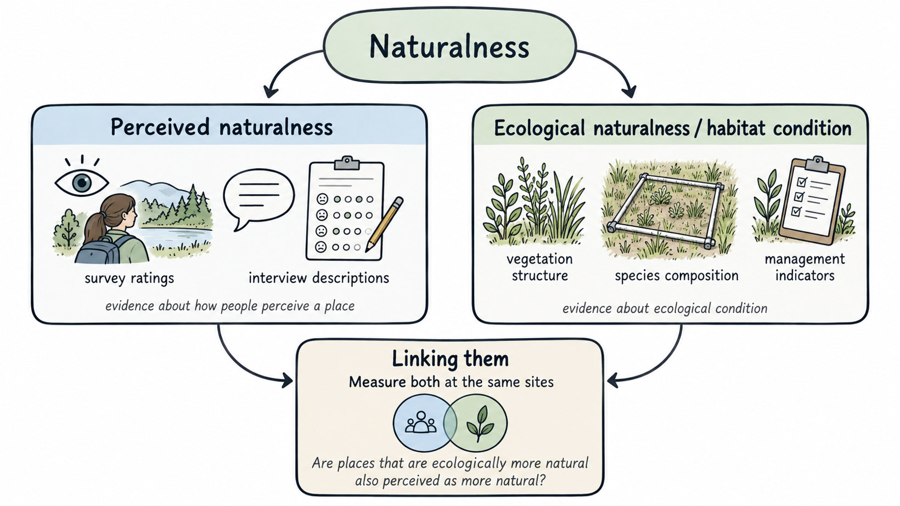
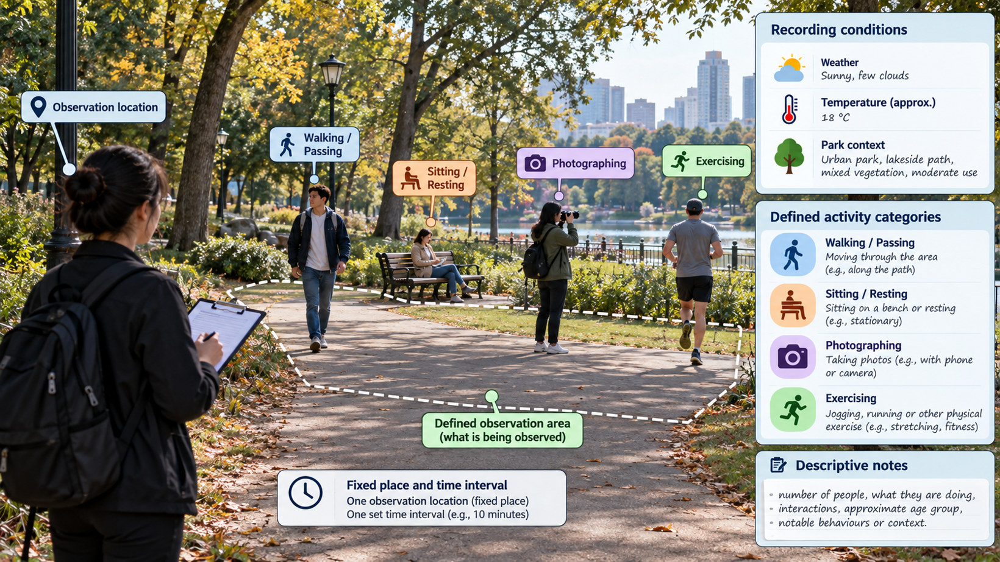
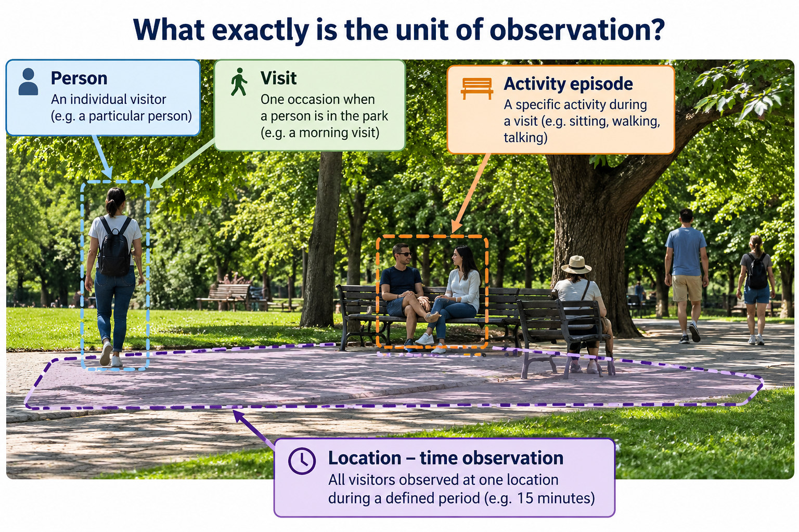
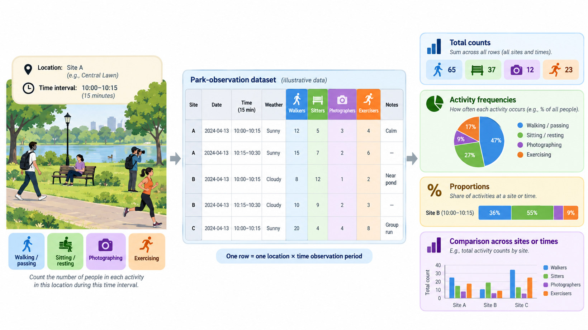
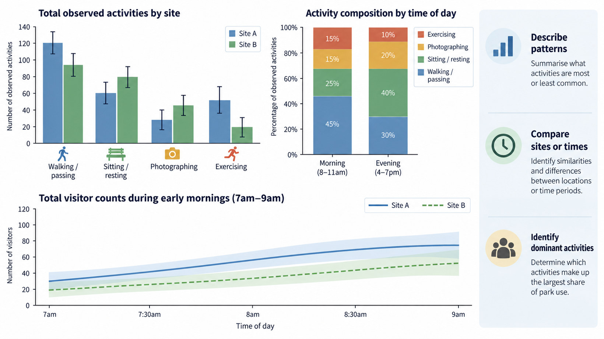
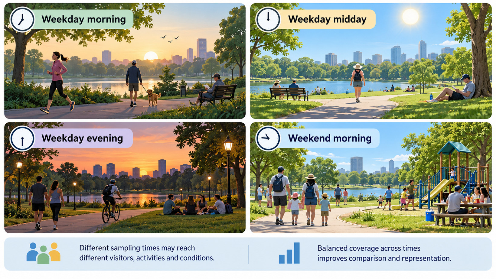
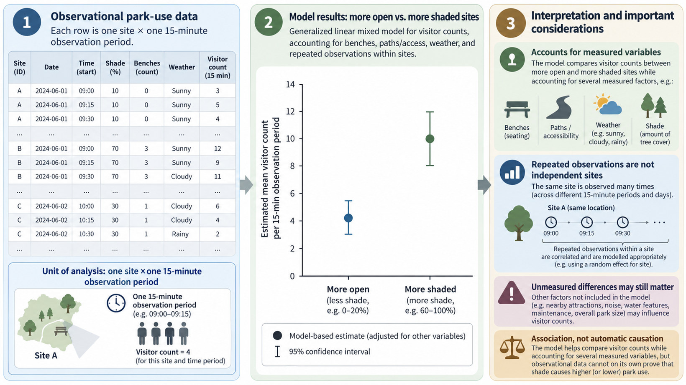

<link rel="stylesheet" href="chapter10-interactive.css" />

<script src="chapter10-interactive.js" defer></script>

In the earlier chapters, we followed the recovery of vegetation in regenerating forests, considering how environmental conditions, disturbance and ecological processes influence the development of plant communities. Yet forest recovery also depends on decisions made by people. Why does one landowner allow a former agricultural field to regenerate while another continues cultivation? How does recovering forest affect residents’ access to land, their livelihoods or the benefits they derive from the landscape? Ecological observations can document the extent and composition of regenerating forest and help explain differences in vegetation development. They cannot, on their own, tell us why landowners make particular decisions, how people use the recovering landscape, or how they experience and value the changes taking place. To investigate these relationships, we also need evidence about people’s actions, choices and experiences, and about the social and environmental circumstances in which these occur.

Consider a municipality proposing to reduce mowing in selected urban parks. Less frequent mowing may change vegetation composition, flowering resources, habitat conditions and the physical environment experienced by visitors. However, park managers may also want to know whether people use the affected areas differently, whether they find the less manicured vegetation attractive or comfortable, and whether they support the proposed changes in management. These questions concern different aspects of people’s relationships with the park, and investigating them requires different kinds of observations. We could record how many people use particular locations and what they do there, or ask visitors about their experiences and preferences. We could also present photographs of alternative vegetation conditions and ask people to evaluate them. Each approach provides different information. For example, someone sitting beneath a tree tells us something about where they spend time, but not necessarily why they chose that location. A questionnaire, on the other hand, can record whether respondents support reduced mowing, but their answers do not establish how they would behave if mowing were actually reduced.

Collecting and interpreting this evidence presents several methodological challenges. One is that people’s behaviour varies with their circumstances and with the opportunities available to them. A shaded area may attract more visitors because it is cooler, but perhaps it also has more benches or lies along a popular walking route. Even if we repeatedly find more people in shaded locations, we therefore need additional evidence to establish which characteristics contribute to that difference. Another challenge concerns which people enter our observations in the first place. The visitors encountered on a weekday morning may differ from those using the park during weekends, and a survey of current visitors tells us little about people who do not visit at all. Yet those non-visitors may be particularly important if our question concerns whether changes in park management could make the park more accessible or attractive. Some may stay away because of poor access, uncomfortable conditions or a lack of suitable facilities. Their absence is therefore potentially related to the very environmental characteristics whose influence we want to investigate.

These difficulties should be familiar from earlier chapters. A forest inventory concentrated near accessible paths may give a misleading impression of vegetation across the wider landscape. Seedlings hidden beneath dense vegetation may be overlooked, and differences among plots may reflect several environmental influences that are difficult to separate. Such problems concern sampling, imperfect detection, measurement and causal inference. Similar considerations apply when observing people in a park: which locations and times we sample affects the activities we encounter, while the surrounding environmental conditions may influence both people’s behaviour and our ability to observe it. But studying people also introduces additional complications. People decide whether to participate in research, and the questions we ask may be interpreted differently from how we intended them. Someone asked whether they support making a park “more natural” might imagine fewer ornamental plants, taller grass or the restoration of native vegetation. Another respondent might associate the same wording with reduced maintenance and poorer accessibility. Their answers may therefore differ even when their underlying preferences are quite similar. The wording of the question has become part of what determines the observations we collect.

Quantitative social research provides methods for investigating these relationships systematically. Structured observations allow us to record and compare patterns of behaviour across locations and times, while questionnaires and photographic comparisons can provide measurements of people’s reported experiences, attitudes and preferences. Existing visitor records, administrative data and automated counts can extend that evidence across periods when researchers were not present. Once organised into a dataset, these observations can be used to describe differences among people or places, investigate relationships with environmental conditions and evaluate possible explanations. Answering such questions requires more than collecting large numbers of observations. We need to define what is measured, decide which people, locations and times to sample, and collect enough information to distinguish among plausible explanations. The principles developed in the earlier chapters therefore remain central, while the behaviour, choices and participation of people become additional factors in designing the study and interpreting its findings.

## 10.1 Vegetation, park use and possible explanations

Imagine observing that people stop more often at a shaded park bench than on an exposed path. One possible explanation follows a sequence: trees alter the shade and thermal environment; these conditions may affect comfort; and comfort may affect where people choose to remain. Yet the comparison is not self-explanatory. The shaded bench might also lie nearer the entrance, have seating, offer a more appealing view or be visited at a cooler time of day. Before treating shade as an explanation, we need to distinguish the environmental feature, the possible pathway connecting it to behaviour, the behaviour of interest and the record produced by our observation method.

Why does one park have dense canopy while another retains open grass? Those conditions partly reflect previous management decisions about recreation, maintenance, flood management, design and budgets. Park use may in turn influence later investment and maintenance priorities. This wider view becomes important when we investigate why greenery differs among neighbourhoods, rather than simply asking how visitors respond to existing vegetation. Social–ecological systems frameworks, including the approach proposed by Ostrom (2009) and compared by Binder et al. (2013), can help trace connections among actors, management and ecological change. Which connections to measure depends on the specific research question.

We also need to distinguish what happens in the park from what our observation procedure records. Suppose 42 passages are counted on a shaded path and 18 on an open path during separate 15-minute periods. Shade, convenience, destinations and preferences all contribute to the number of trips people make. The field record captures only those passages occurring within the selected observation areas and periods; it may count a person twice if they walk through twice. Thus the environmental and social processes producing park use, the observer’s counting procedure and the inference based on the counts belong to different parts of the study. Chapter 8 drew a related distinction between an animal’s presence and its availability for detection. Here the observational limitations arise chiefly from the choice of site, time and event definition.

Time of day introduces a further complication. If the shaded path is observed at 8 AM and the open path at 1 PM, differences in visitor counts may reflect the timing of the observations. Yet the relationship we want to study could itself change during the day: shade may attract people at midday while offering little advantage early in the morning. Observing both paths at comparable times, repeated across days, allows us to distinguish the overall difference between sites from variation in that difference through time. This information would disappear if we retained only one total visitor count for each path.

{width=6.25in}

Figure 10.1 shows a related difficulty with concepts. A place may look natural to visitors while containing largely introduced species, or appear carefully maintained while supporting a diverse native plant community. Survey ratings and vegetation measurements need not agree because they describe different properties. Measuring both at the same locations would enable a new research question: are sites judged more natural also distinguished by selected ecological indicators? The environmental and social variables have to be defined separately before their relationship can be investigated.


```{=html}
<section aria-label="Test your understanding 10A — what was observed, and what remains uncertain?" class="self-test" id="test-your-understanding-10a-what-was-observed-and-what-remains-uncertain"><h4>Test your understanding 10A — what was observed, and what remains uncertain?</h4><div class="test-content">
<p>A researcher records twice as many people sitting beneath trees as in
nearby open areas during one afternoon. What exactly has been observed?
Give two explanations other than temperature and suggest one comparison
that could help investigate them. Would asking only those seated under
trees what they prefer establish the preferences of all neighbourhood
residents?</p>
</div><label class="answer-label" for="test-your-understanding-10a-what-was-observed-and-what-remains-uncertain-response">Your explanation</label><textarea aria-label="Write your answer" class="test-response" id="test-your-understanding-10a-what-was-observed-and-what-remains-uncertain-response" placeholder="Write a short explanation before viewing the suggested response." rows="5"></textarea><div class="test-actions"><span aria-live="polite" class="word-counter">0 / 25 words</span><button class="test-submit" disabled="disabled" type="button">Submit response</button><button aria-expanded="false" class="test-reveal" hidden="hidden" type="button">Show suggested explanation</button></div><div class="test-answer" hidden="hidden"><p><strong>Suggested explanation.</strong> The direct record is a count
of people observed sitting in specified areas during the sampled period;
it is not a measure of why they chose those locations. Benches,
proximity to an entrance, views or social activities could differ
between settings. Repeating the observations across comparable periods
and areas with similar amenities would help evaluate these explanations.
Surveying only the people seated under trees would exclude people who
chose other areas and residents who did not visit at all.</p>
</div></section>
```

## 10.2 From a research question to an observation

Before choosing a method, we have to decide what we would actually need to observe to answer the question. Take the apparently straightforward question, ‘How many people use this park?’ It could refer to the number of people passing an entrance, the number present at a particular moment, the number of visits during a week or the amount of time spent in the park. These quantities are related, but they are not interchangeable. A person who walks through a gate twice contributes two passages but may represent only one visitor. Someone who spends an hour on a bench may appear in several occupancy scans while contributing just one visit. The choice is not simply a matter of finding a convenient instrument. It determines what the eventual result can describe.

When the question concerns people's experiences, the observation becomes less direct. ‘How comfortable is this park?’ might lead us to measure air temperature or canopy cover, ask visitors how comfortable they feel at that moment, or ask residents whether they consider the park suitable for outdoor activity. A thermometer and a questionnaire do not measure the same quantity; one records an environmental condition and the other a reported experience. Both could be useful if we want to investigate how physical conditions relate to what people feel. The point is to specify the relationship we are interested in, so that we know which part of it each measurement addresses. Chapter 3 developed this reasoning for ecological measurements and proxies. In social research we additionally need to consider how people interpret a question, remember their experiences or choose among the answers offered.

Once the quantity is defined, the sampling design begins to take shape. A count of passages needs a spatial boundary, an observation period and rules for people crossing more than once. A survey about support for reduced mowing needs a specified management proposal and a decision about which population's views are relevant. A question about whether reducing mowing *changes* park use additionally needs a comparison that can distinguish the intervention from other changes occurring at the same time. These decisions are developed through the observation, questionnaire and research-design examples that follow. They are linked: the type of observation we collect and the comparisons we can make together determine the conclusions the study can support.

## 10.3 Structured observation of behaviour

Structured observation is appropriate when the outcome is behaviour that can be seen and recorded without asking people to reconstruct or explain it. A study might count people walking through a defined passage, record whether passersby stop at an information board, or classify the activities present in a park section. It does not follow that all three can be collected with one undifferentiated count. Each question determines how events begin and end, which behaviours qualify and what happens when several activities occur together.

{width=6.25in}

Consider the different ways a field team could quantify use at a single entrance. A counter measuring passages may show 300 crossings during a day, but that is not a count of 300 unique people. An observer recording how many people are inside the park at noon would obtain a different quantity, while a questionnaire asking about visits in the past seven days would produce reports from the recruited respondents. Those measurements could support different questions. For the rest of this observation example, we will use *passages per defined interval*, so that the field protocol and the later analysis refer to the same event.

Suppose we begin with a reconnaissance visit to two areas of Labrador Nature Park: a relatively open recreational setting and a wooded path. During a walk we notice people passing, sitting, taking photographs and stopping at signs. These observations can suggest useful categories, but a casual walk has no defined denominator. We do not know whether a busy-looking area was observed for longer or at a more active time. To turn the impression into data, we define an observation area, an observation interval and a reproducible recording rule before the systematic survey begins. For instance, a sample unit could be one 15-minute observation at a defined path segment. At each selected interval we record the number of passages, stops, seating episodes and other pre-specified activities, alongside environmental and contextual conditions.

Even then, a 15-minute count is not self-explanatory. If one person walks through the area twice, is that one person or two passages? A count of passages may appropriately include both, especially when estimating movement through a corridor. A study of unique people needs another procedure and may be difficult without tracking individuals, which introduces additional privacy concerns. Similarly, an observer scanning a lawn once every five minutes records visible occupancy snapshots rather than all arrivals and departures between scans. Those are different sampling designs. The observation unit should correspond to the claim and be kept distinct from the people or events recorded within it.

Structured instruments can improve comparability. The System for Observing Play and Recreation in Communities (SOPARC) provides a published example of scanning defined park areas to record activity levels and contextual conditions. McKenzie et al. (2006) tested the approach in multiple park areas and evaluated agreement among observers. Its importance here is methodological: a park-use study can standardise where an observer stands, how scanning occurs, which categories are permitted and what contextual information is registered. We should not assume that a validated instrument in one setting transfers unchanged to Singapore. Activity categories, park layout, observer viewpoints and ethical expectations may require adaptation and local reliability testing. Consider a pilot with two observers simultaneously recording the same small area independently. If one records 11 passages and the other 18, the discrepancy may reflect different field-of-view boundaries, disagreement about whether a person re-entering is a new event, or missed movements when a group passes. The discrepancy is evidence about the observation process. It is not reduced by collecting more data under an inconsistent protocol. We can walk both observers through the boundary, specify the timing convention, practice categorising ambiguous cases, repeat a trial and compare records. An agreement statistic may be appropriate for particular categorical variables, but the first priority is understanding why discrepancies arise. For an activity type with rare occurrences, raw percent agreement can also be misleading because observers often agree on absence.

Field observation does not become representative merely because each observation was recorded carefully. A study focused on how use differs by vegetation structure needs more than one open and one wooded location if the intended inference concerns vegetation types generally. It also needs relevant temporal coverage. Visitors who exercise before work, families who arrive on weekends and people seeking shade in the afternoon may be unevenly represented by an afternoon-only survey. If we sample weekday and weekend mornings and evenings across several locations, the resulting observations can begin to represent a wider set of circumstances. Weather, public holidays, festivals and construction can introduce further variation. The number of visits and the distribution of effort should follow the target population of location-times, not an arbitrary quota of observations. A carefully stated result might be: ‘In the sampled locations and observation periods, the mean number of passage events per 15-minute interval was greater on the wooded paths.’ A broader statement about regular park users would require a defensible connection from sampled intervals to the intended schedule and site population. To estimate an annual visitation total, a design must represent conditions across the year and define how intervals are weighted. A few observations can still be valuable for generating hypotheses or designing a larger survey, but that is a different purpose.

A passing count and a scan of occupancy can differ greatly even when made at the same location. Imagine five people sitting for an entire 15-minute interval and twenty people walking through it. An observer counting entries might register twenty passages and no new arrivals to the seating area. A scan at minute ten could record five sitters and perhaps two walkers. Neither record is intrinsically better; the first concerns flow through a place, while the second concerns what is present at a moment. If the research concerns the extent of use of seats through the day, repeated scans or a measure of occupied seat-minutes may be informative. If it concerns pedestrian traffic through a planned path, passages per interval are more directly relevant.

### Descriptive notes, interpretations and observation quality

Counts often require a small number of categories to remain consistent. Field notes preserve relevant details that the categories miss: a temporary closure, a queue beside a kiosk, a blocked sightline, or a person apparently waiting at an information board. The distinction is between recording what was observed and proposing what it might mean. “Three visitors stopped beside the information board between 14:10 and 14:25” is an observation. “They stopped because they wanted to learn about the local ecology” is a possible explanation, which cannot be read from the count alone. Keeping both kinds of note, but identifying them separately, allows later analysis to revisit an interpretation without losing the original record. The instrument is not only the field sheet. Its performance also depends on the observer. Two trained observers recording the same interval can disagree about a person partly obscured by a tree, the boundary of a group, or whether briefly stopping to tie a shoe counts as resting. Agreement can be checked by independently recording selected intervals, comparing records and improving the event rules before the main fieldwork. If detection remains imperfect, the limitations should be included in what the final counts are said to represent. This is closely related to the imperfect-detection problem in animal surveys, although the mechanisms differ.


```{=html}
<section aria-label="Test your understanding 10B — why did two observers disagree?" class="self-test" id="test-your-understanding-10b-why-did-two-observers-disagree"><h4>Test your understanding 10B — why did two observers disagree?</h4><div class="test-content">
<p>Two observers independently count passages through the same park
entrance. Their records are shown below.</p>
<table>
<thead>
<tr class="header">
<th style="text-align: left;">Ten-minute period</th>
<th style="text-align: right;">Observer A</th>
<th style="text-align: right;">Observer B</th>
</tr>
</thead>
<tbody>
<tr class="odd">
<td style="text-align: left;">08:00–08:10</td>
<td style="text-align: right;">12</td>
<td style="text-align: right;">12</td>
</tr>
<tr class="even">
<td style="text-align: left;">08:10–08:20</td>
<td style="text-align: right;">19</td>
<td style="text-align: right;">25</td>
</tr>
<tr class="odd">
<td style="text-align: left;">08:20–08:30</td>
<td style="text-align: right;">10</td>
<td style="text-align: right;">13</td>
</tr>
</tbody>
</table>
<p>During the second interval, several joggers passed through twice, and
a large group entered together. Should the observers record unique
people or passages? Give two rules they should agree on and explain how
another short pilot could investigate their disagreement.</p>
</div><label class="answer-label" for="test-your-understanding-10b-why-did-two-observers-disagree-response">Your explanation</label><textarea aria-label="Write your answer" class="test-response" id="test-your-understanding-10b-why-did-two-observers-disagree-response" placeholder="Write a short explanation before viewing the suggested response." rows="5"></textarea><div class="test-actions"><span aria-live="polite" class="word-counter">0 / 25 words</span><button class="test-submit" disabled="disabled" type="button">Submit response</button><button aria-expanded="false" class="test-reveal" hidden="hidden" type="button">Show suggested explanation</button></div><div class="test-answer" hidden="hidden"><p><strong>Suggested explanation.</strong> The answer depends on the
research question. To estimate traffic through that entrance, a passage
is one crossing of a defined boundary; a jogger who crosses twice
contributes two passages. To estimate unique visitors, repeated people
must somehow be distinguished, requiring another protocol. The observers
should agree on the boundary, treatment of repeat crossings, how groups
are tallied and precisely when an interval starts or ends. They could
compare event-level notes in a fresh pilot to see whether different
definitions or missed observations produced the discrepancy. Agreement
in one interval does not prove the procedure is consistently
reliable.</p>
</div></section>
```

## 10.4 Observational units, repeated measurements and independent evidence

{width=6.25in}

Suppose our class records 80 people during four observation intervals at a single bench area. The dataset may contain 80 event records, four intervals and one location. Which number is the sample size? The answer depends on the question. If estimating the composition of observed activities under those intervals, individual event records may be relevant. If comparing park locations, there is still only one location. If comparing management regimes, and that bench is the only sampled location under its management regime, the treatment or site-level replication remains one. Repeated observations at one location help characterise temporal variation at that location; they do not create new independent locations. This is the same hierarchical design problem developed in Chapter 5, now applied to human behaviour.

People create further dependence in the records. Frequent users may appear in many intervals, one household may supply several survey respondents, and participants recruited from a community association may share information and preferences. A conventional analysis that treats every record as independent can produce confidence intervals that are too narrow for the intended site- or population-level inference. Multilevel models and cluster-aware uncertainty estimates can help when the design provides independent higher-level units. Neither can manufacture independent parks or neighbourhoods that were never sampled. Chapter 4’s account of sampling variability and Chapter 6’s account of spatial dependence therefore apply to social research as directly as to environmental plots. A useful data structure assigns identifiers at all relevant levels: park, observation area, date, interval, event, and where ethically permissible and necessary, a non-identifying participant code. Such metadata let us distinguish repeated visits from independent observations without automatically retaining identities. It is often better to redesign a project to avoid collecting personal identifiers than to gather everything and promise to anonymise later. When a person may be inferred from a combination of timestamps, photographs and locations, removing a name is not sufficient protection.

The number of observations is meaningful only in relation to the question. Twenty different people passing a sign may provide twenty event records for estimating the fraction who stop during the sampled period, provided repeated passersby and social grouping are considered. But they are not twenty independent tests of whether that sign attracts people across parks: the sign is at one location, under one combination of site characteristics. Conversely, observing one sign on ten afternoons creates ten location–time records and improves knowledge of temporal variation there, but does not create ten independently sampled signs or parks. A dataset needs identifiers that preserve these distinctions. Consider a photo survey in which each participant evaluates six park images. One hundred participants could supply six hundred ratings. If the aim is to estimate how residents differ in their willingness to accept a management change, the sample includes one hundred people, not six hundred independent respondents. The repeated ratings are valuable because each participant provides a within-person comparison, but an analysis that treats all six hundred as unrelated responses may overstate precision. This is another form of nesting: images are evaluated within people, just as time intervals are repeatedly observed within sites.


```{=html}
<details class="foldable explanation-box" id="guide-box-10a-why-the-number-of-recorded-observations-is-not-always-the-sample-size"><summary>Box 10A — Why the number of recorded observations is not always the sample size</summary>
<p>Suppose 60 people walk past a single information sign during four
observation periods, and an observer records whether each person stops.
We have information about 60 passages, collected during four periods, at
one sign. For describing the fraction of recorded passages that involved
a stop, all 60 records are informative. But imagine that we want to
compare signs with and without a new design. If this was the only sign
with the new design, the 60 people would not be 60 independent examples
of the design’s effect. They all encountered the same sign, at the same
location.</p>
<p>This distinction becomes visible when we think about what could vary.
Passersby differ in their interests and activities; observation periods
differ in weather and crowding; signs differ in design and location. To
investigate variation among signs we need observations at several
independently selected signs. To investigate variation among times at
one sign, we need repeated observation periods. Both kinds of repetition
are useful, but they support different comparisons.</p>
<p>A similar issue arises when a participant rates five photographs.
Fifty people each providing five ratings generate 250 rows of response
data. The 250 ratings help us compare the photographs, particularly
within each respondent, but there are still only 50 independently
recruited people. Analyses should retain a respondent identifier so that
the five answers from each person can be recognised as related. If an
intervention is applied to whole parks, the parks—not the individual
visitors recorded within them—are the units receiving the intervention.
A useful study report therefore states the number of parks, observation
areas, time periods and people separately, rather than giving only one
large ‘sample size’.</p>
</details>
```

## 10.5 From observation sheets to tables, graphs and comparisons

A field protocol should anticipate how its observations will become a dataset. For structured park observation, a straightforward format has one row for each defined location–time interval and columns for the site identifier, date, start time, duration, activity counts, environmental conditions and unusual events. This arrangement preserves the sampling effort that produced the counts. Keeping only the grand totals would remove the information needed to check whether an apparent site difference was consistent across observation periods or concentrated on one unusual afternoon.

{width=6.25in}

The table also allows us to calculate the composition of activity at a particular site and time. In the first Site B period, 8 people are recorded walking, 12 sitting, 1 photographing and 2 exercising. If the categories are mutually exclusive, that is a total of 23 people; walking accounts for about 35% and sitting for about 52%. We can repeat the calculation for other periods and compare whether the activity mix differs between sites, while retaining the corresponding absolute counts.

For example, imagine that Site A was observed for two 15-minute periods, with 12 and 15 people walking, while Site C was observed once and 20 walkers were counted. A grand-total comparison gives 27 for Site A and 20 for Site C. Yet Site A was observed for 30 minutes and Site C for 15. Expressing the records per common 15-minute period yields 13.5 at Site A and 20 at Site C. The ordering has changed solely because we accounted for observation effort. Even this comparison is descriptive: two intervals at A and one at C provide little evidence about usual activity, and the sites may have been observed under different conditions.

Activity composition requires another decision. If every visitor is assigned to exactly one mutually exclusive activity category, category counts can be added to a total and displayed as proportions. If one person can contribute both a walking and a photographing event, the sum is a count of recorded activities, not a count of people, and those activity proportions should not be interpreted as shares of unique visitors. Similarly, a percentage chart can show that sitting makes up a larger fraction of activities in the evening while obscuring the fact that the total number of visitors was much lower then. Showing absolute counts and proportions together often produces a more informative account.

{width=6.25in}

We can then investigate whether the differences recur. Suppose both sites are visited on several mornings and each visit includes the same 15-minute observation windows. Plotting the counts for each interval shows the observations behind any estimated average. For each time window we could calculate the mean count across mornings and an interval expressing how uncertain that mean is. If we use a confidence interval, we should label it as such; a range showing the spread of raw counts conveys a different quantity. The graph might show that activity increases through the morning at both sites but that their difference varies over time.

The sampling calendar determines which of those patterns can be evaluated. Twenty mornings at one location describe variation through time there, whereas observations distributed across several locations make spatial comparisons possible. Sampling multiple sites at several times on multiple days gives evidence about both sources of variation. Simply increasing the number of records does not supply whichever level of replication was omitted.


```{=html}
<section aria-label="Test your understanding 10C — what does the bar chart conceal?" class="self-test" id="test-your-understanding-10c-what-does-the-bar-chart-conceal"><h4>Test your understanding 10C — what does the bar chart conceal?</h4><div class="test-content">
<p>A chart shows 40 recorded walking events at Park A and 30 at Park B.
What three pieces of information would you check before concluding that
Park A is busier? What if A was observed for an hour and B for 15
minutes? Explain what plotting the counts from every period would
add.</p>
</div><label class="answer-label" for="test-your-understanding-10c-what-does-the-bar-chart-conceal-response">Your explanation</label><textarea aria-label="Write your answer" class="test-response" id="test-your-understanding-10c-what-does-the-bar-chart-conceal-response" placeholder="Write a short explanation before viewing the suggested response." rows="5"></textarea><div class="test-actions"><span aria-live="polite" class="word-counter">0 / 25 words</span><button class="test-submit" disabled="disabled" type="button">Submit response</button><button aria-expanded="false" class="test-reveal" hidden="hidden" type="button">Show suggested explanation</button></div><div class="test-answer" hidden="hidden"><p><strong>Suggested explanation.</strong> We need the duration of
observation at each park, the definition of a walking event and the
times or conditions sampled (as well as the location boundaries). If A
was observed for 60 minutes and B for 15, the simple rates would be 10
and 30 recorded events per 15 minutes respectively: the apparent ranking
reverses. Plots of the individual intervals reveal whether those rates
recur across observations or are driven by one particularly busy period.
They also show variation that totals conceal.</p>
</div></section>
```

## 10.6 Questionnaires as instruments for reported experiences and preferences

Observing where people stop tells us something about behaviour, but not what they liked about the location or how they might react to a proposed change. A questionnaire makes it possible to ask about reported experiences, attitudes, preferences and past actions. That does not mean a respondent's answer gives direct access to an unchanging internal preference. To answer, a person must interpret the question, recall relevant information, make a judgement and select one of the response options. Tourangeau, Rips and Rasinski (2000) describe these stages of the survey-response process. Thinking through them helps explain why a questionnaire has to be designed and tested as a measurement instrument, not simply written as a list of things researchers would like to know.

Imagine asking residents, ‘Do you support making our parks more natural and biodiverse?’ Someone may imagine additional native trees, someone else flowering meadows, and a third person taller grass that could obscure paths. The question also asks about naturalness and biodiversity together, although respondents might support one but not the other. If the municipality is considering reducing mowing, a more informative item might ask, ‘How much would you support mowing selected lawn areas less frequently, while keeping paths clear?’ This gives respondents a more specific proposal to evaluate. We still need to find out which lawns they picture, whether they expect a change in maintenance elsewhere, and what consequences they associate with taller vegetation.

The most effective way to identify such problems is to try draft questions with people resembling the intended respondents and ask them how they understood them. This is the basis of *cognitive interviewing* (Willis 2005). Consider another item: ‘How frequently do you use natural green spaces?’ During pretesting, one respondent may explain that they thought only of forests and nature reserves, while another counted every walk through a neighbourhood park. Their answers would not describe the same behaviour. We could ask each respondent which places they considered, how they decided what counted as a visit and which time period they had in mind. If the intended quantity is recreational visits, a revised item might ask, ‘In the past seven days, on how many separate occasions did you visit a park or nature reserve for recreation, excluding journeys in which you only passed through?’ The revision makes both the activity and recall period clearer. Further pretesting can investigate whether ‘separate occasions’ is understood consistently and whether a seven-day recall period captures the behaviour well enough.

Survey responses also depend on how people are invited to answer. A question read privately on a phone may be experienced differently from one asked aloud beside friends or family. Translation can alter connotations, even when the dictionary meaning is preserved. If respondents are asked to report comfort at a particular site, the question should specify which experience and period are intended: ‘How comfortable did you feel at this location during the last fifteen minutes?’ refers to something different from ‘Are parks comfortable?’ The first could be compared with temperature and shade measured near the respondent at that time. Those physical measurements would help investigate possible explanations of the reported experience, while the comfort response remains a measurement in its own right. For studies comparing responses across sites, dates or groups, wording, language, delivery and response options need to remain sufficiently consistent to support the intended comparisons (Dillman, Smyth, and Christian 2014; Groves et al. 2009).

We must also choose what form the answers take. A five-category question about support for reduced mowing might offer *strongly oppose*, *oppose*, *neither support nor oppose*, *support* and *strongly support*. These categories have a clear order, but we cannot assume that the psychological distance between adjacent categories is always equal. A frequency table showing how many people selected each category can be more informative than a single average score, particularly if a group is divided between strong support and strong opposition. Box 10B develops a small example. Where appropriate, *don't know* and *not applicable* should be available as distinct responses, not silently treated as neutrality. The chosen response format should help answer the question that motivated the survey rather than merely make the results easy to calculate.

A questionnaire also needs a recruitment plan. An online survey circulated through a park-interest group, a face-to-face survey of current park visitors and a questionnaire sent to selected households can all ask the same items, but the answers come from different pools of people. Section 10.8 examines the populations and exclusions involved. Questionnaire design and respondent selection must be considered together: carefully written questions are of limited value if the people whose experiences are central to the research cannot be reached, while extensive recruitment cannot repair a consistently misunderstood question.


```{=html}
<details class="foldable explanation-box" id="guide-box-10b-what-can-we-learn-from-a-five-category-rating"><summary>Box 10B — What can we learn from a five-category rating?</summary>
<p>Imagine asking 40 residents how strongly they support reducing mowing
in selected areas, using the ordered responses <em>strongly oppose</em>,
<em>oppose</em>, <em>neither support nor oppose</em>, <em>support</em>
and <em>strongly support</em>. Suppose 6 choose strongly oppose, 8
oppose, 10 the middle category, 12 support and 4 strongly support. These
counts are already informative: 16 residents express support, 14
opposition and 10 neither. A stacked bar chart could display the balance
of responses and make visible that support is not unanimous.</p>
<p>We might assign the categories numerical values from 1 to 5 and
calculate an average. That can be a useful compact summary, particularly
when comparing the same question across groups, but the numbers are
coding choices. We do not know that the difference in preference between
<em>strongly oppose</em> and <em>oppose</em> is psychologically the same
as the difference between <em>support</em> and <em>strongly
support</em>. For that reason the five category counts or proportions
are often a more transparent starting point than the mean alone. More
advanced analyses can model ordered responses directly. There is no need
to choose those models before understanding what the categories mean and
how the responses were collected.</p>
<p>The terms <em>Likert-type item</em> and <em>Likert scale</em> are
sometimes used interchangeably. Strictly, an individual five-category
question is a Likert-type item; a scale often combines answers to
several related questions intended to measure a broader construct.
Combining questions calls for further checks of whether they do indeed
measure a common construct. Finally, <em>don’t know</em> and <em>not
applicable</em> responses should be kept distinct from the middle
category: not knowing one’s preference is different from having neither
support nor opposition.</p>
</details>
```


```{=html}
<section aria-label="Test your understanding 10D — improve a survey question" class="self-test" id="test-your-understanding-10d-improve-a-survey-question"><h4>Test your understanding 10D — improve a survey question</h4><div class="test-content">
<p>Compare ‘Do you agree that our beautiful park should become more
natural and biodiverse?’ with ‘How much would you support mowing
selected lawn areas less frequently, while keeping paths clear?’ Explain
why the first wording is difficult to interpret, and propose one
question you would ask during pretesting to find out what respondents
imagine when reading ‘selected lawn areas’.</p>
</div><label class="answer-label" for="test-your-understanding-10d-improve-a-survey-question-response">Your explanation</label><textarea aria-label="Write your answer" class="test-response" id="test-your-understanding-10d-improve-a-survey-question-response" placeholder="Write a short explanation before viewing the suggested response." rows="5"></textarea><div class="test-actions"><span aria-live="polite" class="word-counter">0 / 25 words</span><button class="test-submit" disabled="disabled" type="button">Submit response</button><button aria-expanded="false" class="test-reveal" hidden="hidden" type="button">Show suggested explanation</button></div><div class="test-answer" hidden="hidden"><p><strong>Suggested explanation.</strong> The first question presents
the park positively, combines naturalness with biodiversity and leaves
the proposed management unspecified. Someone may agree with one idea but
not the other. The second identifies a concrete action and an important
condition, so responses are easier to interpret. In pretesting we could
ask: ‘Which areas of this park did you imagine when you read “selected
lawn areas”? What would you expect to change there?’ The respondent’s
explanation tells us whether the wording evokes the intended
scenario.</p>
</div></section>
```

## 10.7 Photographic comparisons and a published study of urban greenery

When people have not experienced a proposed environmental change, a verbal description may leave too much to individual imagination. Photographs or visual scenarios can make alternative appearances more concrete. Suppose researchers want to know how residents evaluate less frequent mowing. They could prepare images of the same park path with short grass, a moderately tall flowering verge and taller spontaneous vegetation. Respondents then rate or choose among these alternatives. The visual comparison provides a common reference for the question, but what differs between photographs needs careful attention. If the tallest vegetation is also shown with fewer benches, poorer lighting or a narrowed path, we cannot know which feature influenced the rating. A pilot should therefore check whether the changes shown correspond to the attributes researchers mean to investigate, with image order varied or counterbalanced where appropriate.

Hwang et al. (2019) used photographs to investigate preferences for spontaneous vegetation growth in Singapore's urban green spaces. Their study presented three vegetation-growth conditions in four urban settings to 663 respondents from the general public and 48 respondents associated with nature or environmental interests. The results indicated that moderately wilder vegetation could be acceptable in parks, while respondents generally favoured more managed appearances in streetscapes. The context was therefore part of the response: a growth condition that people found acceptable in a park was not necessarily preferred alongside a street. Features such as flowers, fauna and boardwalks also contributed to the evaluations. This example shows why asking whether people simply ‘prefer natural vegetation’ would be a much less informative research question.

{width=6.25in}

Consider how a study of this kind becomes a dataset. One person may rate several photographs, for example three vegetation conditions in each of two settings. The analysis file can contain one row per image evaluation, identifying the respondent, setting, vegetation condition, photograph and rating. We could first plot the distribution of responses to each condition within each setting. Next, we could examine whether ratings change with vegetation condition in similar ways in parks and rooftops. Since the same person evaluates several images, those ratings are related: a person who tends to give high ratings may do so across all conditions. Comparisons can take advantage of the within-person responses while accounting for their dependence. Six hundred image ratings collected from one hundred people are informative repeated evaluations, but they are not six hundred independently recruited respondents.

The strength of this design is the ability to present comparable visual conditions and obtain responses to each. What it measures is people's evaluation of those representations. To discover whether a change in mowing alters actual park use, we would need to observe behaviour following an implemented change, with suitable comparison areas or periods. If the question concerns whether people change their opinions after experiencing a new meadow, researchers might return to the same respondents. Recontacting people introduces another issue: those who participate in a follow-up may differ systematically from those who do not. A combined programme could compare initial photographic preferences, subsequent use and later experiences, provided each component has a clear purpose and its own appropriately designed sample. The qualitative approaches in Chapter 11 could investigate why respondents associate particular vegetation appearances with safety, comfort or maintenance.

Photographs can also form part of *stated-preference* methods that investigate trade-offs. A planner may be choosing between several management packages rather than simply comparing appearances. One option might retain short grass and open sightlines; another might add flowering verges and shaded benches; a third could create more habitat while rerouting a path. If respondents prefer the middle package, the result alone does not identify whether they value flowering vegetation, benches or convenient routes most. A discrete-choice experiment addresses this by presenting a set of choices in which the relevant attributes vary systematically across plausible alternatives, sometimes including the current condition as an option (Johnston et al. 2017). The resulting analysis can estimate how each stated attribute is associated with the probability that an option is chosen, provided the design supplies informative combinations and respondents understand the alternatives.

The distinction between these approaches helps determine when they are useful. A straightforward photograph-rating survey is well suited to comparing reactions to visible vegetation conditions. A choice experiment is useful when a decision genuinely involves multiple competing attributes, although its design and analysis are more demanding. Observing use after a management intervention addresses yet another question. In each case the study can be made clearer by identifying the particular judgement or action being recorded, the unit of observation and the comparison that gives the result meaning.


```{=html}
<section aria-label="Test your understanding 10E — is this a fair photographic comparison?" class="self-test" id="test-your-understanding-10e-is-this-a-fair-photographic-comparison"><h4>Test your understanding 10E — is this a fair photographic comparison?</h4><div class="test-content">
<p>To examine support for reducing mowing, researchers show photographs
of one park under three conditions: A has short grass, a wide path and
benches; B has taller flowering vegetation but the same path and
benches; C has very tall spontaneous vegetation, a narrower path and two
fewer benches. Respondents rate the attractiveness of each scene. If C
receives the lowest ratings, can the researchers conclude that
respondents dislike tall vegetation? What should change in the
photographs? Should the survey include residents who seldom visit the
park?</p>
</div><label class="answer-label" for="test-your-understanding-10e-is-this-a-fair-photographic-comparison-response">Your explanation</label><textarea aria-label="Write your answer" class="test-response" id="test-your-understanding-10e-is-this-a-fair-photographic-comparison-response" placeholder="Write a short explanation before viewing the suggested response." rows="5"></textarea><div class="test-actions"><span aria-live="polite" class="word-counter">0 / 25 words</span><button class="test-submit" disabled="disabled" type="button">Submit response</button><button aria-expanded="false" class="test-reveal" hidden="hidden" type="button">Show suggested explanation</button></div><div class="test-answer" hidden="hidden"><p><strong>Suggested explanation.</strong> Scene C changes vegetation,
path width and seating at the same time. A low rating might reflect any
combination of these changes. If the aim is to compare vegetation alone,
paths, benches, lighting and other features should be held comparable
across scenes; alternatively, attributes could be varied systematically
in a more elaborate preference design. If the decision affects all
neighbourhood residents, recruiting only current visitors would exclude
people whose limited access or preferences keep them away. A study in
which each respondent rates all three scenes should identify the
respondent on every rating row to preserve the repeated-response
structure.</p>
</div></section>
```

## 10.8 Sampling people: coverage, recruitment and nonresponse

Suppose a municipality wants to know whether residents support opening a restored wetland to visitors. Surveying people already using the wetland would be convenient, but it would omit residents who currently stay away—perhaps because of poor paths, safety concerns or mobility barriers. Those exclusions are directly related to the management decision. The study therefore needs to identify whether the intended population is current visitors, nearby residents or all potential users before selecting a recruitment method.

The target population is the set of people about whom the claim is intended. A sampling frame identifies those who can in practice be selected by the design, such as a household address list, registered users of a programme or people crossing defined locations during selected intervals. The selected sample consists of units recruited or invited from that frame, and the responding sample of those from whom measurements are obtained. These levels need to be described separately. A probability-based sample gives eligible units known, nonzero selection probabilities under the design; a nonprobability sample does not. Probability sampling can support design-based population inference when selection probabilities, coverage and response processes are handled appropriately. Convenience and purposive recruitment can support exploratory or other well-defined analyses, but simple proportions from such samples generally should not be presented as unbiased estimates of the target population (Lohr 2022; American Association for Public Opinion Research 2023).

Suppose a park intercept team samples every fifth person crossing a gate during selected periods. This sounds systematic, and within each period it may reduce interviewer discretion. But it cannot capture people who never use that gate or visit outside the periods, and not all people spend equal time at the gate. A different question, such as ‘What do visitors entering through this gate during the sampled periods report?’, has a population much closer to the actual frame. If management needs to know why nearby residents avoid the park, researchers must reach residents beyond current visitors, perhaps through an area-based household design or a carefully described outreach strategy. Every extension in the intended inference demands corresponding information about coverage. Nonresponse is another selection process. A 30% response rate does not, by itself, reveal whether an estimate is biased or by how much: bias depends on whether response probabilities are associated with the variable of interest and how the design handles those associations. Nevertheless, a low or uneven response rate makes the potential problem difficult to dismiss. Researchers should record recruitment attempts, eligibility and refusals where permissible, describe the field conditions, and examine whether response patterns differ across known sampling strata. Weighting can partly correct unequal selection and measured nonresponse differences when suitable reference information is available. It cannot guarantee correction for excluded groups or unmeasured reasons why people decline.

Spatial balance and temporal replication mattered in earlier ecological chapters because environmental conditions are heterogeneous and correlated. A park survey encounters similar structure. Visitors are concentrated along paths and entrances, activity varies between open and shaded areas, and weekend patterns may differ from weekdays. The spatial scale of the question determines the relevant units: individual benches, path segments, whole parks, neighbourhoods or metropolitan districts. Sampling many people within a single park cannot establish differences among parks; repeated surveys of one neighbourhood cannot represent every neighbourhood. When a design contains nested units, the analysis should preserve the hierarchy instead of counting all observations as independent replicates.

For an initial park-use comparison, one practical strategy is to classify accessible observation locations by vegetation structure and type of use, then sample locations within each class and repeat standardised observations at preselected times. Morning/evening and weekday/weekend can be explicit temporal strata. A map of sampled areas and an observation calendar make coverage inspectable. If the aim is instead to compare the experiences of park users and nearby non-users, a separate recruitment frame is required for the latter. The two samples may have different designs, and their results need not be merged into one unqualified percentage. A time-location sampling design may be appropriate for populations encountered in specific venues when no ordinary list of persons exists. The basic unit may be a randomly selected location-time slot; eligible people encountered within it are then recruited according to a stated procedure. Probabilities of selection may depend on the number of venues and visits each individual makes, and adjustment can become complex. The important methodological lesson is that the places and times of recruitment belong to the sampling frame. Choosing convenient afternoons because field staff are available may unintentionally select a particular social population.

A short reconnaissance phase can identify site access points, possible strata, variation in visible activity, likely language needs, and periods when observation is feasible. It can also reveal limitations. Some paths may be inaccessible to surveyors, privacy restrictions may preclude recording certain features, and weather may alter attendance. Document those constraints and revise the target population if necessary. A realistic, explicitly restricted target is preferable to a city-wide claim supported by an unrepresentative convenience sample.

{width=6.25in}

Notice that selection can be part of the substantive environmental question. A survey conducted exclusively inside a park cannot explain whether residents avoid that park because its paths are inaccessible or its open lawns feel too exposed. Those characteristics may prevent people from entering the very sampling frame from which we recruit. No amount of interviewing current users will directly supply the missing non-users’ reasons. A residential survey might reach them, but then the frame, recruitment procedures and kinds of nonresponse must be considered anew.

{width=6.25in}

Time of sampling affects both what people do and which people appear. An observation period on a weekday morning may include commuters and exercisers; a weekend morning might include families and organised activities. The important point is not to assume those patterns, but to investigate the temporal strata required for the target population. If the aim is to describe all visits during a typical week, the sample must cover appropriate combinations of times and days, with effort and weighting that reflect their representation in the target period. If the aim is a narrower question—say, how midday shade relates to stopping behaviour—the target can deliberately be restricted to midday. Precision about the target is more useful than making an unsupported claim about all park use.


```{=html}
<section aria-label="Test your understanding 10F — five hundred responses from whom?" class="self-test" id="test-your-understanding-10f-five-hundred-responses-from-whom"><h4>Test your understanding 10F — five hundred responses from whom?</h4><div class="test-content">
<p>A research team obtains 500 questionnaires from people leaving a
coastal park on three pleasant Saturday afternoons. Its report
announces, ‘Most residents favour the proposed waterfront vegetation
plan.’ Why does the sampling procedure not support that population-wide
statement? Propose a more accurate description of the result and one way
to reach residents who do not visit the park.</p>
</div><label class="answer-label" for="test-your-understanding-10f-five-hundred-responses-from-whom-response">Your explanation</label><textarea aria-label="Write your answer" class="test-response" id="test-your-understanding-10f-five-hundred-responses-from-whom-response" placeholder="Write a short explanation before viewing the suggested response." rows="5"></textarea><div class="test-actions"><span aria-live="polite" class="word-counter">0 / 25 words</span><button class="test-submit" disabled="disabled" type="button">Submit response</button><button aria-expanded="false" class="test-reveal" hidden="hidden" type="button">Show suggested explanation</button></div><div class="test-answer" hidden="hidden"><p><strong>Suggested explanation.</strong> The respondent pool consists
of visitors leaving the selected park during three afternoon sessions
and agreeing to answer. Other residents—including non-visitors, people
who visit at different times and those declining the survey—are not
represented by the same selection process. A defensible report would
describe the opinions of the recruited respondents and give the sampling
dates and response process. A residential sample drawing addresses
across the relevant neighbourhoods could reach at least some
non-visitors, although it would introduce its own coverage and
nonresponse challenges.</p>
</div></section>
```

## 10.9 Sampling error, uncertainty and the limits of a large dataset

In Chapter 4 we considered sampling variability: estimates differ across possible samples even when each sample is selected according to the intended design. Survey researchers often make a broader total survey error distinction, considering how coverage, selection, nonresponse, measurement and processing can all separate a reported estimate from its target (Groves et al. 2009; American Association for Public Opinion Research 2023). A narrow confidence interval describes only particular sources of uncertainty under the assumptions of a model or design. It does not show that a biased instrument or incomplete frame is harmless. If every respondent misunderstands ‘less mowing’ as ‘abandoning the park’, increasing the sample size can make a misleading estimate more precise.

Consider a survey reporting that 60% of 400 respondents support a proposed change in mowing. We need to know how those 400 people were obtained before judging how precisely the result represents a wider population. In a simple random sample of eligible residents, the number supporting the proposal would vary somewhat from one sample to another. A standard error describes this expected variation under the sampling design. But if the 400 answers came from volunteers responding to an online appeal, we know neither how likely different residents were to participate nor whether the respondents resemble those who did not participate. The same percentage then has a different evidential basis. Box 10C develops the calculation for a random sample and compares it with two alternative recruitment designs.

A team might therefore report the observed proportion, sampling design, unweighted and weighted counts where relevant, the complete question, the response and exclusion processes, and the uncertainty that its procedures can actually support. More extensive design details belong in the methods section or an accompanying protocol, but the principal claim should not appear more representative than the design warrants. An observational study may deliver compelling evidence about how selected users respond to a specific scenario while remaining unsuitable for a city-wide prevalence statement.

Suppose two field teams each collect twenty fifteen-minute observations of activity at a park. Team A records the same popular entrance on twenty consecutive weekday lunch periods. Team B selects five access points, including shaded and open locations, and returns on four occasions covering weekdays and weekends. Both datasets contain twenty location-by-time rows. They do not represent the same sampling process. Team A can describe variation over repeated lunch periods at one entrance. Its results may be useful for evaluating the stability of lunchtime counts there, but they cannot directly estimate spatial variation across the park. Team B captures more of the variation among locations and kinds of day, but has fewer repeats for assessing short-term fluctuation at any one access point. Neither design is inherently preferable; the appropriate design depends on the target population and what the analysis is intended to estimate. Imagine that Team A records an average of 30 people per interval, with observed counts mostly between 22 and 38. Team B records an average of 25, with counts ranging from 8 to 55. It would be misleading to conclude simply that Team A’s estimate is ‘more precise’ because the twenty counts vary less. Team A repeatedly sampled one high-use entrance under similar conditions, so its small spread is conditional on a narrow selection of site-times. The difference in observed spread can arise from variation in the sampled environments and activities, quite apart from instrument reliability. The estimate appropriate for the whole park depends on the frequency and distribution of the sampled site-time types, not on which team has the most stable row-level counts. This is a direct application of Chapters 4–7 to social observation.

Now suppose we count multiple people during the same fifteen-minute interval. If a passing group contains five people, those are five recorded persons but not five independent observations of weather, site condition or management regime. A model that ignores shared location-time exposures may report an artificially small standard error when estimating the relationship between management and use. The relevant dependence can be handled by designing replication at the level of distinct locations or intervention units, modelling clustering when suitable, or limiting the estimand to what the design genuinely represents. The same issue occurs in surveys: several respondents from one household or neighbourhood may share experiences and social conditions. The nominal number of questionnaires is not always the effective number of independent contributions to a population comparison (Lohr 2022; Groves et al. 2009).

This example also shows why a survey weighted to resemble a resident population is different from a probability sample in which each person’s selection mechanism is known. Post-stratification weights can improve representation on observed characteristics such as age or residential area, but they do not automatically correct the exclusion of people with different unmeasured preferences. A defensible report describes the sample construction first, the weighting or clustering adjustments second, and the supported scope of inference third. More elaborate analysis can account for known design features; it cannot reconstruct information that the design never made observable.

Uncertainty has more than one source. If a well-defined probability sample happens to contain slightly more supportive people than another equally valid sample, the estimate varies because of sampling. If the recruitment frame systematically omits residents unable to reach the park, the estimate may instead be biased toward the views of current users. An estimate can become very precise under a model while remaining systematically wrong for the intended population. Recording more of the same kind of respondent does not repair that gap.


```{=html}
<details class="foldable explanation-box" id="guide-box-10c-why-400-responses-do-not-always-give-the-same-uncertainty"><summary>Box 10C — Why 400 responses do not always give the same uncertainty</summary>
<p>Suppose a municipality wants to estimate what proportion of <em>all
adult residents</em> support a specified change in park maintenance. It
randomly selects 400 residents from a complete population list, contacts
them successfully, and obtains an answer to the same clearly worded
question from each person. Of the 400, 240 say they support the
proposal. Our estimate is therefore 240/400 = 0.60, or 60%.</p>
<p>Even with careful random sampling, we would not expect every sample
of 400 residents to contain exactly 60% supporters. Another random
sample might include a few more or a few fewer. This is <em>sampling
variation</em>. For a sufficiently large simple random sample with
independent selections, a common approximation for the standard error of
a proportion is:</p>
<p><math display="block" xmlns="http://www.w3.org/1998/Math/MathML"><semantics><mrow><mi>S</mi><mi>E</mi><mrow><mo form="prefix" stretchy="true">(</mo><mover><mi>p</mi><mo accent="true">̂</mo></mover><mo form="postfix" stretchy="true">)</mo></mrow><mo>=</mo><msqrt><mfrac><mrow><mover><mi>p</mi><mo accent="true">̂</mo></mover><mrow><mo form="prefix" stretchy="true">(</mo><mn>1</mn><mo>−</mo><mover><mi>p</mi><mo accent="true">̂</mo></mover><mo form="postfix" stretchy="true">)</mo></mrow></mrow><mi>n</mi></mfrac></msqrt><mi>.</mi></mrow><annotation encoding="application/x-tex">
SE(\hat p) = \sqrt{\frac{\hat p(1-\hat p)}{n}}.
</annotation></semantics></math></p>
<p>Here
<math display="inline" xmlns="http://www.w3.org/1998/Math/MathML"><semantics><mover><mi>p</mi><mo accent="true">̂</mo></mover><annotation encoding="application/x-tex">\hat p</annotation></semantics></math>
is the proportion observed in the sample and
<math display="inline" xmlns="http://www.w3.org/1998/Math/MathML"><semantics><mi>n</mi><annotation encoding="application/x-tex">n</annotation></semantics></math>
is the number of independent sampled people. Substituting the values
gives
<math display="inline" xmlns="http://www.w3.org/1998/Math/MathML"><semantics><mrow><msqrt><mrow><mn>0.60</mn><mo>×</mo><mn>0.40</mn><mi>/</mi><mn>400</mn></mrow></msqrt><mo>≈</mo><mn>0.0245</mn></mrow><annotation encoding="application/x-tex">\sqrt{0.60\times0.40/400}\approx0.0245</annotation></semantics></math>,
or about 2.45 percentage points. A rough 95% confidence interval is 60%
± 1.96 × 2.45 percentage points, or approximately 55.2% to 64.8%. The
interval expresses the precision associated with repeatedly applying
<em>this kind of random-sampling procedure</em>. It is not a promise
that exactly 95% of residents lie in that range, nor does it measure
disagreement among the respondents.</p>
<p>Now consider a different way of obtaining 400 completed
questionnaires. Researchers stand at the entrance to the park on a sunny
Sunday and ask visitors whether they support the change. They again
obtain 240 supportive answers. The observed fraction is still 60%, but
the sample no longer represents residents who were not present—including
people unable to visit, people who avoid the park and those using it at
other times. We cannot legitimately attach the previous
probability-sampling interval to the whole resident population simply
because the number of responses is the same. A larger intercept sample
would describe the recruited park visitors in greater detail, but would
not bring the excluded residents into the survey.</p>
<p>A third study draws 40 people from each of ten neighbourhood
associations. People within an association may share information, living
conditions and views. That similarity means the 400 answers need not
provide as much <em>independent information about differences among
neighbourhoods</em> as 400 people sampled separately across the whole
population. Methods for clustered samples allow the uncertainty
calculation to account for this dependence, provided the design and
group identifiers are recorded. The simple formula above assumes
independent selection and therefore cannot be copied unchanged to a
strongly clustered sample.</p>
<p>Finally, imagine that the original randomly selected residents all
understand ‘less mowing’ to mean that paths will no longer be
maintained, even though the proposed change concerns only some lawn
areas. Sampling uncertainty could be small, yet the results would
describe responses to a misunderstood proposal. This is a measurement
problem, not something the standard-error formula can detect. The same
distinction applies to nonresponse: if many selected people decline, and
their views differ from those who reply, the realised respondent sample
may no longer represent the intended population. Before interpreting a
reported margin of error, we therefore need to know <em>who could have
been sampled, who actually responded and what question they
answered</em>.</p>
</details>
```

## 10.10 Existing records, automated counts and digitally generated information

Socially relevant information can be obtained without administering a new questionnaire. Park entry systems, transport data, visitor booking records, publicly available photographs, online comments, mobile-device mobility products and administrative management records may contain information about activity or use. Existing data reduce some field costs and can provide coverage across long periods. Yet every such dataset has a mechanism of inclusion. People without smartphones or a particular app may be invisible in mobility products. Photos posted online overrepresent activities and places people want to photograph and share. Administrative boundaries may not match ecological units, and record-keeping practices may change over time. The source’s original purpose shapes its relationship to the environmental quantity we now want to infer.

Remote sensing can map vegetation or land-cover conditions across parks; visitor surveys can collect stated experience; administrative records can describe investment or maintenance. Combining them requires common spatial and temporal units. A landscape-wide vegetation map does not establish what conditions each visitor encountered, and a park-level average cannot simply be copied to individual respondents as though it were a precise personal exposure measure. Such cross-level inference is vulnerable to aggregation problems, selection and confounding. Sometimes the appropriate analytical unit is a matched park-time record; sometimes the datasets should remain distinct and be interpreted jointly. For example, combining canopy maps and survey responses requires knowing which canopy measurements apply to the locations and times the respondents actually experienced.

Consider a city that has a record of mowing dates for individual parks and a network of automated pedestrian counters. These files might allow us to investigate whether recorded pedestrian traffic changes during periods when mowing regimes are altered. The advantage is temporal coverage: hundreds of daily or hourly records may already exist, including periods before a new study was conceived. But before using them we need to reconstruct how each record was created. Was the counter positioned at a gate, or did it register all paths? Does it register entering and leaving separately? Was it offline during heavy rain? Did the counter move or its software change? Do maintenance records mark scheduled work or work actually completed? Suppose Park A appears to gain visitors after mowing was reduced. During the same period, however, a new transit stop opens nearby and the counter is upgraded. The observed trend now has several possible explanations. A data file that extends over years is not necessarily superior to a short, carefully designed field study if measurement conventions drift across time. We would first graph daily counts with missing values marked, check the time series for breaks when equipment or recording practices changed, then compare patterns with other parks or access points. Weather, holidays and construction periods would be recorded where relevant. A change in the count series would remain an association until the comparison design made stronger causal reasoning possible.

Digital traces introduce a different form of selection. Photographs posted online may reflect what users consider worth photographing, not what all visitors do. A mobility product may omit people without compatible devices, and the coverage may vary by age, income, location and software. Administrative records reflect operational decisions about what institutions collect and retain. Analysing such records therefore requires both technical documentation and a sampling account. The data are often large, but the number of records should not be confused with representativeness. Fine-grained mobility records may also disclose sensitive information about identifiable people even after obvious names have been removed; access, linkage and disclosure require appropriate ethical and institutional safeguards.

Spatial data about people can be sensitive even when names are absent. Fine-resolution location-time traces, faces, photographs of distinctive activities or combinations of demographic characteristics can allow re-identification. Permission to access data does not necessarily establish that secondary use for research is lawful, ethical or compatible with the conditions under which they were collected. Chapter 12 will treat these matters in detail. For now, include data provenance, permitted use and the minimum necessary spatial precision in the original design rather than treating them as concerns for the end of analysis.


```{=html}
<section aria-label="Test your understanding 10G — can existing records establish a mowing effect?" class="self-test" id="test-your-understanding-10g-can-existing-records-establish-a-mowing-effect"><h4>Test your understanding 10G — can existing records establish a mowing effect?</h4><div class="test-content">
<p>A municipality reduced mowing in Park North at the start of June.
Park South retained its previous regime. The parks’ counters provide
these records:</p>
<table>
<thead>
<tr class="header">
<th style="text-align: left;">Park</th>
<th style="text-align: left;">Month</th>
<th style="text-align: right;">Recorded passages</th>
<th style="text-align: right;">Days counter operated</th>
</tr>
</thead>
<tbody>
<tr class="odd">
<td style="text-align: left;">North</td>
<td style="text-align: left;">April</td>
<td style="text-align: right;">2,000</td>
<td style="text-align: right;">20</td>
</tr>
<tr class="even">
<td style="text-align: left;">North</td>
<td style="text-align: left;">May</td>
<td style="text-align: right;">2,310</td>
<td style="text-align: right;">21</td>
</tr>
<tr class="odd">
<td style="text-align: left;">North</td>
<td style="text-align: left;">June</td>
<td style="text-align: right;">3,600</td>
<td style="text-align: right;">20</td>
</tr>
<tr class="even">
<td style="text-align: left;">North</td>
<td style="text-align: left;">July</td>
<td style="text-align: right;">3,990</td>
<td style="text-align: right;">21</td>
</tr>
<tr class="odd">
<td style="text-align: left;">South</td>
<td style="text-align: left;">April</td>
<td style="text-align: right;">2,200</td>
<td style="text-align: right;">22</td>
</tr>
<tr class="even">
<td style="text-align: left;">South</td>
<td style="text-align: left;">May</td>
<td style="text-align: right;">2,520</td>
<td style="text-align: right;">21</td>
</tr>
<tr class="odd">
<td style="text-align: left;">South</td>
<td style="text-align: left;">June</td>
<td style="text-align: right;">2,310</td>
<td style="text-align: right;">21</td>
</tr>
<tr class="even">
<td style="text-align: left;">South</td>
<td style="text-align: left;">July</td>
<td style="text-align: right;">2,400</td>
<td style="text-align: right;">20</td>
</tr>
</tbody>
</table>
<p>In June, North also received a new counter and a new footbridge
opened. Calculate passages per operating day. What changed at the two
parks, and can the difference be attributed to mowing? What records
would you examine next?</p>
</div><label class="answer-label" for="test-your-understanding-10g-can-existing-records-establish-a-mowing-effect-response">Your explanation</label><textarea aria-label="Write your answer" class="test-response" id="test-your-understanding-10g-can-existing-records-establish-a-mowing-effect-response" placeholder="Write a short explanation before viewing the suggested response." rows="5"></textarea><div class="test-actions"><span aria-live="polite" class="word-counter">0 / 25 words</span><button class="test-submit" disabled="disabled" type="button">Submit response</button><button aria-expanded="false" class="test-reveal" hidden="hidden" type="button">Show suggested explanation</button></div><div class="test-answer" hidden="hidden"><p><strong>Suggested explanation.</strong> North records 100, 110, 180
and 190 passages per operating day; South records 100, 120, 110 and 120.
North shows a substantial increase after May, whereas South does not.
But a new bridge can change access and a new counter can change the
recording procedure. We would investigate both events, including
equipment calibration and whether the counter’s position or detection
rule changed. We would also examine weather, holidays and alternative
access routes. The records support a change in <em>recorded
passages</em>, not yet an identified effect of reduced mowing.</p>
</div></section>
```

## 10.11 Evaluating environmental changes: observational comparisons and interventions

An association between vegetation and use is not yet an estimate of what planting trees or changing mowing would cause. That stronger question asks what would have happened to the same people or locations without the intervention. We cannot usually observe both histories at once. Research designs attempt to make the missing comparison credible through random assignment, matched areas, comparison through time or combinations of these approaches. These principles are not specific to social science: the same issue arises when assessing whether restoration increases seedling recruitment, whether a catchment intervention changes stream flow, or whether park management alters visitor activity. Suppose repeated counts suggest that shaded paths receive more visitors per interval than open paths. We might want to argue that planting trees will increase park use. That is a causal conclusion about what would happen under an intervention, and the cross-sectional association alone does not identify it. Shaded paths may also be closer to transport or destinations. Long-established parks may have both mature vegetation and more amenities. Visitors may choose shade partly because they already planned a longer visit. The ecological and social pathways are intertwined, but they can be distinguished in a conceptual diagram. We should ask what comparison would be informative about the counterfactual: how would comparable use have changed if a similar location had not received the planting or management intervention?

A simple before–after observation is a useful starting point but a weak basis for attribution. Suppose activity counts increase from 25 to 35 per 15-minute interval after mowing is reduced. During that period the weather may also have become cooler, school holidays may have begun, or a nearby path may have closed. Repeated pre-intervention measurements would help establish normal variation, but cannot by themselves rule out changes shared with the wider city. A comparable area without the intervention can provide another reference. If both intervention and comparison areas increase similarly, the common change would argue against attributing the entire increase to mowing. If only the intervention area changes, attribution becomes more plausible, provided other changes have not occurred selectively there. A before–after–control–impact (BACI) design compares the *change* at treated and comparison locations. In social research a related approach is often called difference-in-differences. Both rely on assumptions: the comparison location must provide a credible picture of how the intervention location would have evolved without treatment, and the intervention should not create unaccounted spillovers between sites. A municipality might assign the management change randomly among sufficiently comparable areas, which could strengthen causal identification, although visitors themselves may move between areas or alter the available comparison. None of these approaches eliminates the need to define the response, sample relevant times and record other influences.

{width=6.25in}

Statistical models can help separate measured factors after a suitable study has been designed. A count model might relate visitor events per 15-minute interval to shade, seating, weather and time of day, with repeated observations grouped by site. The estimates express conditional relationships under the model and its data. A model can include only the characteristics recorded, and it may struggle to distinguish factors that almost always occur together—for example, shade and seating if all shaded sites have benches and no exposed site does. Figure 10.9 displays adjusted estimates and uncertainty to illustrate this kind of analysis. Such a graph says little about causal effects unless the sampling and comparison design support that interpretation.

Sometimes the central question is more limited than an intervention effect. A municipality may want to document whether visitor numbers differ by time of day or which activities occur in particular types of green space. Descriptive observational designs are entirely appropriate for those aims. Causal designs become essential when the claim concerns the *consequence* of changing an environmental condition. Matching the strength of the design to the strength of the intended claim prevents an ambitious interpretation from being added after data collection.


```{=html}
<details class="foldable explanation-box" id="guide-box-10d-example-study-how-are-shade-park-use-and-reported-comfort-related"><summary>Box 10D — Example study: How are shade, park use and reported comfort related?</summary>
<p>A field team plans to compare stopping behaviour and reported comfort
in six public parks. Each park contains both shaded pathways and
relatively open areas, making it possible to compare settings within
parks as well as across parks. During reconnaissance the team identifies
24 clearly bounded observation segments: 12 shaded and 12 open, with
both types represented in each park. It records benches, paths, nearby
entrances, vegetation and other amenities before establishing the
observation schedule. The selected parks and segments define the
locations for which the results are most directly informative; they were
chosen to provide contrasts, not drawn randomly from every park in the
city.</p>
<p>Each segment is observed for 15 minutes on four occasions: weekday
morning, weekday late afternoon, weekend morning and weekend late
afternoon. The 24 segments therefore produce 96 location–time
observations. During an observation, a stop is recorded when someone
remains within a designated area for at least one minute; an ordinary
passage without stopping does not count. The field form also records
weather, visibility and any interruption. These rules matter because a
visitor who stops twice may produce two events, while a passerby who
never stops contributes none. In this example the outcome is
<em>stopping events per 15-minute interval</em>, not the number of
unique people who visited the park.</p>
<p>The following small dataset summarises the observations. Each cell
represents 12 observation intervals of 15 minutes, spread across the six
parks. The counts are invented for this example so that we can follow
the calculations.</p>
<table>
<colgroup>
<col style="width: 25%"/>
<col style="width: 25%"/>
<col style="width: 25%"/>
<col style="width: 25%"/>
</colgroup>
<thead>
<tr class="header">
<th style="text-align: left;">Observation period</th>
<th style="text-align: right;">Stopping events in shaded segments</th>
<th style="text-align: right;">Stopping events in open segments</th>
<th style="text-align: right;">Intervals per setting</th>
</tr>
</thead>
<tbody>
<tr class="odd">
<td style="text-align: left;">Weekday morning</td>
<td style="text-align: right;">36</td>
<td style="text-align: right;">30</td>
<td style="text-align: right;">12</td>
</tr>
<tr class="even">
<td style="text-align: left;">Weekday late afternoon</td>
<td style="text-align: right;">84</td>
<td style="text-align: right;">48</td>
<td style="text-align: right;">12</td>
</tr>
<tr class="odd">
<td style="text-align: left;">Weekend morning</td>
<td style="text-align: right;">72</td>
<td style="text-align: right;">66</td>
<td style="text-align: right;">12</td>
</tr>
<tr class="even">
<td style="text-align: left;">Weekend late afternoon</td>
<td style="text-align: right;">108</td>
<td style="text-align: right;">60</td>
<td style="text-align: right;">12</td>
</tr>
<tr class="odd">
<td style="text-align: left;"><strong>All periods</strong></td>
<td style="text-align: right;"><strong>300</strong></td>
<td style="text-align: right;"><strong>204</strong></td>
<td style="text-align: right;"><strong>48</strong></td>
</tr>
</tbody>
</table>
<p>The table shows an overall difference, but we should not compare 300
with 204 without checking the observation effort. Here the effort is
equal: 48 intervals of 15 minutes in each vegetation category. Dividing
by 48 gives averages of <strong>6.25 stopping events per interval in
shaded segments</strong> and <strong>4.25 in open segments</strong>. The
difference is about two stopping events per 15 minutes across the
observed settings and periods. Looking across rows reveals something
else: the weekday-morning difference is only (36 − 30)/12 = <strong>0.5
events per interval</strong>, whereas in the weekday late afternoon it
is (84 − 48)/12 = <strong>3.0</strong>. The shaded and open locations do
not differ equally at all times. That pattern suggests a question about
thermal conditions or afternoon use, although the counts alone cannot
tell us which process is responsible.</p>
<p>The table is a useful first summary, but the analysis should retain
the 96 original rows, each identified by park, segment, date and period.
Plotting the individual interval counts would show whether the apparent
difference recurs within several parks or is dominated by one busy
segment. A statistical model could relate stopping counts to vegetation
setting, time, weather and amenities, while recognising that intervals
from the same segment and park are related. The table does not provide
enough information to calculate a defensible confidence interval for a
general shade effect: the variation among the 24 segments and six parks
has been averaged away. Importantly, all shaded areas may differ from
open areas in benches or access, so the comparison remains observational
even if a model adjusts for recorded characteristics.</p>
<p>The team also asks visitors how comfortable they felt at that
location during the preceding few minutes, using an ordered
five-category question. Suppose 60 of 90 surveyed visitors in shaded
settings choose either <em>comfortable</em> or <em>very
comfortable</em>, compared with 32 of 80 in open settings. That is
approximately <strong>67%</strong> and <strong>40%</strong> of the
surveyed respondents. These percentages describe reported comfort among
the people approached and willing to respond; they are not counts of
stopping events and they should not be inserted into the observation
table as though each event were associated with a survey response. The
survey has its own dataset, with one row per response and fields for
location, time, category, approach and refusal. Connecting these records
to contemporaneous canopy and temperature measurements makes a richer
analysis possible, although visitors who stayed away from the parks are
still outside the survey’s reach.</p>
<p>Both datasets could point toward greater use and reported comfort in
shaded settings, particularly later in the day. That would motivate a
more focused study, perhaps with temperature measurements, repeated
observations during comparable weather and parks where shade differs but
amenities are more similar. To establish what <em>planting trees</em>
would cause, we would need a credible intervention or comparison design
of the kind discussed in Section 10.11. If the question instead concerns
barriers faced by non-visitors, the study would need to recruit
residents beyond the parks. In this way a combined study becomes more
informative because each dataset contributes a defined part of the
explanation, not simply because more kinds of data have been
collected.</p>
<p><em>Data organisation.</em> Keep an observation file with one unique
row per park × segment × date × interval and variables for minutes
observed, event counts, vegetation condition, weather and recording
conditions. Missing or cancelled intervals need an explicit missing code
rather than a count of zero. Keep a separate survey file containing
non-identifying respondent codes, responses, encounter location and
time, and the questionnaire version. The two files can be linked at the
level of place and time where justified, without assuming that a
recorded event and a particular respondent refer to the same person.
These identifiers also preserve the distinction between six parks, 24
segments, 96 observation intervals and 170 completed questionnaires.
That distinction is essential for analysis and for reporting the
study.</p>
</details>
```

## 10.12 Differences among people and the consequences of environmental decisions

An average park-use effect can be insufficient for an environmental-management decision because benefits and costs depend on who can access and use the changed landscape. Suppose a management intervention creates cooler shaded areas but reduces an open space used for informal sport. One quantitative result might be an increase in mean recorded sitting activity, while another shows a decrease in a particular recreational activity. Reporting only the total count would obscure a trade-off. A survey could ask which types of use respondents value, but its sampling frame must include relevant groups, not only those present after the change. A broader study may compare accessibility by neighbourhood, mobility or time availability, depending on the decision and the ethical basis for collecting such information. Heterogeneity can be treated as a substantive question, not merely a statistical interaction appended to an overall estimate. We might hypothesise that shade influences midday use more strongly than evening use, that people with different mobility needs respond differently to trail surfaces, or that a maintenance change affects recreation and informal nature observation in contrasting ways. Each hypothesis requires appropriate measurements, coverage of the groups and settings being compared, and sufficient independent sampling units for the level of inference. It also requires conceptual care. A respondent category such as ‘frequent park user’ is partly an outcome of previous access and preference, not necessarily an external characteristic that can be adjusted away without consequences.

Consider the same intervention from the point of view of someone who uses open lawns for informal sport, a visitor who needs step-free access, and someone seeking a quiet shaded seat. An increase in mean sitting activity could coexist with a reduction in a particular form of recreation. A questionnaire measuring support among current users could miss residents prevented from entering the site. Consequently, an average effect or overall support percentage cannot tell a manager whose circumstances improved or deteriorated. This is not an argument against averages. It is an argument for defining which distributions, groups and uses are substantively relevant before deciding on the outcome measures and recruitment frame.

This analysis has a policy implication that the method must make visible without substituting scientific judgement for public choice. A result about average visitor activity cannot determine how a manager should balance thermal comfort, biodiversity, informal sport, accessibility and maintenance cost. Those are partly empirical and partly normative questions. Quantitative research can clarify how outcomes differ, for whom, under what conditions and with how much uncertainty. Qualitative and participatory work can investigate how people understand the outcomes and whether important concerns were excluded from the quantitative instrument. Institutional and ethical considerations then shape whose interests and knowledge enter the decision process. The synthesis in Week 13 will return to this distinction between estimating environmental consequences and deciding which consequences ought to receive priority.

## 10.13 A question-led key for choosing methods and study designs

Research-method selection begins with the question a study is intended to answer. The starting point is the kind of question to be answered, followed by what would count as informative evidence. A question about actual behaviour leads toward observations or records of activity. One about experiences leads toward a suitable instrument for obtaining reported information. A question about change after management needs a comparison design in addition to measurements. The branching guide below narrows the possibilities by asking what is being studied, where the observations must come from and what sort of inference is intended. It offers *shortlists*, not unique prescriptions: several approaches may be needed to examine different parts of a relationship.

The first practical decision is to distinguish the *object of investigation* from the *data-collection instrument*. “Why do residents avoid a restored wetland?” concerns non-users’ constraints and choices. Counting people already present at the wetland describes use but cannot reach those non-users. A residential questionnaire can investigate reported constraints, while an accessibility analysis can measure travel barriers; interviews or participatory mapping can subsequently investigate how residents understand those barriers (Chapter 11). Conversely, the question “How many people pass this entrance during weekday mornings?” may be answered by a standardised observer count or a properly calibrated automated counter, without immediately requiring a questionnaire.

A second decision concerns the unit and scale. Are the observations about people, visits, events, park sections, neighbourhoods, days or management units? Do we need to sample non-users? Is the exposure being compared a characteristic of the individual, a site or an intervention assigned to an entire park? What time span is relevant? These decisions alter the sample and the structure of the analysis table. They cannot be postponed until the end of the study merely because data are easy to collect.

A third decision concerns the strength of the claim. Describing current use requires suitable coverage of the places and periods of interest. Comparing stated preferences requires a suitable respondent pool and consistent scenarios. Estimating the effect of a policy change generally needs comparable observations before and after the change and/or suitable comparison units. Both observation methods and survey methods can be embedded within such designs. The interactive key below follows these questions step by step and opens practical guidance for the relevant shortlist.

```{=html}
<section aria-label="Interactive question-led research method key" class="method-explorer" id="research-method-key">
<h3>Research-method decision key</h3><p>Work from the question toward the evidence. The result is a shortlist of methods and a warning about what the proposed sample may miss. Choose the closest answer; several approaches can be combined.</p>
<div class="question-grid">
<label>1. What do you most want to learn?<select id="k_goal"><option value="activity">What people actually do</option><option value="report">What people think or experience</option><option value="absence">Why people do not use or access a place</option><option value="change">Whether a change in management affects people</option><option value="pattern">How activity changes across time or space</option></select></label>
<label>2. Who or what should the result represent?<select id="k_target"><option value="users">Current visitors or observed activities</option><option value="residents">Residents, including non-users</option><option value="sites">A defined collection of places or time periods</option><option value="units">Management or intervention units</option></select></label>
<label>3. What kinds of observations are available?<select id="k_evidence"><option value="field">New field observations or questionnaires</option><option value="records">Existing records or automatic counters</option><option value="both">Both new and existing records</option></select></label>
<label>4. What comparison is needed?<select id="k_design"><option value="describe">Describe the sampled situation</option><option value="groups">Compare groups, sites or times</option><option value="effect">Evaluate a change or intervention</option></select></label></div>
<div aria-live="polite" class="key-output" id="k_output"></div>
<p class="small-note">Explore the shortlisted approaches below; the guides explain what each records and how it can be used.</p>
</section>
```

**How do people use a place?** Systematic observations, event counts or automated counters may be suitable. Define the behaviour, location–time units and observation coverage.

**What do people experience or prefer?** An intercept or resident questionnaire or photographic comparison may help. The respondent population, repeated ratings and question wording determine interpretation.

**Why are some groups absent?** Recruitment outside the place, residential surveys or existing access records are needed; interviews and participatory mapping can complement them (Chapter 11).

**How does activity vary over time?** Repeat standardised observations or analyse consistent existing records, keeping timestamps and observation effort.

**Does a management change affect use?** Combine suitable behavioural or survey outcomes with a credible intervention or comparison design.

**What environmental conditions do people experience?** Link measurements to the relevant respondent, location and time, accounting for exposure variability.

The guides below explain how to implement each approach once the key has identified plausible options. Each describes a practical implementation, the resulting data, typical analyses and the main circumstances in which interpretation becomes difficult. The interactive key above provides clickable recommendations and expandable guides. The short descriptions remain visible below for readers who prefer to follow the alternatives in sequence.


```{=html}
<details class="foldable method-guide" id="guide-method-guide-10a-fixed-point-counts-and-activity-scans"><summary>Method guide 10A — fixed-point counts and activity scans</summary>
<p>Suitable questions. How does visible use of a defined location vary
across periods or settings? What activities are recorded during
standardised observation intervals? These methods work best for defined
areas with manageable sightlines and activity categories that can be
recorded reliably.</p>
<p>Set-up. Delineate the sampling area on a map and identify locations
from which it can be observed without unsafe or intrusive behaviour.
Define whether the protocol records all passages, the number present at
scheduled instants, or activity episodes. Write explicit rules for
repeat passages, groups, occlusion, boundary crossings and ambiguous
activity. Select observation periods in advance so convenience does not
silently determine the sample. Pilot with two observers and revise
categories that produce disagreement. Record weather, location,
visibility, unusual events and the exact duration of each functioning
observation. If activity is intermittent, enough repeated time slots are
needed to characterise temporal variability.</p>
<p>Analysis and inference. Begin with counts per common interval and
plots by location and period. Examine variation among independent sites
and across repeated observations. The record is an index of observed
behaviour, not necessarily the number of unique persons or a causal
vegetation effect. Known limitations include partially obscured areas,
changes in detection when crowds become dense, and activity induced or
discouraged by observer presence. SOPARC is a useful example of a
structured park-activity protocol (McKenzie et al. 2006).</p>
<div class="guide-actions"><a class="back-to-key" href="#research-method-key">← Return to method key</a><button class="restart-method-key" type="button">Start key again</button></div></details>
```


```{=html}
<details class="foldable method-guide" id="guide-method-guide-10b-intercept-surveys"><summary>Method guide 10B — intercept surveys</summary>
<p>Suitable questions. What do users encountered at specified venues and
periods report about their experiences, choices or preferences?
Intercept surveys are especially convenient for obtaining responses
immediately after an experience, reducing some recall problems. They are
generally poor instruments for estimating the views of people who never
attend the venue.</p>
<p>Set-up. Define eligible visitors and the location-time frame. Select
time slots deliberately, then implement a predeclared approach rule to
reduce interviewer choice. Prepare a brief explanation of the study,
ethical consent procedures, a standardized script, language options,
stopping rules and response logging. Do not pressure passers-by, and
avoid blocking access. Train interviewers to read questions consistently
and record when a person is ineligible, declines, cannot be contacted or
stops partway through. Test whether respondents understand the reference
period and proposed management change. With an appropriate design,
record visit frequency because regular visitors may have greater
opportunity to be recruited.</p>
<p>Analysis and inference. Report responses separately by relevant
strata and describe recruitment and refusals. Unless there is a
defensible inclusion-probability design and suitable adjustments, do not
label the result representative of all visitors or residents. Responses
are reports made in a particular encounter, possibly influenced by
interviewer, language and context. For established guidance see AAPOR
Best Practices.</p>
<div class="guide-actions"><a class="back-to-key" href="#research-method-key">← Return to method key</a><button class="restart-method-key" type="button">Start key again</button></div></details>
```


```{=html}
<details class="foldable method-guide" id="guide-method-guide-10c-residential-and-household-questionnaires"><summary>Method guide 10C — residential and household questionnaires</summary>
<p>Suitable questions. What fraction of a defined resident population
reports a preference, experience or concern? How do views differ between
residential locations or accessibility groups? This approach may reach
non-visitors and people whose use is constrained by mobility or time,
depending on the frame and response procedures.</p>
<p>Set-up. Define the residential population geographically and
temporally. Identify a suitable address or household sampling frame,
construct a probability selection procedure where prevalence estimation
is the objective, and decide how to select one respondent within a
household. Plan contact and follow-up procedures, languages,
accessibility accommodations, expected response rates and ethical
handling of identifiable contact information. Questionnaires should be
piloted both cognitively and operationally. Survey modes may need to be
combined to improve reach, but mode differences can influence answers
and should be investigated rather than assumed harmless.</p>
<p>Analysis and inference. Record selection probabilities and response
disposition, then use design-consistent estimates and uncertainty where
justified. Weights may adjust known over- or underrepresentation, but do
not eliminate unknown error. Distinguish current park use, past reported
use and hypothetical future choices. References include Dillman, Smyth,
and Christian (2014), Lohr (2022) and Groves et al. (2009).</p>
<div class="guide-actions"><a class="back-to-key" href="#research-method-key">← Return to method key</a><button class="restart-method-key" type="button">Start key again</button></div></details>
```


```{=html}
<details class="foldable method-guide" id="guide-method-guide-10d-photographs-and-stated-preference-scenarios"><summary>Method guide 10D — photographs and stated-preference scenarios</summary>
<p>Suitable questions. How do people respond to alternative visible
management conditions? Which design features influence stated choices
when an intervention is not yet implemented? This method can be
particularly useful for public consultation or preliminary design, but
responses are conditional on the representations shown.</p>
<p>Set-up. Define attributes that are relevant to the decision, create
visual stimuli with consistent irrelevant details, pilot the photographs
and descriptions, use clear response categories and consider
presentation-order effects. Decide whether different respondents see the
same set or randomly assigned subsets. Record differences in the
sampling populations. Be transparent if photographs are composites or
simulations; do not depict a scenario as an actual location if it is not
one.</p>
<p>Analysis and inference. Compare distributions of responses and, for
more elaborate choice experiments, estimate associations with
systematically varied attributes under the relevant model. Examine
whether responses differ among settings and recruited groups. Do not
equate stated preference with actual use. Hwang et al. (2019)
illustrates the substantive value of presenting comparable management
conditions in multiple Singapore urban contexts.</p>
<div class="guide-actions"><a class="back-to-key" href="#research-method-key">← Return to method key</a><button class="restart-method-key" type="button">Start key again</button></div></details>
```


```{=html}
<details class="foldable method-guide" id="guide-method-guide-10e-administrative-records-and-digital-traces"><summary>Method guide 10E — administrative records and digital traces</summary>
<p>Suitable questions. What use or access patterns can be reconstructed
from records gathered continuously or for another operational purpose?
This method may support longitudinal descriptions when past data cannot
be recollected by researchers.</p>
<p>Set-up. Establish precisely what events create records. A transport
tap, park reservation, photograph upload, website click or mobile signal
each has a different behavioural meaning. Document coverage, ownership,
privacy restrictions, spatial precision, changes in technology and
missing periods. Determine whether the permitted purpose of collection
covers the proposed analysis. Align records to defined ecological and
spatial units only after confirming that the mapping is meaningful.</p>
<p>Analysis and inference. Test whether apparent trends could arise from
changes in platform use, data coverage, policies or user populations. Do
not assume app users represent residents or that photographs represent
the distribution of cultural values. Avoid release of fine-grained
locations or combinations that could identify individuals. Thiagarajah
et al. (2015) provides a useful example of interpreting contemporary
photographs as one source with its own selection mechanism.</p>
<div class="guide-actions"><a class="back-to-key" href="#research-method-key">← Return to method key</a><button class="restart-method-key" type="button">Start key again</button></div></details>
```


```{=html}
<details class="foldable method-guide" id="guide-method-guide-10f-linking-environmental-exposures-to-experiences"><summary>Method guide 10F — linking environmental exposures to experiences</summary>
<p>Suitable questions. How is reported comfort associated with
temperature, canopy or noise experienced during a visit? Do
environmental gradients predict differences in stated experience after
other relevant factors are considered?</p>
<p>Set-up. Match the measured environmental conditions to the person,
place and time under investigation. A sensor under a tree may not
represent conditions along an entire journey. Define whether the
exposure is at the interview site, on the route or averaged over a
specified time. Repeated measurements may be necessary where heat and
light change rapidly. Pilot whether respondents understand ‘comfort’
consistently and whether the act of measurement alters their
experience.</p>
<p>Analysis and inference. Describe the observational linkage and its
uncertainty. Distinguish physical conditions, perceived exposure and
reported comfort. Treat relationships as associational unless the design
provides a credible causal comparison. Aggregate cautiously: an average
park temperature cannot be treated as a person-specific exposure without
assumptions about where that person spent time.</p>
<div class="guide-actions"><a class="back-to-key" href="#research-method-key">← Return to method key</a><button class="restart-method-key" type="button">Start key again</button></div></details>
```

## 10.14 Reading and reporting quantitative socio-environmental evidence

A published claim should be traceable from a question to a defined target population, an observation or response process, a dataset and an analysis. When reading a survey report, look for the wording of central questions, who could have been selected, how respondents were recruited, how nonresponse was recorded, whether responses were weighted, and which uncertainty statements the sampling design justifies. When reading a behavioural study, look for the event definitions, spatial boundaries, timing, observation effort, replication and any observer checks. When reading a model, ask what the response variable actually records, what variation the sample contains and which alternative explanations were measured or left unresolved.

The interpretive distinction is especially important where the outcome is reported preference. The Hwang et al. (2019) survey offers evidence about respondents’ evaluations of depicted vegetation conditions, including differences among urban contexts. It does not by itself establish the ecological effects of the vegetation represented, the long-term acceptance of an implemented policy, or resulting changes in park use. Likewise, historical photographs and contemporary social media images may depict different cultural uses of mangroves, but their production and selection processes differ. The Thiagarajah et al. (2015) example will be developed with qualitative and mixed methods in the next chapter, where the sources of cultural meanings and the interpretation of records can receive fuller attention.

An adequate methods report should enable a reader to reconstruct how an eligible person or activity became a row in the dataset. Describe site selection and boundaries, observation times, respondent recruitment, eligibility, refusals, wording and response categories, instrument pretesting, protocols for repeat records, any matching or intervention allocation, relevant permissions and the planned treatment of missing observations. Provide the number of independent higher-level units as well as raw respondent or event counts. A polished statistical table is no substitute for such information. Many published claims are difficult to assess because the reported ‘sample size’ is detached from the sample construction and measurement process that generated it.

The final presentation of a quantitative study should allow readers to identify what was observed, which pattern was estimated, the population or setting represented, and which explanation the design can evaluate. The analysis may support a practical decision, but it cannot independently determine how biodiversity, accessibility, cultural values and recreational opportunities should be weighted. Those choices require evidence about multiple outcomes and a decision process in which the relevant interests are considered. The transition to qualitative and participatory methods is a substantive extension of inquiry into those experiences and meanings, not a substitution for the quantitative evidence developed here.

### Further exercises

The shorter *Test your understanding* activities can be completed while reading individual sections. The following exercises bring several parts of the chapter together and may be used for more extended study or discussion.

#### Exercise 1 — design and defend a park study

A municipality manages eight parks, four with extensive canopy and four with largely open lawns. With resources for 32 distinct 15-minute observation intervals, allocate observations across parks, weekday/weekend periods and morning/afternoon conditions. Explain which comparisons the design permits and why collecting all 32 intervals at two convenient parks would restrict inference. Then propose a short comfort survey and specify whose experiences it would represent. Draw the possible causal pathway from vegetation to thermal exposure, comfort and visitor use, while naming two alternative pathways.

#### Exercise 2 — test the method key on two different systems

1. In a regenerating tropical-forest landscape, the question is whether landowners who retain tree regeneration differ in reported reasons for land-use decisions from those who continue farming. Specify the target population, the unit, a recruitment frame, the information to be asked, and how ecological plot data could be linked without confusing independent parcels with interviewed people. 2. In a coastal neighbourhood, the question is whether opening an accessible mangrove boardwalk changes use among residents, including those who did not previously visit. Identify a measurement method, appropriate comparison design and sampling approach for non-users. For each case, list two plausible methods from the key and explain what each contributes that the other does not.

### References and further reading

American Association for Public Opinion Research. 2023. “Best Practices for Survey Research.” 2023. https://aapor.org/standards-and-ethics/best-practices/.

Binder, Claudia R., Jochen Hinkel, Pieter W. G. Bots, and Claudia Pahl-Wostl. 2013. “Comparison of Frameworks for Analyzing Social-Ecological Systems.” Ecology and Society 18 (4): 26. https://doi.org/10.5751/ES-05551-180426.

Dillman, Don A., Jolene D. Smyth, and Leah Melani Christian. 2014. Internet, Phone, Mail, and Mixed-Mode Surveys: The Tailored Design Method. 4th ed. Wiley. https://doi.org/10.1002/9781394260645.

Groves, Robert M., Floyd J. Fowler, Mick P. Couper, James M. Lepkowski, Eleanor Singer, and Roger Tourangeau. 2009. Survey Methodology. 2nd ed. Wiley.

Hwang, Yun Hye, Zi En Jonathan Yue, Seow Kang Ling, and Hee Hiong Victor Tan. 2019. “It’s OK to Be Wilder: Preference for Natural Growth in Urban Green Spaces in a Tropical City.” Urban Forestry & Urban Greening 38: 165–76. https://doi.org/10.1016/j.ufug.2018.12.005.

Johnston, Robert J., Kevin J. Boyle, Wiktor Adamowicz, Jeff Bennett, Roy Brouwer, Trudy Ann Cameron, W. Michael Hanemann, et al. 2017. “Contemporary Guidance for Stated Preference Studies.” Journal of the Association of Environmental and Resource Economists 4 (2): 319–405. https://doi.org/10.1086/691697.

Lohr, Sharon L. 2022. Sampling: Design and Analysis. 3rd ed. Chapman; Hall/CRC. https://www.routledge.com/Sampling-Design-and-Analysis/Lohr/p/book/9780367279509.

McKenzie, Thomas L., Deborah A. Cohen, Amber Sehgal, Stephanie Williamson, and Daniela Golinelli. 2006. “System for Observing Play and Recreation in Communities (SOPARC): Reliability and Feasibility Measures.” Journal of Physical Activity and Health 3 (s1): S208–22. https://doi.org/10.1123/jpah.3.s1.s208.

Ostrom, Elinor. 2009. “A General Framework for Analyzing Sustainability of Social-Ecological Systems.” Science 325 (5939): 419–22. https://doi.org/10.1126/science.1172133.

Thiagarajah, Jharyathri, Shermaine K. M. Wong, Daniel R. Richards, and Daniel A. Friess. 2015. “Historical and Contemporary Cultural Ecosystem Service Values in the Rapidly Urbanizing City State of Singapore.” Ambio 44: 666–77. https://doi.org/10.1007/s13280-015-0647-7.

Tourangeau, Roger, Lance J. Rips, and Kenneth A. Rasinski. 2000. The Psychology of Survey Response. Cambridge University Press.

Willis, Gordon B. 2005. Cognitive Interviewing: A Tool for Improving Questionnaire Design. SAGE Publications. https://us.sagepub.com/en-us/nam/cognitive-interviewing/book225856.

