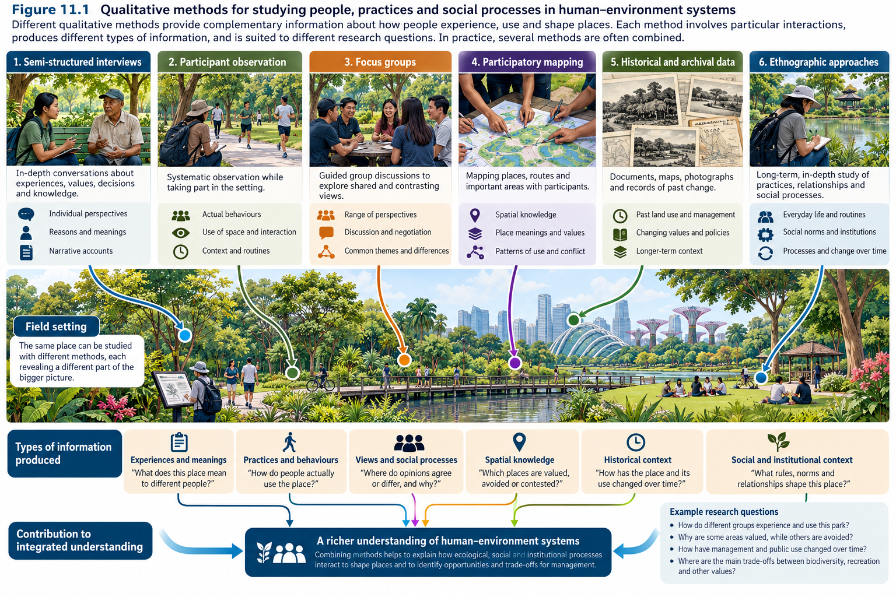
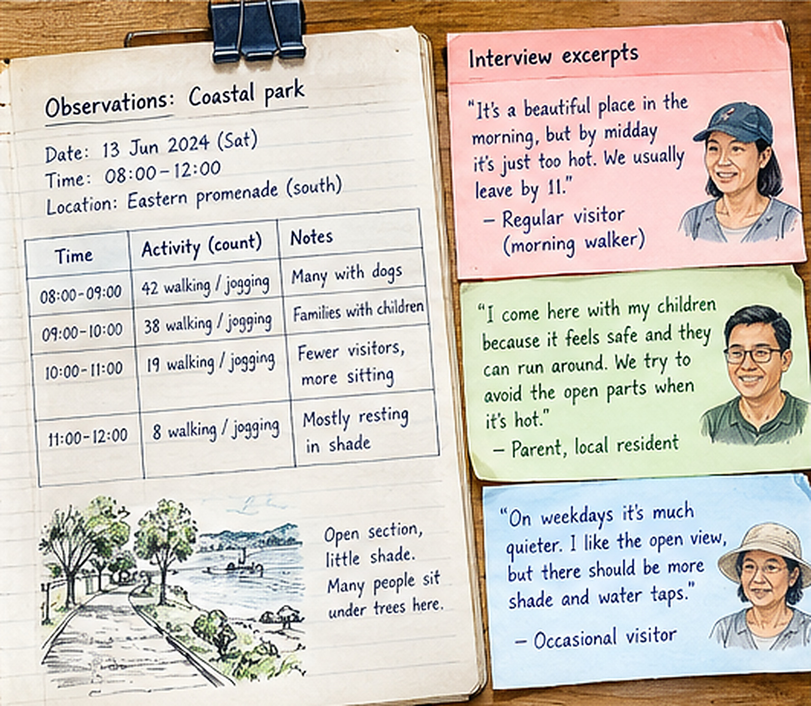
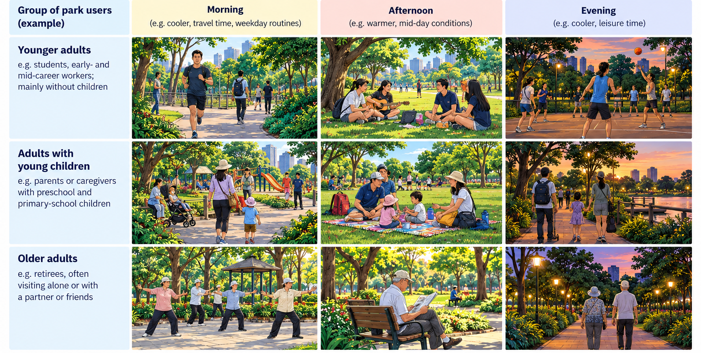
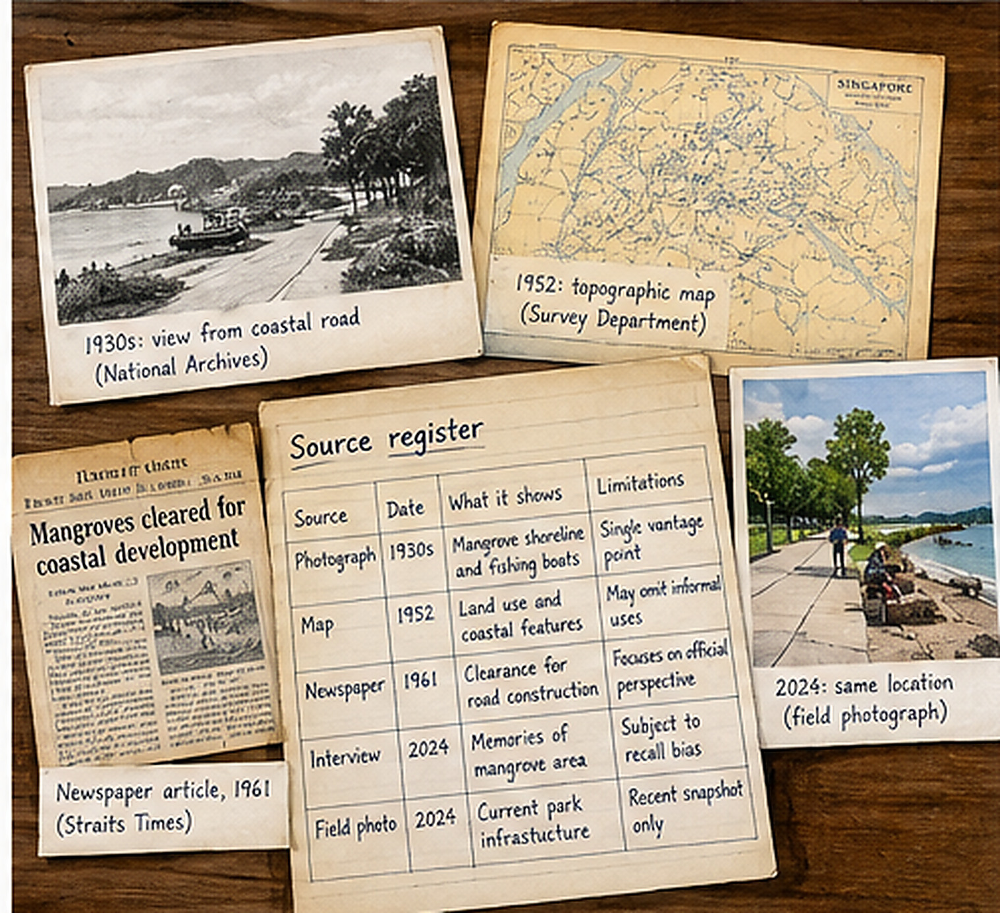
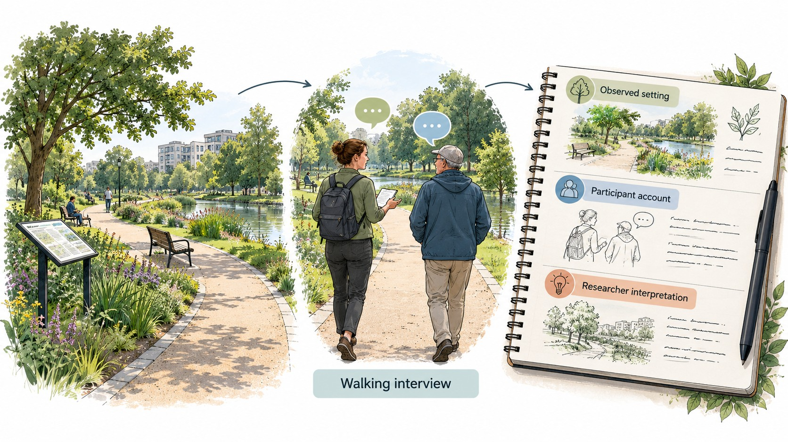
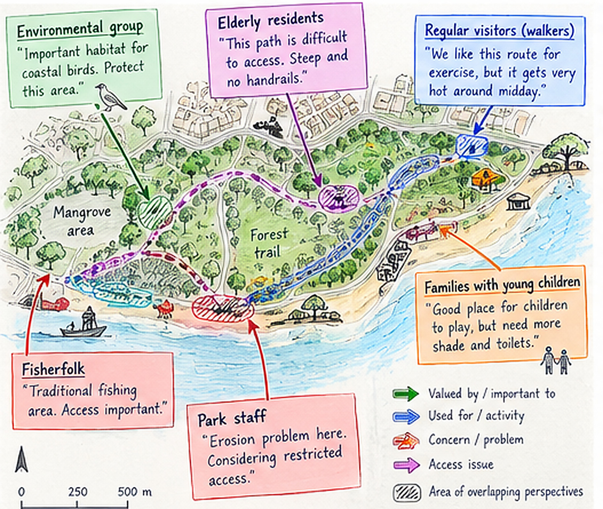

<script src="chapter-assets/chapter-interactions.js" defer></script>


```{=html}
<dialog class="figure-dialog" aria-label="Enlarged figure"><button class="figure-close" type="button" aria-label="Close enlarged figure">Close ×</button><p></p></dialog>
```


## 11.1 From patterns to experiences and explanations {#ch11-s111}


<p>In Chapter 10, we investigated how observations about people’s
behaviour, experiences and preferences can be collected systematically
through activity counts, questionnaires and other quantitative methods.
Imagine that you have conducted a study of how people use different
parts of an urban park. You may have found that a wooded path is used
less frequently than a more open route, or that visitor numbers vary
substantially throughout the day. These observations establish patterns
in park use, but what explains them? Perhaps people avoid the wooded
path because it is difficult to access, because they are uncertain where
it leads, or because they feel uncomfortable in the enclosed vegetation.
Alternatively, the path may simply connect fewer places that visitors
want to reach. Each explanation suggests a different reason for the
observed pattern, with different implications for how the park might be
managed. You might also have conducted a questionnaire investigating
people’s preferences for different forms of vegetation management and
found that many respondents prefer more natural-looking greenery. But
what do they mean by <em>natural</em>? Some may associate it with
spontaneous vegetation growth and greater biodiversity, others with
large trees and comfortable shade, and still others with a landscape
that looks relatively undisturbed but remains carefully maintained.
Respondents giving the same answer may therefore have rather different
environments in mind. The survey results can provide valuable
information about the distribution of reported preferences, but
understanding what those preferences involve, how they develop and how
they might influence people’s behaviour requires us to investigate these
differences more closely. We could do so by talking with park users
about their experiences, asking them to describe particular locations or
accompanying them as they walk through the park. Their explanations
might reveal influences on park use that we had not considered when
designing our original study. For example, we might discover that some
visitors avoid the wooded path not because they dislike dense vegetation
but because they cannot see where the path leads. Others may appreciate
the shaded environment but find its uneven surface difficult to
negotiate. We could compare these accounts with our own observations,
investigate whether other visitors describe similar experiences, and
examine whether the proposed explanations are consistent with the
physical characteristics and observed use of the locations. These accounts give us several possible explanations to examine against the observations and the settings in which people make their choices.</p>
<p>To assess those explanations, we also need to consider how the accounts were produced: the questions asked, the circumstances described and the experiences participants bring to the conversation. If we ask only frequent park users, we will learn relatively little about those who rarely visit. If we ask whether the wooded route is “safe”, one participant may think about traffic, another about visibility at dusk and another about the likelihood of meeting unfamiliar people. We need to retain the wording and setting of each account, compare experiences across relevant groups and places, and examine interpretations against other observations. This connects directly with the system understanding developed in Chapter 2: interviews and observation can reveal a relationship we did not initially include, suggest why a measured pattern differs among people, or lead us to measure something new. A quantitative finding can likewise generate a question that we follow up through qualitative research. Consider, for example, two visitors who both give the wooded path a low comfort rating. One finds that it requires a long detour from a bus stop. The other avoids enclosed vegetation at dusk because they cannot see who might be approaching. The numerical responses are identical, but the accounts suggest different processes and, potentially, different responses from park managers. If we subsequently want to estimate how common each concern is, we need to define the population of interest, select respondents accordingly and ask questions that distinguish those experiences. Interviews can thus change both the explanation we are considering and what needs to be sampled or measured to investigate it.</p>

<figure class="rich-figure wide-figure" id="fig-ch11-1"><button class="figure-enlarge" type="button">Enlarge figure</button>

<figcaption aria-hidden="true">Figure 11.1. Different ways to investigate the same urban park: interviews, participant observation, focus groups, mapping, archives and ethnographic approaches yield complementary information about experiences, practices and social processes. See @newing2011, @hammersley2019 and @evans2006.</figcaption>
</figure>
<section class="ch11-exercise" id="ch11-exercise-1"><h4>Test your understanding 11.1 · Match the claim to the evidence</h4><div class="ch11-question"><p>Choose a suitable primary approach for each question: (i) What
fraction of nearby residents support reduced mowing? (ii) Why do some
visitors describe wooded areas as peaceful while others describe them as
unsafe? (iii) How do maintenance staff decide which informal paths to
clear? (iv) How have residents’ memories of a mangrove area changed
across generations? For each, identify a possible unit of inquiry and
what the method would record. Explain when interviews could complement,
but not replace, a population survey.</p></div><label for="ch11-exercise-1-answer">Your reasoning</label><textarea id="ch11-exercise-1-answer" placeholder="Write a short explanation before revealing the suggested response." rows="4"></textarea><div class="ch11-actions"><span aria-live="polite" class="ch11-count">0 words</span><button aria-expanded="false" class="ch11-reveal" disabled="" type="button">Show suggested response</button></div><div class="ch11-solution" hidden=""><p>For (i), the quantity sought is the proportion of *nearby residents* who support reduced mowing. A defined residential population and a survey sampling strategy are needed if the result is to be used as an estimate for that population. The unit is an eligible resident, or perhaps a household if the question is explicitly about households; a questionnaire would record an operationally defined response, ideally after piloting what “reduced mowing” means. Interviews with a smaller, deliberately varied group could help us understand what residents imagine when they hear the term, including whether it implies wildflowers, untidiness, pests or a loss of play space. They would improve the survey questions but could not by themselves establish the population percentage. For (ii), we need to understand different interpretations of the same wooded setting. The primary units could be individual visits and participants' accounts of those visits. Semi-structured interviews, preferably with a walk through the site for some participants, would explore when and where the experience occurred, what features participants noticed, and whether darkness, visibility, previous incidents or companions shaped the assessment. Observations and measurements of route conditions might help test interpretations, but a reported feeling of insecurity is not itself a measurement of actual risk. For (iii), maintenance *decisions and practices* are the focus. Interviews with staff can elicit stated responsibilities and criteria; observation of maintenance work and examination of work orders can show how decisions are implemented under constraints of staffing, safety and institutional rules. The unit might be a clearing decision or maintenance episode, not merely a staff member. Official policies alone may not explain day-to-day decisions. For (iv), oral-history interviews with people who knew the mangrove at different stages, together with dated photographs, maps and archival records, can reconstruct remembered uses and environmental changes. Here the units include individual recollections, documentary records and identifiable historical events. Memories from different age groups are not a repeated population survey, so a change in the accounts does not automatically demonstrate a shift in the prevalence of values across generations. In all four cases, a different approach could be appropriate if we changed the claim we wanted to make: the method must be chosen to produce evidence for that claim, not simply because the topic concerns people.</p></div><noscript><details><summary>Suggested response (available without JavaScript)</summary><p>For (i), the quantity sought is the proportion of *nearby residents* who support reduced mowing. A defined residential population and a survey sampling strategy are needed if the result is to be used as an estimate for that population. The unit is an eligible resident, or perhaps a household if the question is explicitly about households; a questionnaire would record an operationally defined response, ideally after piloting what “reduced mowing” means. Interviews with a smaller, deliberately varied group could help us understand what residents imagine when they hear the term, including whether it implies wildflowers, untidiness, pests or a loss of play space. They would improve the survey questions but could not by themselves establish the population percentage. For (ii), we need to understand different interpretations of the same wooded setting. The primary units could be individual visits and participants' accounts of those visits. Semi-structured interviews, preferably with a walk through the site for some participants, would explore when and where the experience occurred, what features participants noticed, and whether darkness, visibility, previous incidents or companions shaped the assessment. Observations and measurements of route conditions might help test interpretations, but a reported feeling of insecurity is not itself a measurement of actual risk. For (iii), maintenance *decisions and practices* are the focus. Interviews with staff can elicit stated responsibilities and criteria; observation of maintenance work and examination of work orders can show how decisions are implemented under constraints of staffing, safety and institutional rules. The unit might be a clearing decision or maintenance episode, not merely a staff member. Official policies alone may not explain day-to-day decisions. For (iv), oral-history interviews with people who knew the mangrove at different stages, together with dated photographs, maps and archival records, can reconstruct remembered uses and environmental changes. Here the units include individual recollections, documentary records and identifiable historical events. Memories from different age groups are not a repeated population survey, so a change in the accounts does not automatically demonstrate a shift in the prevalence of values across generations. In all four cases, a different approach could be appropriate if we changed the claim we wanted to make: the method must be chosen to produce evidence for that claim, not simply because the topic concerns people.</p></details></noscript><p class="answer-status">Write your answer before revealing the suggested response.</p></section>


## 11.2 Interviews {#ch11-s112}


<p>You probably have a reasonable idea of what an interview involves,
even if you have never conducted one yourself. We ask someone questions
about a particular subject, listen to their answers and often ask
further questions to understand what they mean. In research, however, we
want to use those conversations to answer specific questions about the
system we are studying. This requires some preparation. We need to
consider whom to interview, what we want to learn from them, how to
formulate questions that allow them to explain their experiences, and
how we will record and subsequently interpret their answers. The person
being interviewed brings their own knowledge, memories, experiences and
interests, but the interviewer also influences the conversation through
the questions asked, the order in which topics are introduced and the
way responses are followed up. For example, asking someone whether they
avoid a wooded path because they feel unsafe may lead to a quite
different conversation from asking them to describe how they decide
which route to take through the park. The interview questions and the way they are followed up therefore influence which experiences and explanations become part of the research record.</p>
<p>There are different ways of organising interviews, depending on what
we want to investigate. A <strong>structured interview</strong> follows
a largely predetermined set of questions, often with standardised
response options. This makes it easier to compare answers across many
participants and is similar to an interviewer-administered
questionnaire. A <strong>semi-structured interview</strong> also uses a
prepared set of questions or topics, but allows the interviewer to
change their sequence, ask additional questions and follow up on
unexpected information. For example, we might want to discuss park use,
accessibility, comfort and vegetation preferences with every
participant, while leaving room for each person to describe experiences
that we had not anticipated. In a more <strong>open or narrative
interview</strong>, the participant has greater freedom to decide what
to discuss and how to organise their account. We might ask someone who
has lived near a coastal park for several decades to describe how the
area and its uses have changed during their lifetime, allowing them to
identify events and experiences that they consider important. These
approaches are not entirely separate categories. Interviews can differ
in how closely they follow predetermined questions, how much freedom
participants have to introduce new topics, and how extensively
particular experiences are explored. Preparing an interview guide then requires deciding how much structure is useful and where participants need room to introduce experiences or explanations we have not anticipated.</p>
<p>Designing and conducting an interview that provides useful evidence
is not necessarily straightforward. We usually want enough consistency
across interviews to compare what different people tell us, while also
allowing individual participants to explain their experiences in their
own terms. Consider again our investigation of how people use different
parts of an urban park. We might begin by asking someone to describe
their most recent visit: where they went, which places they stopped at
and what influenced their choices. This provides a concrete starting
point, and the interviewer can then ask further questions about
particular decisions or experiences. If the participant mentions that
they avoided a wooded path, we could ask what made them decide against
using it. Perhaps they did not know where it led, found it difficult to
walk on, or were simply going somewhere else. We would learn rather less
by immediately asking, ‘Do you avoid the wooded path because it feels
unsafe?’ That question assumes that they avoid the path and introduces a
particular explanation before we know whether it is relevant. Similarly,
asking whether someone prefers shaded areas may tell us something about
their stated preference, but asking them to describe where they went
during a recent visit may reveal how shade influences their choices in
relation to other considerations, such as accessibility, destinations or
the activities they intended to undertake. We can still ask directly
about shade later in the interview, particularly if it is important to
our research question. The point is to give participants an opportunity
to describe their experiences before we introduce all our own possible
explanations. When preparing an interview, we therefore need to think not only
about the questions we intend to ask, but also about how the
conversation might develop. In a semi-structured interview, an interview
guide can identify the main topics that should be discussed with every
participant, together with possible follow-up questions. For the park
study, we might include questions about recent visits, commonly used
routes, places people particularly appreciate or avoid, and how their
use of the park varies with time of day or weather. Within each topic,
we can prepare prompts that help participants provide more detail: when
did something happen, what were the circumstances, who was involved, and
has their experience changed over time? At the same time, we need to
listen carefully enough to recognise when an answer introduces something
we had not considered. Someone may unexpectedly mention that they no
longer visit a particular area because maintenance activities have
changed the paths, or that their preferences differ depending on whether
they come alone or with children. These observations may suggest
additional questions worth asking other participants, or new
relationships to consider in our understanding of the park. We should
therefore test the interview guide before using it for the main study. A
few pilot interviews can reveal questions that are difficult to
understand, terms that different people interpret differently, or topics
that are important to participants but missing from our guide. They also
help us practise following up on answers without repeatedly directing
participants towards explanations we already have in mind.</p>

<p>As with other field methods, the circumstances in which interviews
are conducted affect the information we collect. Interviewing someone
beside a busy path may be convenient, but background noise,
interruptions or the presence of other people may make it difficult for
them to explain their experiences freely. An interview conducted in a
quiet and comfortable location may allow a more extensive conversation,
although it may also be less convenient for some participants. Language
is another consideration. People may be better able to explain their
experiences in a language with which they are familiar, and translation
may be necessary when the researcher and participant do not share that
language. We also need to decide how to record the interview. With
appropriate consent, an audio recording can preserve much of what was
said and allow the interviewer to concentrate on the conversation.
Recordings can be transcribed manually or with software, including
automated transcription tools, but the resulting transcripts need to be
checked because names, unfamiliar terms, accents and overlapping speech
can produce errors. Field notes remain useful even when recordings are
available. They can document the location and circumstances of the
interview, relevant observations that are not captured in the audio,
interruptions, and questions that arose during the conversation. These
details can become important when interpreting a participant’s account.
For example, someone’s statement that a park location is ‘usually quiet’
may need to be understood in relation to when they normally visit,
particularly if the interviewer has observed quite different conditions
at other times.</p>
<p>People’s experiences, willingness
to participate and ways of explaining themselves vary considerably. Two
people who regularly visit the same park may use it for different
purposes and encounter different conditions. Their experiences may also
depend on age, mobility, familiarity with the park, the activities they
undertake and the times at which they visit. Some of this variation is
precisely what we want to understand. But the circumstances of
recruitment and interviewing can introduce additional differences. Some
people may be comfortable discussing their experiences with a university
researcher, while others may be reluctant, unsure why the information is
being collected or concerned about possible consequences of what they
say. Someone approached through a park authority may respond differently
from someone recruited independently. We should be aware of these
influences when interpreting similarities and differences among
interviews. Where possible, the sampling design can deliberately include
people with contrasting experiences, while our interview records should
help us understand the circumstances under which different accounts were
obtained. We cannot anticipate or control every influence, nor can we
assume that speaking with several people from the same nominal group
adequately captures the variation within it. This connects to the
principles of sampling and variability discussed earlier in the book: we
need to consider which differences are relevant to our research
question, which our design allows us to investigate, and which may
remain poorly represented. The next section develops how participants
can be selected to explore such variation, including experiences and
perspectives that would be difficult to reach through a survey of
current park users alone. For fuller treatment of how interview
questions, relationships and transcription influence the evidence, see
@brinkmannkvale2014.</p>
<details class="ch11-foldable box" id="ch11-note-2"><summary>Box 11.1 · An interview-guide prototype for park experience</summary><div class="ch11-foldable-body"><p><strong>Research purpose.</strong> Understand why visitors choose or
avoid differently managed park settings and what they mean by comfort or
naturalness. <strong>Eligibility.</strong> People with relevant recent
experience; the broader question may also require a separate group of
non-visitors.</p>
<p><strong>Opening.</strong> ‘Can you tell me about a recent visit to
this park? Where did you go, and what did you do?’ Allow the account to
develop before asking for reasons.</p>
<p><strong>Probe for choices.</strong> ‘What influenced your route?’
‘Were there places you chose not to use?’ ‘How does that compare with
other visits?’ Ask for examples if the account remains abstract.</p>
<p><strong>Probe for interpretation.</strong> ‘You described that area
as natural. What made it feel natural to you?’ ‘Would another part of
the park fit that description?’ Avoid presupposing that one meaning is
scientifically correct.</p>
<p><strong>Probe for management change.</strong> ‘Have you noticed
changes in the vegetation or maintenance?’ ‘What difference, if any,
have those changes made to your experience?’ The respondent may not have
noticed a change; do not push for a causal story.</p>
<p><strong>Closing.</strong> ‘Is there something important about your
use of the park that my questions have not covered?’ Document the
setting, date, conditions and any analytic memo without unnecessarily
recording identifiable details.</p>
<p><strong>Quality check.</strong> Does each question invite an account?
Is it understandable without specialist vocabulary? Is the interview
long enough to develop examples, yet short enough to respect
participants’ time? Are consent and permissions in place?</p><p><strong>Further reading.</strong> @brinkmannkvale2014 provide a specialist account of interview design, follow-up questioning and the interpretation of what interview conversations produce.</p></div></details>
<details class="ch11-foldable box" id="ch11-textbooks-for-methods"><summary>Box 11.2 · Books for developing qualitative field methods</summary><div class="ch11-foldable-body">
<p><strong>@newing2011, <em>Conducting Research in Conservation</em>.</strong> A practical introduction to social-science approaches in environmental and conservation projects, including interviewing, sampling, field procedures and the decisions that connect methods to research questions.</p>
<p><strong>@hammersley2019, <em>Ethnography: Principles in Practice</em>.</strong> Explains how extended observation, interviews and documentary material are used together, how field relationships shape information, and how researchers move from descriptive records to interpretations.</p>
<p><strong>@brinkmannkvale2014, <em>InterViews</em>.</strong> Develops the craft of designing, conducting, interpreting and reporting research interviews, with more attention to interviewing practice than a short methods chapter can provide.</p>
</div></details>

<figure class="rich-figure" id="fig-ch11-2"><button class="figure-enlarge" type="button">Enlarge figure</button>

<figcaption aria-hidden="true">Figure 11.2. Different information from systematic observations and interviews in the same park setting. Counts describe activity during sampled periods; visitor accounts describe experiences and suggest explanations to investigate.</figcaption>
</figure>


## 11.3 Selecting participants {#ch11-s113}


<p>The interviews discussed in the preceding section will be informative
only if the people we speak with have experiences relevant to what we
want to understand. Chapter 5 introduced the relationship between
sampling, variation and inference: the units we select affect which
differences become visible to us. That principle also applies here,
although in qualitative research our immediate aim may be to examine how
different experiences arise and what they mean, rather than to estimate
how frequently a view occurs in a population. Suppose the question is
why people avoid the wooded path. Interviewing ten convenient passers-by
at one entrance may give us ten detailed accounts, but it may also
repeatedly expose us to people with very similar routines. We need to
consider which experiences may be absent and why they are important for
understanding the observed pattern. This is the logic of
<em>purposive</em> (or <em>purposeful</em>) sampling: selecting
participants or cases because of what they can contribute to a
particular inquiry. Established discussions of interview sampling
describe both systematic selection across relevant categories and
adjustments made as analysis develops [@robinson2014; @palinkas2015]. To make the choices concrete, consider a more specific question: <strong>How and why do park use
and people’s experiences differ among younger adults, adults visiting
with young children and older adults, and how do these differences vary
between morning, afternoon and evening?</strong> Figure 11.3 illustrates
one possible way of thinking about whom to interview. Its rows
distinguish three broad categories of park users, while the columns
distinguish periods that may differ in temperature, routine activities,
available time, light conditions and who is present. The small scenes
suggest possible uses of the park, not findings that we already know to
be true. By considering the combinations, we can make more deliberate
choices about whom to approach and when, instead of allowing our
interview sample to consist mainly of whoever happens to be there during
our own convenient fieldwork hours.</p>

<figure class="rich-figure" id="fig-ch11-3"><button class="figure-enlarge" type="button">Enlarge figure</button>

<figcaption aria-hidden="true">Figure 11.3. Selecting interview participants across three groups of park users and three periods of the day. The combination of visitor groups and visiting times draws attention to differences in experiences that a single recruitment location or time might miss. Other studies might compare frequent and occasional visitors, different park areas, or weekdays and weekends.</figcaption>
</figure>
<p>Why might comparisons along both dimensions be informative? People
who belong to the same broad category but visit at different times may
represent different <strong>subgroups</strong>. Younger adults passing
through the park before work may have different purposes, opportunities
and constraints from those arriving to play sport in the evening. Adults
with young children encountered during school hours may likewise differ
from those able to visit only after work. The time of day can also alter
an individual’s experience even when the person remains the same: an
open lawn that seems attractive during a cool morning may feel
uncomfortable on a hot afternoon, while the reasons for visiting,
companions, fatigue or mood may change. Finally, time and group
characteristics may interact. Afternoon heat could affect someone
supervising young children differently from a person exercising alone.
These are possibilities to investigate, rather than assumptions the
categories allow us to confirm in advance. Depending on what
participants tell us, factors such as mobility, familiarity, employment
schedules or whether people visit alone may turn out to distinguish
experiences more clearly than age. The distinction between <strong>different people observed at
different times</strong> and <strong>the same person’s changing
experience</strong> deserves attention. If older adults interviewed in
the morning describe the park differently from older adults interviewed
in the evening, we cannot automatically attribute the contrast to time
of day. It might reflect who is available to visit at each time, the
conditions under which their visits occur, or a combination of these
influences. To investigate changes within individuals, we could ask how
they experience the park during visits at different times, accompany
some of them on more than one occasion, or arrange repeat interviews.
None of these choices is automatically preferable. They give access to
different kinds of evidence, and the study question determines which
comparison is useful. We should also remember that interviews conducted
<strong>inside</strong> the park systematically exclude people who
cannot or do not visit. If their reasons for staying away concern
accessibility, safety or competing responsibilities, omitting them may
remove precisely the experiences needed to understand the system. The combinations in Figure 11.3 guide recruitment without becoming fixed quotas. Qualitative sampling often seeks a diversity of accounts because the
differences help develop and evaluate explanations. Deliberately seeking a broad range
of experiences is often called <em>maximum-variation sampling</em>; organising
recruitment around selected characteristics is <em>stratified purposive sampling</em>
[@robinson2014; @palinkas2015]. The relevant contrasts depend on the question. To investigate how maintenance decisions are made, you might interview gardeners, contractors, volunteers and managers according to their roles in making and implementing decisions, rather than their age or visiting time.</p>
<p>How does this kind of deliberate selection work in an actual study? @talal2021 investigated what urban-park visitors value about vegetation in Portland, Oregon. Their first sampling decision concerned <em>parks</em>, not interviewees. The researchers used the city's park inventory and distinguished three park types: natural-passive parks, with trails and viewing areas but without formal sports fields; recreational-active parks, with facilities such as playing fields and playgrounds; and multi-use parks, combining active and passive recreation. These categories were useful because park design, vegetation and the purposes of visits could all shape what visitors notice and prefer. Choosing parks of just one type would have left out these potentially informative differences. From this inventory the team selected five parks of each type, giving 15 parks across the city. The published description reports random selection within the park categories, with an explicit exception: Forest Park was included deliberately because it is Portland's largest and best-known park. That distinction is worth retaining. The categories define a <em>stratified</em> selection of settings, while the deliberate inclusion of Forest Park introduces a judgement-based choice. The selection rules should therefore be reported separately, with the implications of including a deliberately chosen park considered when interpreting differences among the sampled settings. The researchers did not attempt to estimate city-wide preferences from a simple random sample of every Portland resident. They then made a second set of choices about <em>when and where to approach visitors</em>. Visits covered different weekdays and weekends and morning, afternoon and evening periods across the park types. That was important because the people present, their activities and even how they experience vegetation may change across the day and week. They conducted interviews in the parks and adjusted interview questions in response to preliminary field experience. The resulting accounts could reveal variation in what visitors meant by attractive vegetation, including differences among park settings. Because the researchers approached visitors inside parks, the interviews do not include residents who did not visit; the selection of participants also cannot support a population estimate of all Portland residents’ preferences. The decisions work together. Park type determines the range of settings observed; the chosen times influence which visitors are encountered; the locations where a researcher approaches people influence whose experiences enter the interviews; and an evolving interview protocol affects what each person can explain. Our wooded-path investigation involves comparable choices. Rather than simply continuing to interview whoever passes our usual observation point, we could deliberately sample contrasting locations and times, then alter recruitment as the interviews reveal experiences we have not yet understood.</p>

<p>Suppose, for example, that
our first interviews suggest poor visibility is the main reason people
avoid the wooded path. A later participant says she uses it during the
afternoon but avoids it during morning delivery activity; another person
cannot enter because a short flight of steps blocks wheelchair access.
These accounts indicate that <em>avoiding the path</em> may result from
several different processes. Continuing to recruit only people who
mention visibility would confirm our initial expectations by design. We
could instead look for people using the path at different times, people
choosing the alternative route, those affected by access barriers and
staff familiar with maintenance practices. Other forms of purposive
selection might focus on people who have experienced a particular
management change (<em>criterion sampling</em>) or people whose accounts
appear to contradict an emerging interpretation (<em>negative or
contrasting cases</em>). Network or snowball recruitment can also help
us reach less visible participants, although relying on a single social
network may exclude others. As we expand or revise the sample, we should
record the reasons for doing so and remain within the permissions and
consent arrangements of the study [@palinkas2015].</p>
<p>How many people should we interview? The formula used to estimate the sampling uncertainty of a population proportion does not tell us whether interviews cover the experiences and explanations needed for a qualitative question. You may encounter the idea of <em>saturation</em>, but whether further interviews add useful material depends on the kind of analysis being conducted. @malterud2016 introduce <em>information power</em>: the adequacy of a sample depends on the research question, how specifically participants are selected, relevant theory, the quality of the conversations and what the analysis is intended to accomplish. Their paper develops the idea through a hypothetical clinical investigation of how patients manage foot-ulcer care. This is a useful reminder to look beyond environmental research for well-explained methodological ideas. The same reasoning can be applied to interviews about park use. Apply this reasoning to a narrow question: how do people with mobility limitations experience one particular wooded path? We might initially plan twelve interviews, deliberately recruiting people with different mobility requirements and people who do not use the path. After five interviews, imagine that all five participants praise the shade but describe no difficulty reaching the path. That would not establish that accessibility is unimportant. Perhaps we have recruited only people able to walk the route. The more informative next step would be to contact people with different mobility requirements through a community organisation or other appropriate recruitment route, rather than simply collect seven more interviews from the same path entrance. We would document why recruitment changed. The sampling decision changes again if we ask a broader question: why do different groups choose or avoid wooded routes throughout the park? This requires investigating more settings, purposes of visits, visiting times and contrasting experiences. It may also require speaking with maintenance staff and observing routes. A larger interview sample could be useful, but interview <em>number</em> alone cannot compensate for missing relevant experiences or poorly developed questions. Conversely, an effective interview with a carefully selected participant may reveal several aspects of a process that numerous brief interviews would not. The researcher should periodically review what the collected accounts actually explain, what contrasts remain inadequately represented and how the intended analysis is changing. Information power guides such judgements; it is not a formula for fixing a sample size.</p>
<details class="ch11-foldable box" id="box-ch11-information-power"><summary>Box 11.3 · Working through a qualitative sampling decision</summary><div class="ch11-foldable-body">
<p><strong>1. State the intended inference.</strong> We want to explain how path accessibility influences experiences and route choices, not estimate the proportion of all residents who dislike wooded paths.</p>
<p><strong>2. Identify informative contrasts.</strong> Include people who use the route routinely, those who use it only at certain times, and people for whom access may be difficult. Where might we find people who never enter the park?</p>
<p><strong>3. Plan initial recruitment.</strong> Use selected park locations and times, and an additional recruitment route outside the park. Record the basis for approaching each person.</p>
<p><strong>4. Examine early accounts.</strong> If all initial interviewees can walk the route comfortably, their agreement does not settle whether mobility restricts access. If accounts are superficial, improve questions and follow-up prompts before increasing recruitment.</p>
<p><strong>5. Adjust the sample deliberately.</strong> Recruit people whose circumstances could challenge the emerging explanation. An interviewee who likes the shade but cannot negotiate the steps may be more informative than another regular user reporting similar preferences.</p>
<p><strong>6. Evaluate what the analysis can support.</strong> Compare accounts and field observations, identify what remains unexamined and describe whom the study has and has not reached. The final interview total follows from the work and the available resources, not from a universal numerical threshold.</p>
</div></details>
<p>Qualitative sampling requires a record of whom the researchers attempted to reach, which experiences were represented, which contrasts were pursued and why recruitment changed. In natural-history studies, researchers similarly may seek particular behaviours, life stages, habitats or unusual events because these observations help explain a process. Such strategically collected observations can be highly informative without providing an estimate of how common that behaviour is in a larger population. When we do want that estimate—whether for park visitors or animal populations—we must design observations around the relevant population, units and opportunities for detection, as discussed in Chapters 5 and 8.</p>
<section class="ch11-exercise" id="ch11-exercise-3"><h4>Test your understanding 11.2 · Who would you interview, and when?</h4><div class="ch11-question"><p>You have observed that visits to the wooded path are fewer at midday. Start with the three-by-three example in Figure 11.3 and explain which combinations you would investigate first, given your initial hypotheses. Then identify one important perspective the matrix would miss, and explain how you could reach it. How would your design change if interviews suggested mobility, rather than age, was the main source of contrasting experiences? Finally, what additional observations would be necessary to distinguish differences among people from changes in the same individual's experience across the day?</p></div><label for="ch11-exercise-3-answer">Your reasoning</label><textarea id="ch11-exercise-3-answer" placeholder="Write a short explanation before revealing the suggested response." rows="4"></textarea><div class="ch11-actions"><span aria-live="polite" class="ch11-count">0 words</span><button aria-expanded="false" class="ch11-reveal" disabled="" type="button">Show suggested response</button></div><div class="ch11-solution" hidden=""><p>I would begin with adults with young children and older adults encountered at midday and in the cooler morning or evening, because shade, heat exposure, mobility and the need to supervise others are plausible explanations for avoiding the wooded path. I would also recruit younger adults during both commuting and leisure periods so that differences in the reason for visiting do not become confused with a simple age contrast. I would not allocate equal numbers mechanically to all nine cells: I would keep a record of which combinations have been reached and of the emerging contrasts, and I would shift recruitment toward experiences that are still poorly understood. A key omission is people who live nearby but seldom or never enter the park. They cannot be recruited through an on-site intercept interview and might be reached through neighbourhood organisations or an appropriately designed household recruitment strategy. Another omission could be park staff, whose knowledge concerns maintenance rather than visitor comfort. If I found that some older interviewees describe the path as unsafe only at dusk, I would investigate whether evening visitors are different people from morning visitors or whether the same individuals report changing experiences. Repeated visits or interviews with the same people could distinguish these possibilities better than interviews with entirely different respondents. The resulting material would help us understand plausible mechanisms and variation in experiences, not estimate how common each explanation is among all residents.</p></div><noscript><details><summary>Suggested response (available without JavaScript)</summary><p>I would begin with adults with young children and older adults encountered at midday and in the cooler morning or evening, because shade, heat exposure, mobility and the need to supervise others are plausible explanations for avoiding the wooded path. I would also recruit younger adults during both commuting and leisure periods so that differences in the reason for visiting do not become confused with a simple age contrast. I would not allocate equal numbers mechanically to all nine cells: I would keep a record of which combinations have been reached and of the emerging contrasts, and I would shift recruitment toward experiences that are still poorly understood. A key omission is people who live nearby but seldom or never enter the park. They cannot be recruited through an on-site intercept interview and might be reached through neighbourhood organisations or an appropriately designed household recruitment strategy. Another omission could be park staff, whose knowledge concerns maintenance rather than visitor comfort. If I found that some older interviewees describe the path as unsafe only at dusk, I would investigate whether evening visitors are different people from morning visitors or whether the same individuals report changing experiences. Repeated visits or interviews with the same people could distinguish these possibilities better than interviews with entirely different respondents. The resulting material would help us understand plausible mechanisms and variation in experiences, not estimate how common each explanation is among all residents.</p></details></noscript><p class="answer-status">Write your answer before revealing the suggested response.</p></section>


## 11.4 Memories and historical records {#ch11-s114}


<p>An interview can also help us investigate environmental changes that
took place before our fieldwork. Imagine that we want to understand how
a coastal neighbourhood’s relationship with mangroves has changed. Older
residents might recall fishing, walking through tidal channels or
collecting food where a road and seawall now stand. Their accounts could
tell us about activities, places and relationships that do not appear in
a contemporary land-cover map. But how do we distinguish what happened
at a particular date from what those places meant to the people
remembering them? We would ask participants to describe a specific
journey or activity, locate it as carefully as possible, and relate it
to events they remember, while also examining historical maps,
photographs and administrative records. This allows us to investigate
environmental and social change without treating every recollection as a
precise measurement of the past. For example, suppose one resident remembers access ending when a road was built,
while another remembers still walking to the shore several years
afterwards. The disagreement is not necessarily a choice between a
correct and an incorrect witness. A road may have blocked one route
while another remained passable, or the participants may be remembering
different sections of the coast. We could mark the locations on
historical maps, check when photographs show a new road alignment and
ask what each person meant by <em>access</em>. We might find that the
sources refer to different stages of a gradual change. The exercise also
reveals why the circumstances in which records were produced are
important. A planning map can establish what was proposed but does not
necessarily show when construction began; an aerial photograph shows a
landscape at one recorded moment but cannot tell us how residents
understood it. An oral account may be uncertain about dates while
providing detailed evidence of routine practices and personal
significance. We would therefore preserve both the account and the
independent record, noting what we can and cannot conclude from their
comparison.</p>

<p>A published Singapore example shows what this kind of investigation
can contribute. @thiagarajah2015
examined changes in the cultural values associated with mangroves using
archival photographs and previously recorded oral histories alongside
contemporary photographs and interviews. The archival oral histories
described relationships with mangrove environments rooted in everyday
life, place and heritage; more recent material emphasised, among other
things, recreation and education. This comparison makes changes in how
people encounter and represent mangroves visible, but it does not
establish that every Singaporean shared one set of values in the past
and another today. The historical archive contains material that was
selected, collected and preserved for particular reasons, while
contemporary online photographs depend on who takes and shares pictures.
The sources contribute different information because they were produced, selected and preserved in different ways, an issue that becomes particularly important when interpreting change over time. When working with historical material, record who created each item, its purpose, date and location, how it entered the collection and what it leaves out. In the Singapore example, archival oral histories and photographs from different periods were produced through different selection processes. The observed shift in represented activities therefore provides a starting point for further comparisons, including who had opportunities to be recorded and how the same place was described over time. For a project reconstructing coastal access, students could start with a dated sequence of maps and photographs, interview residents about particular places and journeys, and retain disagreements rather than prematurely averaging them into a single narrative. The methodological question is what each comparison establishes, and which part of the historical experience remains dependent on memory or on selectively preserved records.</p>
<figure class="rich-figure medium-illustration" id="fig-ch11-4"><button class="figure-enlarge" type="button">Enlarge figure</button>

<figcaption aria-hidden="true">Figure 11.4. Illustration of examining
historical and contemporary materials alongside a source register. Who
produced a record, why it was created and what it preserves or omits are
central to its interpretation.</figcaption>
</figure>
<details class="ch11-foldable box" id="ch11-note-9"><summary>Box 11.4 · Comparing a remembered change with historical records</summary><div class="ch11-foldable-body"><p>Imagine that a resident recalls that the shoreline became inaccessible “after the big flood”, while another remembers a new road blocking the former footpath. Place these accounts in separate rows of a working timeline, recording the event as described, the approximate date and what anchors each recollection. Alongside the accounts, enter a dated road plan, an aerial photograph and any accessible flood or maintenance records. The date of the road plan may establish when construction was authorised without establishing when the footpath stopped being usable; the photograph may show a physical barrier but not the social significance of the route.</p><p>Rather than selecting the earliest date as the correct answer, the researcher can return to participants to ask which section of the path they used, whether the road and flood affected different access points, and whether “closed” means legally prohibited or physically difficult. This may lead to a sequence of changes, or leave an unresolved disagreement. In either case, the timeline helps keep each inference attached to the source that supports it. It does not require the sources to agree, and it does not transform a few recollections into a population estimate.</p><p><strong>Research example:</strong> @thiagarajah2015 examine changes in cultural values of mangroves in Singapore using historical and contemporary information. For detailed methods, see @newing2011.</p></div></details>
<section class="ch11-exercise" id="ch11-exercise-extra-11D"><h4>Test your understanding 11.3 · Does the archive show a change in values?</h4><div class="ch11-question"><p>The archive contains many references to cultural heritage and the contemporary photograph collection contains mostly recreation scenes. What is supported directly by this comparison? What additional evidence would strengthen a claim about changes in people’s values?</p></div><label for="ch11-exercise-extra-11D-answer">Your reasoning</label><textarea id="ch11-exercise-extra-11D-answer" placeholder="Write your answer before seeing the suggested response." rows="4"></textarea><div class="ch11-actions"><span aria-live="polite" class="ch11-count">0 words</span><button aria-expanded="false" class="ch11-reveal" disabled="" type="button">Show suggested response</button></div><div class="ch11-solution" hidden=""><p>The collections directly support a narrower statement: *different kinds of cultural values are represented in the archival material and the contemporary photographs*. They do not establish that the historical population valued cultural heritage more, or that modern residents value only recreation. Institutional archives may preserve ceremonial events, land-use disputes and historically notable places disproportionately; contemporary photographs may be taken and shared because leisure activities are visually appealing. We should first document who created the records, the periods and locations represented, how each collection was assembled and whether a single contributor supplied many items. We could then seek additional, more comparable evidence—for example, repeated local newspaper coverage, management documents over several periods, oral histories that ask about particular uses and places, and interviews with contemporary residents using similar prompts. Even then we should distinguish remembered historical activities from currently reported values and explain whose experiences remain missing. A plausible alternative interpretation is not a historical change in the values themselves but a change in the practices of documentation. The comparison is therefore valuable for generating questions about changing relationships with mangroves, while direct claims about population-level change would require stronger and more comparably produced evidence.</p></div><noscript><details><summary>Suggested response</summary><p>The collections directly support a narrower statement: *different kinds of cultural values are represented in the archival material and the contemporary photographs*. They do not establish that the historical population valued cultural heritage more, or that modern residents value only recreation. Institutional archives may preserve ceremonial events, land-use disputes and historically notable places disproportionately; contemporary photographs may be taken and shared because leisure activities are visually appealing. We should first document who created the records, the periods and locations represented, how each collection was assembled and whether a single contributor supplied many items. We could then seek additional, more comparable evidence—for example, repeated local newspaper coverage, management documents over several periods, oral histories that ask about particular uses and places, and interviews with contemporary residents using similar prompts. Even then we should distinguish remembered historical activities from currently reported values and explain whose experiences remain missing. A plausible alternative interpretation is not a historical change in the values themselves but a change in the practices of documentation. The comparison is therefore valuable for generating questions about changing relationships with mangroves, while direct claims about population-level change would require stronger and more comparably produced evidence.</p></details></noscript><p class="answer-status">Write your answer before revealing the suggested response.</p></section>


## 11.5 Observing social practices {#ch11-s115}


<p>Interviews tell us how people describe what they do and why, but the
practices themselves often need to be observed. Suppose we want to know
why a community garden has sharply defined planting beds, cleared paths
and little spontaneous vegetation. We could ask gardeners what they like
about its appearance, but we might also visit on an ordinary maintenance
day, watch how they decide what to remove and note when that decision is
questioned. If one gardener clears vegetation after receiving a reminder
from an organiser, that observation leads us to ask about institutional
expectations as well as personal preferences. A photograph of the
finished garden would not show the interaction that produced its
appearance. By observing practices as they occur, then discussing them
with the people involved, we can investigate relationships among
environmental conditions, decisions, routines and authority. It is important to understand the difference between
<strong>descriptive field notes</strong> and <strong>analytic or
interpretive memos</strong>. In the notes from the garden visit, we
might record the time, the activity and the words used during the
exchange, separating what we observed from what someone subsequently
told us. An interpretive memo would address what we think the exchange
means. We might propose that gardeners clear vegetation partly because
they anticipate a judgement about tidiness. That is an interpretation to
be investigated through other visits, interviews and rules or
correspondence, not an observation we have already verified. Notes
become much less informative if we write only that a gardener was
‘following institutional pressure’, because we can no longer see what
happened or examine another explanation. Recording ordinary occasions as
well as special events also helps us understand whether an observed
practice is routine or exceptional [@hammersley2019; @newing2011].</p>

<p>The study by @montefrio2021 gives this
reasoning a concrete social context. Investigating Singapore community
gardens, they describe the <strong>aesthetic politics</strong> of
gardening: expectations concerning the order and beauty of cultivated
spaces operate through formal authority and through judgements that
circulate among different actors. Gardeners do not simply reproduce
these expectations; they may negotiate them or resist them in their
everyday practices. The relevant question is therefore larger than
whether gardeners personally prefer neat vegetation. It concerns how
urban expectations, regulation and gardeners’ own purposes shape what
happens on the ground. We can use this study to consider why seeing the
garden, hearing gardeners’ explanations and understanding the
institutional setting can contribute different evidence to an
interpretation. <strong>Participant observation</strong> is a form of fieldwork in
which the researcher joins activities while also examining them. Imagine
a researcher working with volunteers during several community-gardening
sessions. By taking part in planting, clearing and discussions about
maintenance, the researcher may learn how rules are communicated, how
gardeners negotiate differences and what practices are taken for
granted. This differs from a short non-participant observation:
involvement can provide access to tacit knowledge and relationships that
may not become visible in an interview, while also influencing what
people do and say in the researcher’s presence. Participation varies in
duration and degree, and it is not synonymous with <em>participatory
research</em>: a researcher can participate in daily activities while
still retaining control over research questions and interpretations.
Ethnographers discuss these relationships, including how the
researcher’s position and obligations affect observations [@hammersley2019; @bernard2018]. The Singapore garden study by Montefrio and colleagues
[@montefrio2021] offers a relevant empirical setting for investigating
how aesthetic expectations influence everyday decisions, while the garden episode above illustrates the kinds of observations through which such questions can be investigated.</p>

<div class="callout-note box" data-collapse="true" title="Box 11.5 · Singapore community gardens: aesthetic expectations and negotiated practice">
<p>Suppose we observe that community gardens in a city appear unusually
tidy. From photographs we can describe plot boundaries, plant
arrangement, signs, cleared paths and visible maintenance. It may be
tempting to conclude that gardeners prefer tidiness. The observed
pattern cannot establish that conclusion. Gardeners may respond to
institutional rules, neighbours’ expectations, access conditions, public
complaints or their own ideas of beauty. Some may welcome the
arrangements while others may comply reluctantly or find ways to
negotiate them. To understand the social process, the research design
must investigate how aesthetic expectations are generated, communicated
and acted upon. @montefrio2021 provide a
Singapore case. Their study of community gardens examined the aesthetic
politics of order and beauty within Singapore’s carefully managed urban
greenery. The researchers drew on qualitative research to investigate
how gardeners encounter expectations from institutions and other actors,
and how they negotiate or sometimes resist them. The published
interpretation is not simply that gardens look orderly: it considers the
forms of authority and social expectation through which that order is
maintained. The article’s argument depends on information that cannot be
read directly from garden appearance, including gardeners’ accounts and
institutional context. At the same time, the accounts are situated
within the studied gardens and research relationships; they do not give
a statistical prevalence for every gardener in Singapore.</p>
<p>Field observation identifies patterns in spatial arrangements and
maintenance practices. Interviews explore participants’ reasons and perceived
constraints. Documents may reveal official expectations and formal rules. Repeated
visits show how these are enacted, negotiated or evaded through practice. Analysis
compares the sources and asks which interpretation fits the observations and where
it breaks down. A later survey could estimate how common particular experiences
are in a specified population, using categories informed by the qualitative work
and an appropriate sampling frame. An environmental scientist might also measure the ecological
consequences of aesthetic management: mowing frequency, bare-soil
exposure, vegetation structure, species composition or flower
availability. The qualitative study explains why management varies or
persists, while ecological measurements examine its consequences. A
combined project would specify whether comparisons are made among
gardens, management regimes or times, and it would retain the different
units and inferential limits of the social and ecological records.
The links between expectations, management practices and ecological changes would need to be investigated at compatible units and scales; treating “institutional pressure” as a single explanatory variable would conceal the relationships of interest.</p>
</div>
<p>Another way to observe situated experiences is to accompany someone
during an activity. In a <strong>walking or go-along interview</strong>,
a participant might choose a route through the park and describe places
as they encounter them. This can bring up details absent from a seated
interview: the slope of a path, the noise near a junction, a familiar
meeting place or a location they avoid. Who selects the route shapes the
information collected. A route chosen by the researcher allows
comparison of reactions to a common setting; one chosen by the
participant may reveal unexpected locations and associations. We should
record whose observation a statement represents: if a visitor describes
the path as hot, that is their experience, while a temperature
measurement would provide separate environmental evidence [@kusenbach2003].</p>
<figure class="rich-figure medium-illustration" id="fig-ch11-5"><button class="figure-enlarge" type="button">Enlarge figure</button>

<figcaption aria-hidden="true">Figure 11.5. Illustration of a walking
interview, combining participant-guided movement and conversation with
contextual field notes. Direct observations, participant accounts and
researcher interpretations are distinguished.</figcaption>
</figure>
<p>Before leaving an observation site, consider what your presence might
have changed. A supervisor’s attendance or a researcher taking notes can
alter behaviour; people may also be reluctant to explain institutional
disagreements when others can hear. Observational research therefore
involves decisions about permission, consent, the identification of
individuals in small groups and the limits of what can be inferred from
an event. These are not complications added after data collection. They
influence which practices and accounts become available to us. The wider
treatment of ethnography in @hammersley2019
provides a more complete introduction for students who intend to pursue
this approach.</p>
<section class="ch11-exercise" id="ch11-exercise-extra-11E"><h4>Test your understanding 11.4 · What would contradict the garden explanation?</h4><div class="ch11-question"><p>You observe carefully maintained community gardens and propose that gardeners favour neatness. Suggest an alternative mechanism and identify what records could help distinguish these explanations.</p></div><label for="ch11-exercise-extra-11E-answer">Your reasoning</label><textarea id="ch11-exercise-extra-11E-answer" placeholder="Write your answer before seeing the suggested response." rows="4"></textarea><div class="ch11-actions"><span aria-live="polite" class="ch11-count">0 words</span><button aria-expanded="false" class="ch11-reveal" disabled="" type="button">Show suggested response</button></div><div class="ch11-solution" hidden=""><p>If the proposed explanation is that gardeners maintain orderly plots mainly because institutional expectations reward tidiness, a valuable contrasting case would be a garden with similar regulations but very different maintenance, or a gardener who strongly prefers orderly plots even where no official inspections occur. I would look for evidence about the timing of changes: do people clear beds particularly before visits from managers, after complaints, or throughout the year regardless of oversight? The data could include observations at ordinary and inspection periods, interviews with gardeners occupying different roles, meeting notes and published or locally communicated management requirements. An observed correlation between inspections and tidiness would be consistent with institutional influence but would not by itself establish why particular gardeners acted. Conversely, the presence of personal aesthetic preferences does not invalidate an institutional explanation if both contribute to the observed arrangements. I would revise the interpretation to specify which arrangements depend on rules, resources, shared practices and personal preferences, and identify where the evidence is still incomplete.</p></div><noscript><details><summary>Suggested response</summary><p>If the proposed explanation is that gardeners maintain orderly plots mainly because institutional expectations reward tidiness, a valuable contrasting case would be a garden with similar regulations but very different maintenance, or a gardener who strongly prefers orderly plots even where no official inspections occur. I would look for evidence about the timing of changes: do people clear beds particularly before visits from managers, after complaints, or throughout the year regardless of oversight? The data could include observations at ordinary and inspection periods, interviews with gardeners occupying different roles, meeting notes and published or locally communicated management requirements. An observed correlation between inspections and tidiness would be consistent with institutional influence but would not by itself establish why particular gardeners acted. Conversely, the presence of personal aesthetic preferences does not invalidate an institutional explanation if both contribute to the observed arrangements. I would revise the interpretation to specify which arrangements depend on rules, resources, shared practices and personal preferences, and identify where the evidence is still incomplete.</p></details></noscript><p class="answer-status">Write your answer before revealing the suggested response.</p></section>


## 11.6 Focus groups {#ch11-s116}


<p>If our question concerns how people negotiate a shared issue,
discussing it together can produce evidence that individual interviews
do not. Consider a group asked whether park managers should reduce
mowing. One participant may initially say that tall grass looks
neglected. Another asks whether the objection concerns appearance, and
someone else describes being unable to see children near a busy path.
The discussion changes the meaning of the first statement: a concern
initially presented as untidiness may also involve visibility and
particular uses of the space. In a <strong>focus group</strong>, the
researcher attends to these interactions and not only to the number of
participants expressing each opinion. Who speaks after whom, which
examples provoke disagreement and whether some views go unspoken are
part of the material being interpreted [@kruegercasey2014]. @sefcik2019 investigated caregivers’ experiences of nature and green space in four low-resource neighbourhoods in Philadelphia. They recruited 42 caregivers for six focus groups and organised the discussions around experiences of outdoor spaces, perceived benefits and barriers to spending time in nature. With participants’ consent, the sessions were recorded and transcribed, and the researchers analysed the material for recurring subjects and experiences. Their findings included valued physical and mental-health benefits alongside reports of parks perceived as unsafe, poorly maintained or otherwise difficult to use. The focus-group approach allowed caregivers to discuss their circumstances while hearing other participants explain similar or contrasting experiences. The discussion in these groups illuminates barriers and experiences; an estimate of how frequently a particular concern occurs among all local caregivers would require a defined population, suitable sampling and tested survey questions.</p>
<p>How a focus group is constituted also influences what participants
feel able to say. A group containing a manager and junior staff might
discourage criticism of maintenance decisions. A group of people who
already know each other might recall shared events but also reproduce
familiar expectations. Sometimes individual confidential interviews
would be more appropriate, particularly where disagreement could have
consequences. Students planning their own focus groups should use the
specialist guidance in @kruegercasey2014 and
the <a href="12-socioenvironmental-explanations.html#ch12-guide">method
guide in Chapter 12</a>; the group design and analysis require their own careful decisions.</p>
<details class="ch11-foldable box" id="ch11-note-4"><summary>Box 11.6 · Designing a focus-group session</summary><div class="ch11-foldable-body"><p><strong>Purpose and composition.</strong> Define what the
conversation should reveal. Choose whether participants need a shared
relevant experience or contrasting perspectives. Avoid inviting
participants whose positions may make open disagreement unsafe. Specify
recruitment, compensation if any, consent and the moderator’s
responsibilities.</p>
<p><strong>Opening.</strong> Begin with a concrete prompt, such as two
differently managed park photographs, and ask participants what they
notice before inviting evaluations. Record how the setting is described
in participants’ language.</p>
<p><strong>Development.</strong> Explore agreements and disagreements
with neutral prompts: ‘Would anyone describe that differently?’ ‘What
makes that feature useful or difficult?’ ‘Does this experience vary at
different times?’ Avoid requiring the group to reach consensus.</p>
<p><strong>Documentation.</strong> With appropriate permission, make an
audio record and field notes that identify interactional features
without retaining unnecessary personal information. Note which comments
followed disagreement or prompts; the sequence can matter
analytically.</p>
<p><strong>Analysis.</strong> Attend to how positions are negotiated,
not only which topics appear in the transcript. A frequently repeated
statement may reflect group dynamics rather than how prevalent the view
is in the wider population. Explain the group composition and context
when presenting findings.</p><p><strong>Further reading.</strong> @kruegercasey2014, <em>Focus Groups: A Practical Guide for Applied Research</em>, develops recruitment, question design, moderation and analysis. @sefcik2019 provides an empirical example involving parents' and caregivers' experiences of urban greenery.</p></div></details>
<section class="ch11-exercise" id="ch11-exercise-8"><h4>Test your understanding 11.5 · Reconstruct an empirical qualitative study</h4><div class="ch11-question"><p>Read the methods and results of @sefcik2019. Identify the
recruitment population, number and composition of groups, how material
was recorded and analysed, three major themes, and one limitation
associated with the population or group setting. Choose one theme and
explain which kinds of observations and accounts support it. Design a
quantitative follow-up suited to estimating how common one concrete
concern is in a clearly defined local population. Specify what would
need to be reworded or revalidated before transferring the instrument to
Singapore.</p></div><label for="ch11-exercise-8-answer">Your reasoning</label><textarea id="ch11-exercise-8-answer" placeholder="Write a short explanation before revealing the suggested response." rows="4"></textarea><div class="ch11-actions"><span aria-live="polite" class="ch11-count">0 words</span><button aria-expanded="false" class="ch11-reveal" disabled="" type="button">Show suggested response</button></div><div class="ch11-solution" hidden=""><p>@sefcik2019 examined urban residents' experiences of nature and use of green space, including views on possible paediatric “nature prescriptions”. They recruited guardians and caregivers of children in four low-resource Philadelphia neighbourhoods: 42 residents participated across six focus groups, with groups comprising four to thirteen people. Facilitators used a semi-structured guide; with consent, discussions were audio recorded, transcribed and checked against the recordings, then coded through a conventional qualitative content-analysis approach. The three reported themes were **perceived benefits of being in nature** (including opportunities for physical activity and improved mental well-being), **barriers to time spent in nature** (including perceived lack of safety and poor local park conditions), and **desired features of green spaces** (such as clean, maintained and safe environments, suitable play facilities and organised activities). These themes summarise patterns in the selected group discussions, not percentages of the city's caregivers. For example, the barrier theme is supported by accounts of neighbourhood parks perceived as unsafe or poorly maintained and by descriptions of travelling elsewhere to find better conditions. Some participants connected those conditions to unequal public investment. The evidence demonstrates how caregivers articulated these constraints; it does not establish their prevalence across all households or verify every reported hazard independently. Participants were caregivers from selected neighbourhoods, and group interaction may have affected what individuals felt comfortable saying. To estimate how frequently one concern occurs locally—for example, how many caregivers avoid their nearest park because of perceived safety—we would need a defined population, a suitable recruitment frame, a carefully piloted question with a specified recall period and survey sampling that supports population inference. In Singapore, the wording and underlying construct should first be tested locally: perceptions of safety, facility provision, transport constraints and the meaning of an accessible park may differ from those in Philadelphia. This is why a published qualitative study can guide both hypotheses and survey design without supplying a ready-made population estimate.</p></div><noscript><details><summary>Suggested response (available without JavaScript)</summary><p>@sefcik2019 examined urban residents' experiences of nature and use of green space, including views on possible paediatric “nature prescriptions”. They recruited guardians and caregivers of children in four low-resource Philadelphia neighbourhoods: 42 residents participated across six focus groups, with groups comprising four to thirteen people. Facilitators used a semi-structured guide; with consent, discussions were audio recorded, transcribed and checked against the recordings, then coded through a conventional qualitative content-analysis approach. The three reported themes were **perceived benefits of being in nature** (including opportunities for physical activity and improved mental well-being), **barriers to time spent in nature** (including perceived lack of safety and poor local park conditions), and **desired features of green spaces** (such as clean, maintained and safe environments, suitable play facilities and organised activities). These themes summarise patterns in the selected group discussions, not percentages of the city's caregivers. For example, the barrier theme is supported by accounts of neighbourhood parks perceived as unsafe or poorly maintained and by descriptions of travelling elsewhere to find better conditions. Some participants connected those conditions to unequal public investment. The evidence demonstrates how caregivers articulated these constraints; it does not establish their prevalence across all households or verify every reported hazard independently. Participants were caregivers from selected neighbourhoods, and group interaction may have affected what individuals felt comfortable saying. To estimate how frequently one concern occurs locally—for example, how many caregivers avoid their nearest park because of perceived safety—we would need a defined population, a suitable recruitment frame, a carefully piloted question with a specified recall period and survey sampling that supports population inference. In Singapore, the wording and underlying construct should first be tested locally: perceptions of safety, facility provision, transport constraints and the meaning of an accessible park may differ from those in Philadelphia. This is why a published qualitative study can guide both hypotheses and survey design without supplying a ready-made population estimate.</p></details></noscript><p class="answer-status">Write your answer before revealing the suggested response.</p></section>
<div class="callout-note box" data-collapse="true" title="Box 11.7 · Investigating barriers to urban green space through focus groups">
<p>The investigators were interested in
caregivers’ experiences of urban nature and barriers to spending time in
green space in four low-resource Philadelphia neighbourhoods. They
organised six focus groups with 42 caregivers and used a conventional
content-analysis approach to interpret the discussions. The study
identified perceived benefits of nature, obstacles such as unsafe or
undesirable local park conditions, and features participants felt would
make green space more usable [@sefcik2019]. The combination of benefits and
barriers is important: respondents could value nature and still have
difficulty using nearby spaces. A purely biophysical description of park
vegetation or a general preference question would not have revealed the
same practical constraints.</p>
<p>The study question also shaped whom the researchers recruited.
Caregivers responsible for children were relevant because decisions
about outdoor activity are made partly through their assessments of
safety, accessibility and available amenities. The focus groups allowed
participants to discuss experiences within a shared topic. But the
participants were not selected through a design intended to represent
every Philadelphia resident, or even every caregiver. Their accounts
were situated in particular neighbourhoods and influenced by the group
setting. If a local authority needed to estimate the percentage of
residents concerned about safety, a different survey design would be
required. If the objective was to identify the kinds of barriers that
affect families and understand how people describe them, the focus-group
material was directly relevant. Consider how the analysis moves from speech to interpretation. One
participant might describe avoiding a park because the playground is
damaged; another might mention insufficient lighting; others may refer
to encounters or experiences of disorder. A broad code such as
<em>safety concern</em> can organise these statements but should not
erase the differences among them. The mechanisms and possible
interventions differ: repairing equipment, maintaining lighting and
addressing social conditions are not interchangeable solutions.
Likewise, perceived benefits may concern children’s activity, social
time, psychological relief or a valued encounter with greenery. The
analytic task is to develop categories without flattening distinctions
that matter to the study question. We should ask whether the authors
provide sufficient evidence for their themes, how the themes are
related, whether exceptions are considered, and how participants’
context shapes what could be learned.</p>
<p>This case can be translated to Singapore cautiously. The ecological
and urban settings differ; neighbourhood social relations, public-space
management and participant experiences cannot be assumed identical. What
transfers more readily is the <strong>research reasoning</strong>:
identify a population with direct experience of an environmental
decision, select a method that permits discussion of barriers and
benefits in participants’ own language, document the group and context,
analyse the material systematically, and limit conclusions to the
supported scope. It would be inappropriate to import the Philadelphia
findings as a ready-made list of Singapore respondents’ concerns. They
instead suggest potentially relevant dimensions that a locally designed
study could examine and revise. Suppose a park survey finds high stated appreciation of shade but
low use among certain residents. A focus group with residents underrepresented
among visitors might explore access constraints, although a group setting may
inhibit discussion of sensitive experiences. Individual interviews could provide
more candid accounts. Interviews could first clarify how people describe barriers,
a survey could then estimate their distribution, and physical access measurements
and field observations could investigate the conditions involved. Each source
would answer a distinct part of the environmental question. Simply collecting
two types of information would not by itself demonstrate that the findings
support the same explanation.</p>
</div>


## 11.7 Participatory and visual methods {#ch11-s117}


<p>Not every important experience is easily expressed in response to a
verbal question. Someone may struggle to describe where a park becomes
difficult to navigate, yet immediately recognise the problem when
looking at a map. A <strong>participatory mapping</strong> activity
might ask several park users to identify routes, valued places,
obstacles or locations associated with particular activities. If one
participant marks a shaded bench as an essential resting point and
another marks the same area as a busy meeting place, the resulting map
can help the researcher investigate how different people experience the
same environment. We would retain which participant supplied each
annotation and ask what it means rather than combine every mark into a
single supposedly agreed ‘community view’. The way the mapping activity is organised determines which
perspectives become visible. Participants may draw separately before
discussing a common map, or contribute directly to a shared map where
some participants are more confident than others. The map may omit
experiences of people who cannot visit the site or have difficulty
reading the chosen representation. The researcher must also decide
whether mapped information about homes, valued sites or customary uses
should be disclosed. Photographs chosen and explained by participants
offer another entry into questions of meaning and experience;
participatory photography or <strong>photovoice</strong> has a wider
literature concerning both its possibilities and its ethical demands
[@wangburris1997]. Neither technique is merely a way to obtain more
colourful illustrations: the people who create the representations
influence what becomes evidence and how it should be interpreted.</p>
<p>The choice of mapping questions and who makes them can also alter the direction of an investigation. A park authority might initially ask residents to rank photographs of alternative mowing treatments while residents consider access to play space or a route across the park more urgent. An invitation to mark valued and difficult locations on a map can reveal these concerns before the research questions and observations are finalised. The distinction between consultation and a collaborative research process lies partly in what participants are allowed to influence: selecting sites and questions, interpreting the results and shaping recommendations are different roles from expressing a preference for alternatives chosen in advance. @reed2008 discusses how stakeholder participation depends on expectations, timing and the relationship between those providing information and those making decisions. Participation also depends on institutional relationships. A maintenance worker may know why vegetation is cleared in a particular place but be reluctant to criticise the rules of an employer in a group discussion. A local organisation may know seasonal access problems that a short field campaign would miss, yet lack influence over park management. Recruitment and facilitation should therefore consider whose experiences are missing, who can speak openly in a given setting and whether the methods provide a way for less visible participants to contribute. In research involving Indigenous and local knowledge, the question is also how information is interpreted, attributed and used, not simply how many people attended a meeting. We will return to that issue in Chapter 12 when comparing knowledge produced through different practices.</p>
<figure class="rich-figure" id="fig-ch11-6"><button class="figure-enlarge" type="button">Enlarge figure</button>

<figcaption aria-hidden="true">Figure 11.6. Participatory map combining different visitors’ and stakeholders’ accounts of valued places, activities, access barriers and management concerns. Recording who supplied each annotation makes agreement and disagreement visible.</figcaption>
</figure>
<p>To investigate a park’s accessibility, we might combine the annotated
routes with our own observations of entrances and path conditions. But
the spatial accuracy of a mark, a participant’s reported experience and
a measurement of path slope are different kinds of evidence. Their
relationship is often productive precisely because they do not tell us
the same thing. If your investigation needs a fuller protocol for
participatory mapping or participant-generated images, consult the <a href="12-socioenvironmental-explanations.html#ch12-guide">method guide
in Chapter 12</a> and its selected methodological readings.</p>
<section class="ch11-exercise" id="ch11-exercise-5"><h4>Test your understanding 11.6 · A
participatory mapping protocol</h4><div class="ch11-question"><p>Design a mapping session addressing the question, ‘Which parts of
this park are accessible, comfortable or meaningful to different users?’
Identify participants whose knowledge would be relevant and participants
who might be excluded by your invitation channel. Decide whether to use
an aerial photograph, a paper base map or a guided walk. Prepare opening
prompts that do not predefine the important sites. Specify what will be
documented during disagreement, whether locations can be omitted, how
sensitive information will be protected, and how the map will be
returned to participants. Explain why a consensus map could conceal
rather than resolve differences.</p></div><label for="ch11-exercise-5-answer">Your reasoning</label><textarea id="ch11-exercise-5-answer" placeholder="Write a short explanation before revealing the suggested response." rows="4"></textarea><div class="ch11-actions"><span aria-live="polite" class="ch11-count">0 words</span><button aria-expanded="false" class="ch11-reveal" disabled="" type="button">Show suggested response</button></div><div class="ch11-solution" hidden=""><p>I would begin by retaining each participant's marked map and explanation separately. For example, one person may mark a waterside route as valued for quiet and wildlife, while another avoids precisely that location because of poor lighting or difficult access. Combining both into one “popular route” layer would erase the contrast that our research is intended to investigate. I would record when, with whom and under what conditions the person uses the route, then compare the annotations with observations of path surfaces, access points, lighting and visitor activity. Some spatial claims may be corroborated by measurements; others concern remembered or anticipated experiences and should remain labelled accordingly. The map also needs to reflect who participated. If only confident, frequent park users were invited, it would be misleading to present the mapped preferences as community consensus. Individual maps may be preferable where disagreement is sensitive; group mapping may reveal negotiation but can also allow influential participants to dominate. The method should be chosen according to which process the study seeks to understand.</p></div><noscript><details><summary>Suggested response (available without JavaScript)</summary><p>I would begin by retaining each participant's marked map and explanation separately. For example, one person may mark a waterside route as valued for quiet and wildlife, while another avoids precisely that location because of poor lighting or difficult access. Combining both into one “popular route” layer would erase the contrast that our research is intended to investigate. I would record when, with whom and under what conditions the person uses the route, then compare the annotations with observations of path surfaces, access points, lighting and visitor activity. Some spatial claims may be corroborated by measurements; others concern remembered or anticipated experiences and should remain labelled accordingly. The map also needs to reflect who participated. If only confident, frequent park users were invited, it would be misleading to present the mapped preferences as community consensus. Individual maps may be preferable where disagreement is sensitive; group mapping may reveal negotiation but can also allow influential participants to dominate. The method should be chosen according to which process the study seeks to understand.</p></details></noscript><p class="answer-status">Write your answer before revealing the suggested response.</p></section>
<span id="ch11-s118"></span>
<section class="ch11-exercise" id="ch11-exercise-participation"><h4>Test your understanding 11.7 · What would participation change?</h4><div class="ch11-question"><p>An agency has already decided to reduce mowing and asks residents only to rank three photographs of the proposed landscape. Residents instead identify loss of play space and an inaccessible path as their main concerns. Which parts of the research design could change if the project made room for genuine participation? What evidence would be needed to investigate the new questions, and which decision would still belong to the agency?</p></div><label for="ch11-exercise-participation-answer">Your reasoning</label><textarea id="ch11-exercise-participation-answer" placeholder="Explain what changes in the question, observations and authority." rows="4"></textarea><div class="ch11-actions"><span aria-live="polite" class="ch11-count">0 words</span><button aria-expanded="false" class="ch11-reveal" disabled="" type="button">Show suggested response</button></div><div class="ch11-solution" hidden=""><p>If the agency invited residents only to rank photographs after deciding to reduce mowing, the initial consultation has a restricted scope: it measures reactions to predetermined visual alternatives. A more participatory research process could reopen the definition of outcomes and ask about accessible routes, informal play, children’s needs, and who is absent from the consultation. Residents could help identify locations and circumstances for observation, review interview topics and interpret discrepancies in the results. The team could then conduct time-stratified counts of play and movement, assess path accessibility, interview people who rarely use the site and collect vegetation or biodiversity measurements to examine ecological effects. This does not make any single person's preference decisive. An agency might retain statutory responsibility for budgets, safety and mowing policy; it should say explicitly which choices are open to influence and what happens if participant recommendations conflict with regulatory duties. The difference between consultation and participation thus concerns decision-making authority and the way research questions are developed, not simply whether members of the public attended a meeting.</p></div><noscript><details><summary>Suggested response</summary><p>If the agency invited residents only to rank photographs after deciding to reduce mowing, the initial consultation has a restricted scope: it measures reactions to predetermined visual alternatives. A more participatory research process could reopen the definition of outcomes and ask about accessible routes, informal play, children’s needs, and who is absent from the consultation. Residents could help identify locations and circumstances for observation, review interview topics and interpret discrepancies in the results. The team could then conduct time-stratified counts of play and movement, assess path accessibility, interview people who rarely use the site and collect vegetation or biodiversity measurements to examine ecological effects. This does not make any single person's preference decisive. An agency might retain statutory responsibility for budgets, safety and mowing policy; it should say explicitly which choices are open to influence and what happens if participant recommendations conflict with regulatory duties. The difference between consultation and participation thus concerns decision-making authority and the way research questions are developed, not simply whether members of the public attended a meeting.</p></details></noscript><p class="answer-status">Write your answer before revealing the suggested response.</p></section>

## Further exercises {#ch11-further-exercises}

<span id="ch11-further-1"></span>

**Exercise 1 — Selecting parks and participants (Talal, Santelmann and Tilt 2021).** The researchers interviewed visitors in 15 Portland parks, five from each of three park types, with Forest Park intentionally included. Explain what is gained by selecting different park types, what is gained by covering different visiting times, and why neither choice guarantees that non-visitors are represented. Propose a follow-up study aimed specifically at residents who seldom visit parks. State how your recruitment and conclusions would differ from the on-site interview study.

<span id="ch11-further-2"></span>

**Exercise 2 — Deciding whom to interview next (Malterud, Siersma and Guassora 2016).** Suppose six interviews about a wooded path have been completed. Four regular users appreciate its shade, one runner avoids its uneven surface and one visitor reports poor visibility at dusk. Your question concerns how vegetation and access conditions shape route choice. Identify two experiences not yet adequately represented. Choose whom to recruit next, explain why they would contribute new information, and describe one observation that could help evaluate the accounts. Would interviewing six more regular users necessarily improve your explanation? Why or why not?

<span id="ch11-further-3"></span>

**Exercise 3 — Observations and interviews (Montefrio, Lee and Lim 2021).** Read the study of Singapore community gardens and distinguish practices the researcher could observe from explanations, motivations or institutional constraints that would need additional sources. Design one observation session and one interview question that complement one another. What would count as a disagreement between observed practice and a participant's account, and how could you investigate it?
