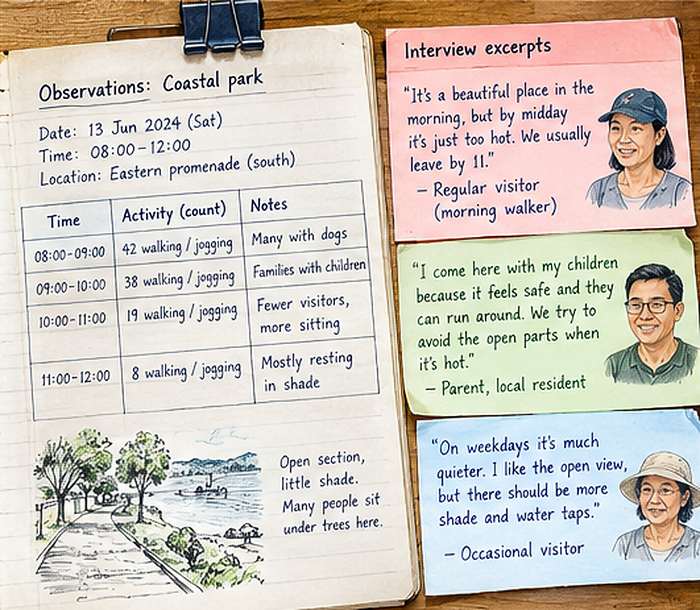
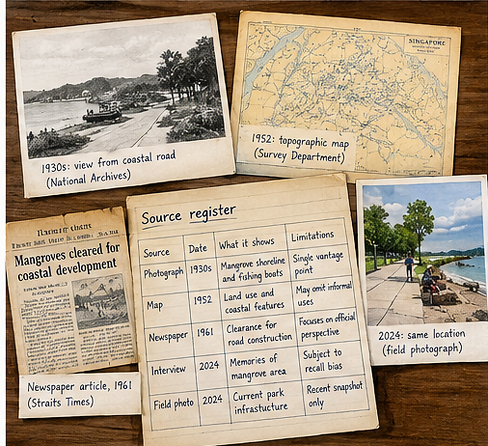
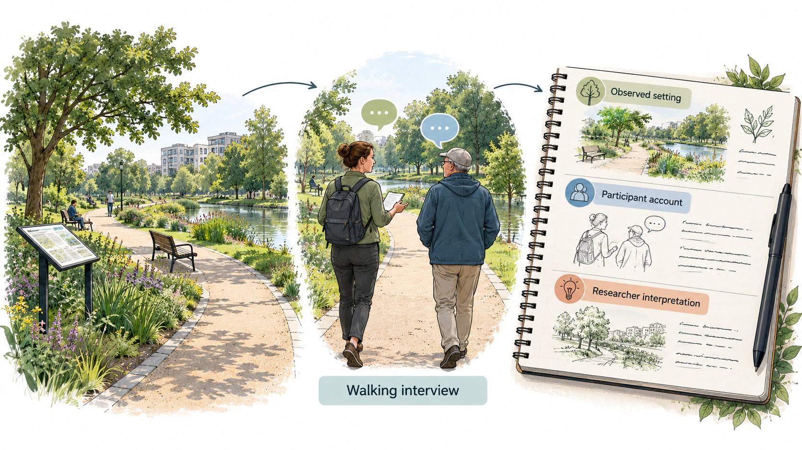
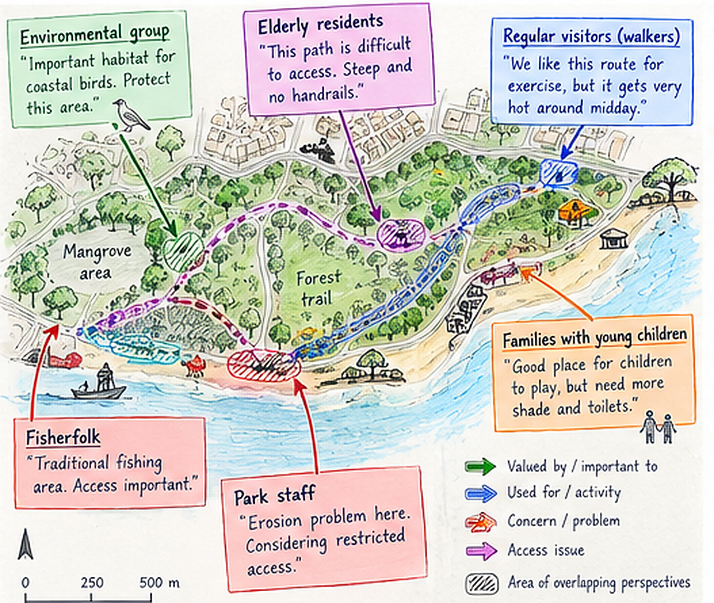
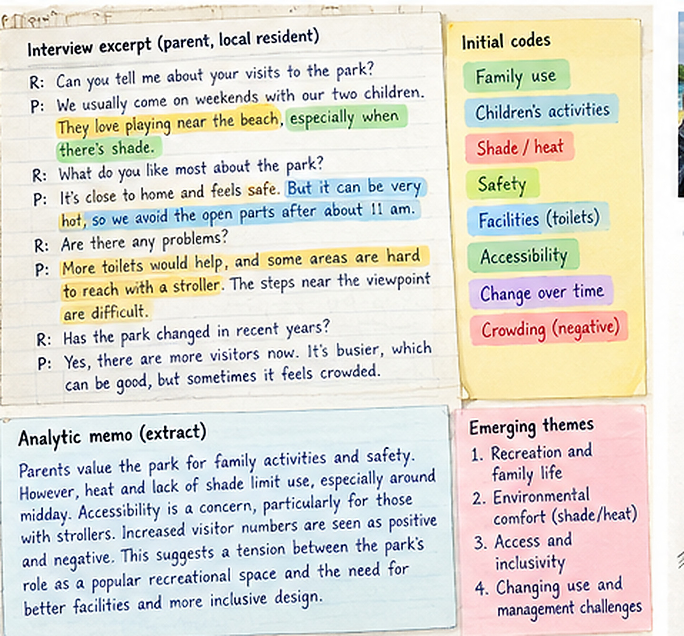
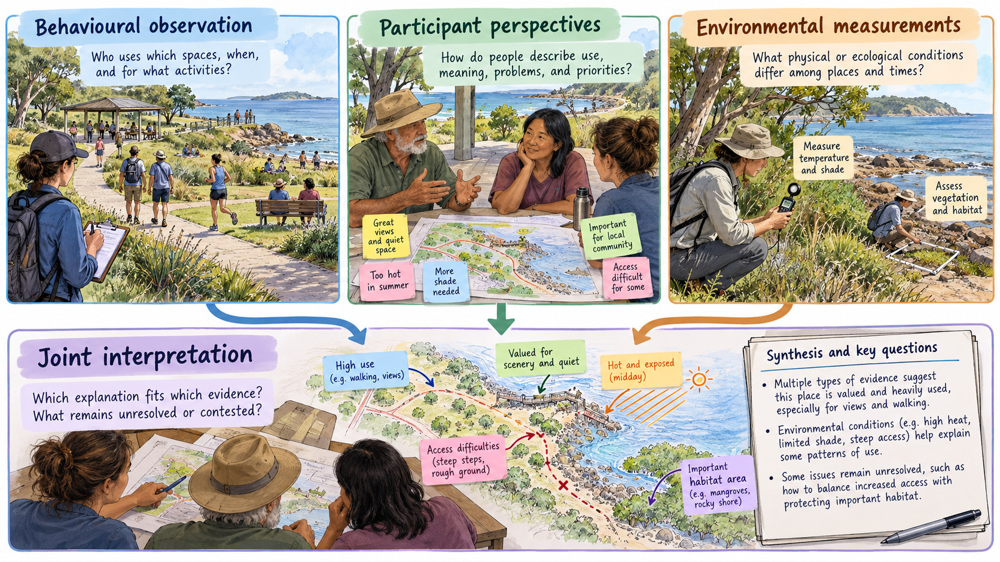

<!-- Chapter 11 v3: prose in Markdown; tables, interactive controls, figures -->
<!-- and already-formatted bibliography retained as HTML from reviewed source. -->

## 11.1 From observed patterns to understanding experiences, practices and social processes {#ch11-s111}

In Chapter 10, we investigated how observations about people's behaviour, experiences and preferences can be collected systematically through activity counts, questionnaires and other quantitative methods. Imagine that you have conducted a study of how people use different parts of an urban park. You may have found that a wooded path is used less frequently than a more open route, or that visitor numbers vary substantially throughout the day. These observations establish patterns in park use, but what explains them? Perhaps people avoid the wooded path because it is difficult to access, because they are uncertain where it leads, or because they feel uncomfortable in the enclosed vegetation. Alternatively, the path may simply connect fewer places that visitors want to reach. Each explanation suggests a different reason for the observed pattern, with different implications for how the park might be managed. You might also have conducted a questionnaire investigating people's preferences for different forms of vegetation management and found that many respondents prefer more natural-looking greenery. But what do they mean by *natural*? Some may associate it with spontaneous vegetation growth and greater biodiversity, others with large trees and comfortable shade, and still others with a landscape that looks relatively undisturbed but remains carefully maintained. Respondents giving the same answer may therefore have rather different environments in mind. The survey results can provide valuable information about the distribution of reported preferences, but understanding what those preferences involve, how they develop and how they might influence people's behaviour requires us to investigate these differences more closely. We could do so by talking with park users about their experiences, asking them to describe particular locations or accompanying them as they walk through the park. Their explanations might reveal influences on park use that we had not considered when designing our original study. For example, we might discover that some visitors avoid the wooded path not because they dislike dense vegetation but because they cannot see where the path leads. Others may appreciate the shaded environment but find its uneven surface difficult to negotiate. We could compare these accounts with our own observations, investigate whether other visitors describe similar experiences, and examine whether the proposed explanations are consistent with the physical characteristics and observed use of the locations. In this way, qualitative research can help us develop a more complete understanding of the processes underlying the patterns we initially observed.

You may have encountered the idea that quantitative research produces more objective evidence because its observations and analyses are expressed numerically, whereas qualitative research relies more heavily on people's subjective accounts and researchers' interpretations. However, as we have seen throughout this book, numerical measurements also involve decisions about what to measure, how to measure it, whom to sample and how to interpret the results. Similarly, qualitative research involves methodological decisions that affect the evidence collected and the conclusions that can be drawn from it. Consider, for example, the explanations people give for avoiding a particular park location. We need to consider whom we interviewed, whether our questions encouraged particular answers, whether different participants give similar or conflicting accounts, and how their explanations relate to other available evidence. Careful attention to these decisions, and to the possibility that our initial interpretation may be incorrect, is what makes qualitative research systematic and its conclusions well supported.

This also connects to the conceptual frameworks introduced in Chapter 2. When we investigate a socio-environmental system, we try to understand the processes and relationships through which environmental conditions, people's decisions and their activities influence one another. Qualitative research can contribute to constructing and revising such a framework. Interviews, observation and other approaches may identify relationships that were missing from our initial understanding of the system, clarify how people respond to environmental conditions, or reveal that different groups respond in different ways. These insights can guide subsequent quantitative research, for example by identifying additional variables to measure, suggesting comparisons between groups or locations, or generating predictions that can be investigated through systematic sampling. In turn, quantitative findings may raise new questions that benefit from qualitative investigation.

Throughout the chapter, the urban park investigated in Chapter 10 provides a continuing example, alongside published studies of community gardens, mangroves and urban green spaces. Imagine, for example, that two visitors both give the wooded path a low comfort rating. One finds that it requires a long detour from a bus stop; the other avoids enclosed vegetation at dusk because they cannot see who might be approaching. The numerical responses are identical, but their accounts suggest different processes and, potentially, different responses from park managers. If we want to know how widespread either concern is, we must also establish whom we asked and how respondents were selected. Qualitative and quantitative evidence can thus inform one another, with interviews revealing distinctions that a questionnaire had not anticipated and systematically collected observations helping us examine where and when those distinctions arise [[(Newing et al. 2011](#ref-newing2011); [Bernard 2018)](#ref-bernard2018)]{.citation cites="newing2011 bernard2018"}. Figure 11.1 shows how the chapter's methods and analytical questions connect; it is not a prescribed research sequence. If you want to develop your own investigation, the interactive Method guide in Section 11.12 will help you explore those choices after you have worked through the examples and explanations in the chapter.

<figure>

<figcaption aria-hidden="true">Figure 11.1. Overview of the chapter’s
questions and methods, from choosing whose experiences to investigate
and collecting different kinds of evidence to analysing and evaluating
interpretations, combining sources and using the interactive Method
guide. The connections are iterative: what we learn may change
subsequent recruitment, observations and explanations.</figcaption>
</figure>

<section class="ch11-exercise" id="ch11-exercise-1"><h4>Test your understanding 11.1 · Match the claim to the evidence</h4>

Choose a suitable primary approach for each question: (i) What
fraction of nearby residents support reduced mowing? (ii) Why do some
visitors describe wooded areas as peaceful while others describe them as
unsafe? (iii) How do maintenance staff decide which informal paths to
clear? (iv) How have residents’ memories of a mangrove area changed
across generations? For each, identify a possible unit of inquiry and
what the method would record. Explain when interviews could complement,
but not replace, a population survey.

<label for="ch11-exercise-1-answer">Your reasoning</label><textarea id="ch11-exercise-1-answer" placeholder="Write a short explanation before revealing the suggested response." rows="4"></textarea>
0 words<button aria-expanded="false" class="ch11-reveal" disabled="" type="button">Show suggested response</button>

For (i), the quantity sought is the proportion of *nearby residents* who support reduced mowing. A defined residential population and a survey sampling strategy are needed if the result is to be used as an estimate for that population. The unit is an eligible resident, or perhaps a household if the question is explicitly about households; a questionnaire would record an operationally defined response, ideally after piloting what “reduced mowing” means. Interviews with a smaller, deliberately varied group could help us understand what residents imagine when they hear the term, including whether it implies wildflowers, untidiness, pests or a loss of play space. They would improve the survey questions but could not by themselves establish the population percentage. For (ii), we need to understand different interpretations of the same wooded setting. The primary units could be individual visits and participants' accounts of those visits. Semi-structured interviews, preferably with a walk through the site for some participants, would explore when and where the experience occurred, what features participants noticed, and whether darkness, visibility, previous incidents or companions shaped the assessment. Observations and measurements of route conditions might help test interpretations, but a reported feeling of insecurity is not itself a measurement of actual risk. For (iii), maintenance *decisions and practices* are the focus. Interviews with staff can elicit stated responsibilities and criteria; observation of maintenance work and examination of work orders can show how decisions are implemented under constraints of staffing, safety and institutional rules. The unit might be a clearing decision or maintenance episode, not merely a staff member. Official policies alone may not explain day-to-day decisions. For (iv), oral-history interviews with people who knew the mangrove at different stages, together with dated photographs, maps and archival records, can reconstruct remembered uses and environmental changes. Here the units include individual recollections, documentary records and identifiable historical events. Memories from different age groups are not a repeated population survey, so a change in the accounts does not automatically demonstrate a shift in the prevalence of values across generations. In all four cases, a different approach could be appropriate if we changed the claim we wanted to make: the method must be chosen to produce evidence for that claim, not simply because the topic concerns people.

<noscript>

Suggested response (available without JavaScript)

For (i), the quantity sought is the proportion of *nearby residents* who support reduced mowing. A defined residential population and a survey sampling strategy are needed if the result is to be used as an estimate for that population. The unit is an eligible resident, or perhaps a household if the question is explicitly about households; a questionnaire would record an operationally defined response, ideally after piloting what “reduced mowing” means. Interviews with a smaller, deliberately varied group could help us understand what residents imagine when they hear the term, including whether it implies wildflowers, untidiness, pests or a loss of play space. They would improve the survey questions but could not by themselves establish the population percentage. For (ii), we need to understand different interpretations of the same wooded setting. The primary units could be individual visits and participants' accounts of those visits. Semi-structured interviews, preferably with a walk through the site for some participants, would explore when and where the experience occurred, what features participants noticed, and whether darkness, visibility, previous incidents or companions shaped the assessment. Observations and measurements of route conditions might help test interpretations, but a reported feeling of insecurity is not itself a measurement of actual risk. For (iii), maintenance *decisions and practices* are the focus. Interviews with staff can elicit stated responsibilities and criteria; observation of maintenance work and examination of work orders can show how decisions are implemented under constraints of staffing, safety and institutional rules. The unit might be a clearing decision or maintenance episode, not merely a staff member. Official policies alone may not explain day-to-day decisions. For (iv), oral-history interviews with people who knew the mangrove at different stages, together with dated photographs, maps and archival records, can reconstruct remembered uses and environmental changes. Here the units include individual recollections, documentary records and identifiable historical events. Memories from different age groups are not a repeated population survey, so a change in the accounts does not automatically demonstrate a shift in the prevalence of values across generations. In all four cases, a different approach could be appropriate if we changed the claim we wanted to make: the method must be chosen to produce evidence for that claim, not simply because the topic concerns people.

</noscript></section>

## 11.2 Interviews: investigating experiences and explanations {#ch11-s112}

You probably have a reasonable idea of what an interview involves, even if you have never conducted one yourself. We ask someone questions about a particular subject, listen to their answers and often ask further questions to understand what they mean. In research, however, we want to use those conversations to answer specific questions about the system we are studying. This requires some preparation. We need to consider whom to interview, what we want to learn from them, how to formulate questions that allow them to explain their experiences, and how we will record and subsequently interpret their answers. The person being interviewed brings their own knowledge, memories, experiences and interests, but the interviewer also influences the conversation through the questions asked, the order in which topics are introduced and the way responses are followed up. For example, asking someone whether they avoid a wooded path because they feel unsafe may lead to a quite different conversation from asking them to describe how they decide which route to take through the park. This does not mean that interviews provide unreliable information, but it does mean that we need to think about how the interview itself influences the explanations we obtain.

There are different ways of organising interviews, depending on what we want to investigate. A **structured interview** follows a largely predetermined set of questions, often with standardised response options. This makes it easier to compare answers across many participants and is similar to an interviewer-administered questionnaire. A **semi-structured interview** also uses a prepared set of questions or topics, but allows the interviewer to change their sequence, ask additional questions and follow up on unexpected information. For example, we might want to discuss park use, accessibility, comfort and vegetation preferences with every participant, while leaving room for each person to describe experiences that we had not anticipated. In a more **open or narrative interview**, the participant has greater freedom to decide what to discuss and how to organise their account. We might ask someone who has lived near a coastal park for several decades to describe how the area and its uses have changed during their lifetime, allowing them to identify events and experiences that they consider important. These approaches are not entirely separate categories. Interviews can differ in how closely they follow predetermined questions, how much freedom participants have to introduce new topics, and how extensively particular experiences are explored. The appropriate degree of structure depends partly on whether we already know which questions we need to ask and partly on how much we want to discover about experiences and processes we do not yet understand.

Designing and conducting an interview that provides useful evidence is not necessarily straightforward. We usually want enough consistency across interviews to compare what different people tell us, while also allowing individual participants to explain their experiences in their own terms. Consider again our investigation of how people use different parts of an urban park. We might begin by asking someone to describe their most recent visit: where they went, which places they stopped at and what influenced their choices. This provides a concrete starting point, and the interviewer can then ask further questions about particular decisions or experiences. If the participant mentions that they avoided a wooded path, we could ask what made them decide against using it. Perhaps they did not know where it led, found it difficult to walk on, or were simply going somewhere else. We would learn rather less by immediately asking, 'Do you avoid the wooded path because it feels unsafe?' That question assumes that they avoid the path and introduces a particular explanation before we know whether it is relevant. Similarly, asking whether someone prefers shaded areas may tell us something about their stated preference, but asking them to describe where they went during a recent visit may reveal how shade influences their choices in relation to other considerations, such as accessibility, destinations or the activities they intended to undertake. We can still ask directly about shade later in the interview, particularly if it is important to our research question. The point is to give participants an opportunity to describe their experiences before we introduce all our own possible explanations.

When preparing an interview, we therefore need to think not only about the questions we intend to ask, but also about how the conversation might develop. In a semi-structured interview, an interview guide can identify the main topics that should be discussed with every participant, together with possible follow-up questions. For the park study, we might include questions about recent visits, commonly used routes, places people particularly appreciate or avoid, and how their use of the park varies with time of day or weather. Within each topic, we can prepare prompts that help participants provide more detail: when did something happen, what were the circumstances, who was involved, and has their experience changed over time? At the same time, we need to listen carefully enough to recognise when an answer introduces something we had not considered. Someone may unexpectedly mention that they no longer visit a particular area because maintenance activities have changed the paths, or that their preferences differ depending on whether they come alone or with children. These observations may suggest additional questions worth asking other participants, or new relationships to consider in our understanding of the park. We should therefore test the interview guide before using it for the main study. A few pilot interviews can reveal questions that are difficult to understand, terms that different people interpret differently, or topics that are important to participants but missing from our guide. They also help us practise following up on answers without repeatedly directing participants towards explanations we already have in mind.

As with other field methods, the circumstances in which interviews are conducted affect the information we collect. Interviewing someone beside a busy path may be convenient, but background noise, interruptions or the presence of other people may make it difficult for them to explain their experiences freely. An interview conducted in a quiet and comfortable location may allow a more extensive conversation, although it may also be less convenient for some participants. Language is another consideration. People may be better able to explain their experiences in a language with which they are familiar, and translation may be necessary when the researcher and participant do not share that language. We also need to decide how to record the interview. With appropriate consent, an audio recording can preserve much of what was said and allow the interviewer to concentrate on the conversation. Recordings can be transcribed manually or with software, including automated transcription tools, but the resulting transcripts need to be checked because names, unfamiliar terms, accents and overlapping speech can produce errors. Field notes remain useful even when recordings are available. They can document the location and circumstances of the interview, relevant observations that are not captured in the audio, interruptions, and questions that arose during the conversation. These details can become important when interpreting a participant's account. For example, someone's statement that a park location is 'usually quiet' may need to be understood in relation to when they normally visit, particularly if the interviewer has observed quite different conditions at other times.

Finally, we need to recognise that people's experiences, willingness to participate and ways of explaining themselves vary considerably. Two people who regularly visit the same park may use it for different purposes and encounter different conditions. Their experiences may also depend on age, mobility, familiarity with the park, the activities they undertake and the times at which they visit. Some of this variation is precisely what we want to understand. But the circumstances of recruitment and interviewing can introduce additional differences. Some people may be comfortable discussing their experiences with a university researcher, while others may be reluctant, unsure why the information is being collected or concerned about possible consequences of what they say. Someone approached through a park authority may respond differently from someone recruited independently. We should be aware of these influences when interpreting similarities and differences among interviews. Where possible, the sampling design can deliberately include people with contrasting experiences, while our interview records should help us understand the circumstances under which different accounts were obtained. We cannot anticipate or control every influence, nor can we assume that speaking with several people from the same nominal group adequately captures the variation within it. This connects to the principles of sampling and variability discussed earlier in the book: we need to consider which differences are relevant to our research question, which our design allows us to investigate, and which may remain poorly represented. The next section develops how participants can be selected to explore such variation, including experiences and perspectives that would be difficult to reach through a survey of current park users alone. For fuller treatment of how interview questions, relationships and transcription influence the evidence, see Brinkmann and Kvale [[(2014)](#ref-brinkmannkvale2014)]{.citation cites="brinkmannkvale2014"}.

Box 11A · An interview-guide prototype for park experience

<strong>Research purpose.</strong> Understand why visitors choose or
avoid differently managed park settings and what they mean by comfort or
naturalness. <strong>Eligibility.</strong> People with relevant recent
experience; the broader question may also require a separate group of
non-visitors.

<strong>Opening.</strong> ‘Can you tell me about a recent visit to
this park? Where did you go, and what did you do?’ Allow the account to
develop before asking for reasons.

<strong>Probe for choices.</strong> ‘What influenced your route?’
‘Were there places you chose not to use?’ ‘How does that compare with
other visits?’ Ask for examples if the account remains abstract.

<strong>Probe for interpretation.</strong> ‘You described that area
as natural. What made it feel natural to you?’ ‘Would another part of
the park fit that description?’ Avoid presupposing that one meaning is
scientifically correct.

<strong>Probe for management change.</strong> ‘Have you noticed
changes in the vegetation or maintenance?’ ‘What difference, if any,
have those changes made to your experience?’ The respondent may not have
noticed a change; do not push for a causal story.

<strong>Closing.</strong> ‘Is there something important about your
use of the park that my questions have not covered?’ Document the
setting, date, conditions and any analytic memo without unnecessarily
recording identifiable details.

<strong>Quality check.</strong> Does each question invite an account?
Is it understandable without specialist vocabulary? Is the interview
long enough to develop examples, yet short enough to respect
participants’ time? Are consent and permissions in place?

<strong>Further reading.</strong> Brinkmann and Kvale (2014) provide a specialist account of interview design, follow-up questioning and the interpretation of what interview conversations produce.

<figure>

<figcaption aria-hidden="true">Figure 11.2. Illustration of the
different evidence provided by systematic observations and interviews
about a common park setting. Recorded counts show how activity varies
during sampled periods, while participants’ descriptions suggest
experiences and possible explanations to investigate
further.</figcaption>
</figure>

## 11.3 Selecting participants and investigating variation among experiences {#ch11-s113}

The interviews discussed in the preceding section will be informative only if the people we speak with have experiences relevant to what we want to understand. Chapter 5 introduced the relationship between sampling, variation and inference: the units we select affect which differences become visible to us. That principle also applies here, although in qualitative research our immediate aim may be to examine how different experiences arise and what they mean, rather than to estimate how frequently a view occurs in a population. Suppose the question is why people avoid the wooded path. Interviewing ten convenient passers-by at one entrance may give us ten detailed accounts, but it may also repeatedly expose us to people with very similar routines. We need to consider which experiences may be absent and why they are important for understanding the observed pattern. This is the logic of *purposive* (or *purposeful*) sampling: selecting participants or cases because of what they can contribute to a particular inquiry. Established discussions of interview sampling describe both systematic selection across relevant categories and adjustments made as analysis develops [[(Robinson 2014](#ref-robinson2014); [Palinkas et al. 2015)](#ref-palinkas2015)]{.citation cites="robinson2014 palinkas2015"}.

Consider a more specific question: **How and why do park use and people's experiences differ among younger adults, adults visiting with young children and older adults, and how do these differences vary between morning, afternoon and evening?** Figure 11.3 illustrates one possible way of thinking about whom to interview. Its rows distinguish three broad categories of park users, while the columns distinguish periods that may differ in temperature, routine activities, available time, light conditions and who is present. The small scenes suggest possible uses of the park, not findings that we already know to be true. By considering the combinations, we can make more deliberate choices about whom to approach and when, instead of allowing our interview sample to consist mainly of whoever happens to be there during our own convenient fieldwork hours.

<figure>

<figcaption aria-hidden="true">Figure 11.3. An illustrative example of
selecting interviewees across three broad groups of park users and three
periods of the day. Each scene suggests a possible encounter or
activity; the figure does not depict observed frequencies or imply that
these groups invariably use the park in the ways shown. The categories
provide a way of considering which experiences may be missing from an
initial set of interviews. A different research question might lead us
to compare other groups or conditions, including frequent and occasional
visitors, different park areas, or weekdays and weekends.</figcaption>
</figure>

Why might comparisons along both dimensions be informative? People who belong to the same broad category but visit at different times may represent different **subgroups**. Younger adults passing through the park before work may have different purposes, opportunities and constraints from those arriving to play sport in the evening. Adults with young children encountered during school hours may likewise differ from those able to visit only after work. The time of day can also alter an individual's experience even when the person remains the same: an open lawn that seems attractive during a cool morning may feel uncomfortable on a hot afternoon, while the reasons for visiting, companions, fatigue or mood may change. Finally, time and group characteristics may interact. Afternoon heat could affect someone supervising young children differently from a person exercising alone. These are possibilities to investigate, rather than assumptions the categories allow us to confirm in advance. Depending on what participants tell us, factors such as mobility, familiarity, employment schedules or whether people visit alone may turn out to distinguish experiences more clearly than age.

The distinction between **different people observed at different times** and **the same person's changing experience** deserves attention. If older adults interviewed in the morning describe the park differently from older adults interviewed in the evening, we cannot automatically attribute the contrast to time of day. It might reflect who is available to visit at each time, the conditions under which their visits occur, or a combination of these influences. To investigate changes within individuals, we could ask how they experience the park during visits at different times, accompany some of them on more than one occasion, or arrange repeat interviews. None of these choices is automatically preferable. They give access to different kinds of evidence, and the study question determines which comparison is useful. We should also remember that interviews conducted **inside** the park systematically exclude people who cannot or do not visit. If their reasons for staying away concern accessibility, safety or competing responsibilities, omitting them may remove precisely the experiences needed to understand the system.

This is an illustrative sampling choice, not a universal design for qualitative interviewing. It does not require the same number of interviews in every cell, or even an interview in every combination. In qualitative research, we may seek a diversity of accounts because the differences themselves can help us develop and evaluate explanations. The matrix is simply a way of thinking through variation we suspect may be relevant, making recruitment more deliberate and transparent. Researchers describe related approaches as *maximum-variation sampling* when they deliberately seek a broad range of experiences, or *stratified purposive sampling* when recruitment is organised across selected characteristics [[(Robinson 2014](#ref-robinson2014); [Palinkas et al. 2015)](#ref-palinkas2015)]{.citation cites="robinson2014 palinkas2015"}. These are established approaches, but their usefulness depends on the inquiry. A study of how maintenance decisions are made might instead interview gardeners, contractors, volunteers and managers, selecting people according to their role in a decision process rather than their age or time of park visit.

Talal, Santelmann and Tilt [[(2021)](#ref-talal2021)]{.citation cites="talal2021"} investigated visitors' vegetation preferences through on-site semi-structured interviews in **15 parks in Portland, Oregon**, chosen across three park types. To consider possible variation associated with when people visited, their fieldwork covered different days of the week, including weekend days, and morning, afternoon and evening periods across the park types. Participants were then approached on site according to their proximity to different areas of each park, rather than being recruited into predetermined demographic cells. The authors also used preliminary visits and conversations to revise the interview questions. Their choices illustrate two connected aspects of research design: planning fieldwork so that particular circumstances are not inadvertently omitted, and allowing what is learned in the field to improve the investigation. The study does not establish that time of day caused particular preferences, but it takes seriously the possibility that the people encountered and the conditions they experience vary across visits.

We can also revise our own selection during fieldwork. Imagine that our first interviews suggest poor visibility is the main reason people avoid the wooded path. A later participant says she uses it during the afternoon but avoids it during morning delivery activity; another person cannot enter because a short flight of steps blocks wheelchair access. These accounts indicate that *avoiding the path* may result from several different processes. Continuing to recruit only people who mention visibility would confirm our initial expectations by design. We could instead look for people using the path at different times, people choosing the alternative route, those affected by access barriers and staff familiar with maintenance practices. Other forms of purposive selection might focus on people who have experienced a particular management change (*criterion sampling*) or people whose accounts appear to contradict an emerging interpretation (*negative or contrasting cases*). Network or snowball recruitment can also help us reach less visible participants, although relying on a single social network may exclude others. As we expand or revise the sample, we should record the reasons for doing so and remain within the permissions and consent arrangements of the study [[(Palinkas et al. 2015)](#ref-palinkas2015)]{.citation cites="palinkas2015"}.

How many people should we interview? The formula used to estimate sampling uncertainty for a population proportion cannot tell us whether we have explored the range of experiences and explanations relevant to a qualitative question. You may encounter the term *saturation*, meaning that additional material no longer contributes relevant information to a specified analysis, but the interpretation and usefulness of that idea depend on the kind of qualitative study. Malterud, Siersma and Guassora [[(2016)](#ref-malterud2016)]{.citation cites="malterud2016"} propose thinking instead about *information power*: how much relevant information participants provide depends on the specificity of the question and sample, existing theory, the quality of interviews and the intended analysis. A study of a narrowly defined experience may need fewer participants than one investigating very different groups and contested accounts. We should describe whom we attempted to reach, whose experiences were included, which contrasts were pursued, how and why the sample changed, and which perspectives may still be missing. Twelve carefully selected participants can help explain how a process operates under particular conditions; those twelve interviews do not, by themselves, show what proportion of all residents share a particular view. If estimating prevalence is part of the research question, we need to design an appropriate quantitative component alongside the qualitative investigation.

<section class="ch11-exercise" id="ch11-exercise-3"><h4>Test your understanding 11.2 · Who would you interview, and when?</h4>

You have observed that visits to the wooded path are fewer at midday. Start with the three-by-three example in Figure 11.3 and explain which combinations you would investigate first, given your initial hypotheses. Then identify one important perspective the matrix would miss, and explain how you could reach it. How would your design change if interviews suggested mobility, rather than age, was the main source of contrasting experiences? Finally, what additional observations would be necessary to distinguish differences among people from changes in the same individual's experience across the day?

<label for="ch11-exercise-3-answer">Your reasoning</label><textarea id="ch11-exercise-3-answer" placeholder="Write a short explanation before revealing the suggested response." rows="4"></textarea>
0 words<button aria-expanded="false" class="ch11-reveal" disabled="" type="button">Show suggested response</button>

I would begin with adults with young children and older adults encountered at midday and in the cooler morning or evening, because shade, heat exposure, mobility and the need to supervise others are plausible explanations for avoiding the wooded path. I would also recruit younger adults during both commuting and leisure periods so that differences in the reason for visiting do not become confused with a simple age contrast. I would not allocate equal numbers mechanically to all nine cells: I would keep a record of which combinations have been reached and of the emerging contrasts, and I would shift recruitment toward experiences that are still poorly understood. A key omission is people who live nearby but seldom or never enter the park. They cannot be recruited through an on-site intercept interview and might be reached through neighbourhood organisations or an appropriately designed household recruitment strategy. Another omission could be park staff, whose knowledge concerns maintenance rather than visitor comfort. If I found that some older interviewees describe the path as unsafe only at dusk, I would investigate whether evening visitors are different people from morning visitors or whether the same individuals report changing experiences. Repeated visits or interviews with the same people could distinguish these possibilities better than interviews with entirely different respondents. The resulting material would help us understand plausible mechanisms and variation in experiences, not estimate how common each explanation is among all residents.

<noscript>

Suggested response (available without JavaScript)

I would begin with adults with young children and older adults encountered at midday and in the cooler morning or evening, because shade, heat exposure, mobility and the need to supervise others are plausible explanations for avoiding the wooded path. I would also recruit younger adults during both commuting and leisure periods so that differences in the reason for visiting do not become confused with a simple age contrast. I would not allocate equal numbers mechanically to all nine cells: I would keep a record of which combinations have been reached and of the emerging contrasts, and I would shift recruitment toward experiences that are still poorly understood. A key omission is people who live nearby but seldom or never enter the park. They cannot be recruited through an on-site intercept interview and might be reached through neighbourhood organisations or an appropriately designed household recruitment strategy. Another omission could be park staff, whose knowledge concerns maintenance rather than visitor comfort. If I found that some older interviewees describe the path as unsafe only at dusk, I would investigate whether evening visitors are different people from morning visitors or whether the same individuals report changing experiences. Repeated visits or interviews with the same people could distinguish these possibilities better than interviews with entirely different respondents. The resulting material would help us understand plausible mechanisms and variation in experiences, not estimate how common each explanation is among all residents.

</noscript></section>

## 11.4 Reconstructing environmental change through memories and historical records {#ch11-s114}

An interview can also help us investigate environmental changes that took place before our fieldwork. Imagine that we want to understand how a coastal neighbourhood's relationship with mangroves has changed. Older residents might recall fishing, walking through tidal channels or collecting food where a road and seawall now stand. Their accounts could tell us about activities, places and relationships that do not appear in a contemporary land-cover map. But how do we distinguish what happened at a particular date from what those places meant to the people remembering them? We would ask participants to describe a specific journey or activity, locate it as carefully as possible, and relate it to events they remember, while also examining historical maps, photographs and administrative records. This allows us to investigate environmental and social change without treating every recollection as a precise measurement of the past.

Suppose one resident remembers access ending when a road was built, while another remembers still walking to the shore several years afterwards. The disagreement is not necessarily a choice between a correct and an incorrect witness. A road may have blocked one route while another remained passable, or the participants may be remembering different sections of the coast. We could mark the locations on historical maps, check when photographs show a new road alignment and ask what each person meant by *access*. We might find that the sources refer to different stages of a gradual change. The exercise also reveals why the circumstances in which records were produced are important. A planning map can establish what was proposed but does not necessarily show when construction began; an aerial photograph shows a landscape at one recorded moment but cannot tell us how residents understood it. An oral account may be uncertain about dates while providing detailed evidence of routine practices and personal significance. We would therefore preserve both the account and the independent record, noting what we can and cannot conclude from their comparison.

A published Singapore example shows what this kind of investigation can contribute. [[Thiagarajah et al. (2015)](#ref-thiagarajah2015)]{.citation cites="thiagarajah2015"} examined changes in the cultural values associated with mangroves using archival photographs and previously recorded oral histories alongside contemporary photographs and interviews. The archival oral histories described relationships with mangrove environments rooted in everyday life, place and heritage; more recent material emphasised, among other things, recreation and education. This comparison makes changes in how people encounter and represent mangroves visible, but it does not establish that every Singaporean shared one set of values in the past and another today. The historical archive contains material that was selected, collected and preserved for particular reasons, while contemporary online photographs depend on who takes and shares pictures. The researchers' use of several kinds of evidence is instructive precisely because each adds information while having a different selection process and interpretive scope.

If you use records of earlier environments, keep track of who created each record, for what purpose, the period and location it covers, and what or whom it leaves out. Before asking whether two records agree, establish what each is actually recording. For students interested in the detailed conduct of oral-history interviews or archival research, the [Method guide](#ch11-s1112) provides routes into more specialised reading. Our purpose here is to recognise how historical sources open up questions about environmental change that present-day measurements alone cannot answer.

<figure>

<figcaption aria-hidden="true">Figure 11.4. Illustration of examining
historical and contemporary materials alongside a source register. Who
produced a record, why it was created and what it preserves or omits are
central to its interpretation.</figcaption>
</figure>

Box 11B · Comparing a remembered change with historical records

Imagine that a resident recalls that the shoreline became inaccessible “after the big flood”, while another remembers a new road blocking the former footpath. Place these accounts in separate rows of a working timeline, recording the event as described, the approximate date and what anchors each recollection. Alongside the accounts, enter a dated road plan, an aerial photograph and any accessible flood or maintenance records. The date of the road plan may establish when construction was authorised without establishing when the footpath stopped being usable; the photograph may show a physical barrier but not the social significance of the route.

Rather than selecting the earliest date as the correct answer, the researcher can return to participants to ask which section of the path they used, whether the road and flood affected different access points, and whether “closed” means legally prohibited or physically difficult. This may lead to a sequence of changes, or leave an unresolved disagreement. In either case, the timeline helps keep each inference attached to the source that supports it. It does not require the sources to agree, and it does not transform a few recollections into a population estimate.

<strong>Further reading:</strong> <a class="ch11-citation" href="#ref-thiagarajah2015">thiagarajah2015</a> provides a Singapore example of comparing historical and contemporary evidence for cultural values; <a class="ch11-citation" href="#ref-newing2011">newing2011</a> discusses qualitative and historical research approaches in conservation.

<section class="ch11-exercise" id="ch11-exercise-extra-11D"><h4>Test your understanding 11.3 · Does the archive show a change in values?</h4>

The archive contains many references to cultural heritage and the contemporary photograph collection contains mostly recreation scenes. What is supported directly by this comparison? What additional evidence would strengthen a claim about changes in people’s values?

<label for="ch11-exercise-extra-11D-answer">Your reasoning</label><textarea id="ch11-exercise-extra-11D-answer" placeholder="Write your answer before seeing the suggested response." rows="4"></textarea>
0 words<button aria-expanded="false" class="ch11-reveal" disabled="" type="button">Show suggested response</button>

The collections directly support a narrower statement: *different kinds of cultural values are represented in the archival material and the contemporary photographs*. They do not establish that the historical population valued cultural heritage more, or that modern residents value only recreation. Institutional archives may preserve ceremonial events, land-use disputes and historically notable places disproportionately; contemporary photographs may be taken and shared because leisure activities are visually appealing. We should first document who created the records, the periods and locations represented, how each collection was assembled and whether a single contributor supplied many items. We could then seek additional, more comparable evidence—for example, repeated local newspaper coverage, management documents over several periods, oral histories that ask about particular uses and places, and interviews with contemporary residents using similar prompts. Even then we should distinguish remembered historical activities from currently reported values and explain whose experiences remain missing. A plausible alternative interpretation is not a historical change in the values themselves but a change in the practices of documentation. The comparison is therefore valuable for generating questions about changing relationships with mangroves, while direct claims about population-level change would require stronger and more comparably produced evidence.

<noscript>

Suggested response

The collections directly support a narrower statement: *different kinds of cultural values are represented in the archival material and the contemporary photographs*. They do not establish that the historical population valued cultural heritage more, or that modern residents value only recreation. Institutional archives may preserve ceremonial events, land-use disputes and historically notable places disproportionately; contemporary photographs may be taken and shared because leisure activities are visually appealing. We should first document who created the records, the periods and locations represented, how each collection was assembled and whether a single contributor supplied many items. We could then seek additional, more comparable evidence—for example, repeated local newspaper coverage, management documents over several periods, oral histories that ask about particular uses and places, and interviews with contemporary residents using similar prompts. Even then we should distinguish remembered historical activities from currently reported values and explain whose experiences remain missing. A plausible alternative interpretation is not a historical change in the values themselves but a change in the practices of documentation. The comparison is therefore valuable for generating questions about changing relationships with mangroves, while direct claims about population-level change would require stronger and more comparably produced evidence.

</noscript></section>

## 11.5 Observing practices in their social and environmental settings {#ch11-s115}

Interviews tell us how people describe what they do and why, but the practices themselves often need to be observed. Suppose we want to know why a community garden has sharply defined planting beds, cleared paths and little spontaneous vegetation. We could ask gardeners what they like about its appearance, but we might also visit on an ordinary maintenance day, watch how they decide what to remove and note when that decision is questioned. If one gardener clears vegetation after receiving a reminder from an organiser, that observation leads us to ask about institutional expectations as well as personal preferences. A photograph of the finished garden would not show the interaction that produced its appearance. By observing practices as they occur, then discussing them with the people involved, we can investigate relationships among environmental conditions, decisions, routines and authority.

It is important to understand the difference between **descriptive field notes** and **analytic or interpretive memos**. In the notes from the garden visit, we might record the time, the activity and the words used during the exchange, separating what we observed from what someone subsequently told us. An interpretive memo would address what we think the exchange means. We might propose that gardeners clear vegetation partly because they anticipate a judgement about tidiness. That is an interpretation to be investigated through other visits, interviews and rules or correspondence, not an observation we have already verified. Notes become much less informative if we write only that a gardener was 'following institutional pressure', because we can no longer see what happened or examine another explanation. Recording ordinary occasions as well as special events also helps us understand whether an observed practice is routine or exceptional [[(Hammersley and Atkinson 2019; Newing et al. 2011)](#ref-hammersley2019)]{.citation cites="hammersley2019 newing2011"}.

A study of Singapore community gardens by [[Montefrio, Lee and Lim (2021)](#ref-montefrio2021)]{.citation cites="montefrio2021"} gives this reasoning a concrete social context. It describes the **aesthetic politics** of gardening: expectations concerning the order and beauty of cultivated spaces operate through formal authority and through judgements that circulate among different actors. Gardeners do not simply reproduce these expectations; they may negotiate them or resist them in their everyday practices. The relevant question is therefore larger than whether gardeners personally prefer neat vegetation. It concerns how urban expectations, regulation and gardeners' own purposes shape what happens on the ground. We can use this study to consider why seeing the garden, hearing gardeners' explanations and understanding the institutional setting can contribute different evidence to an interpretation (see [Box 11C](#ch11-box-11C)).

Box 11C · Singapore community gardens: aesthetic expectations and negotiated practice

Suppose that, during a gardening session, one gardener removes vegetation between planting beds after another draws attention to the path. A descriptive field note could record the sequence of actions and the words exchanged, including any uncertainty about what was heard. From that encounter alone, we could not establish whether vegetation was removed because of a rule, a shared maintenance routine, concern about access or personal preference. Each explanation suggests questions for subsequent observation and interviews.

On later visits, we might compare ordinary maintenance with preparations for an organised event, and ask different gardeners how decisions about clearing and planting are made. A posted rule or a message from an organiser would provide evidence of communicated expectations, but not automatically of how everyone interprets or responds to them. We would compare stated reasons with the circumstances of observed actions and seek exceptions, such as a gardener who prefers cleared beds despite having considerable freedom to manage the plot differently.

Ecological measurements could extend this investigation by comparing vegetation structure, bare-soil exposure, flowers or species composition across management practices. These observations would concern the environmental consequences of maintenance, while gardeners’ accounts and institutional records help explain why it occurs. The Singapore study discussed in the main text provides the context for investigating how these influences interact.

Another way to observe situated experiences is to accompany someone during an activity. In a **walking or go-along interview**, a participant might choose a route through the park and describe places as they encounter them. This can bring up details absent from a seated interview: the slope of a path, the noise near a junction, a familiar meeting place or a location they avoid. Who selects the route shapes the information collected. A route chosen by the researcher allows comparison of reactions to a common setting; one chosen by the participant may reveal unexpected locations and associations. We should record whose observation a statement represents: if a visitor describes the path as hot, that is their experience, while a temperature measurement would provide separate environmental evidence [[(Kusenbach 2003)](#ref-kusenbach2003)]{.citation cites="kusenbach2003"}.

<figure>

<figcaption aria-hidden="true">Figure 11.5. Illustration of a walking
interview, combining participant-guided movement and conversation with
contextual field notes. Direct observations, participant accounts and
researcher interpretations are distinguished.</figcaption>
</figure>

Before leaving an observation site, consider what your presence might have changed. A supervisor's attendance or a researcher taking notes can alter behaviour; people may also be reluctant to explain institutional disagreements when others can hear. Observational research therefore involves decisions about permission, consent, the identification of individuals in small groups and the limits of what can be inferred from an event. These are not complications added after data collection. They influence which practices and accounts become available to us. The wider treatment of ethnography in [[Hammersley and Atkinson (2019)](#ref-hammersley2019)]{.citation cites="hammersley2019"} provides a more complete introduction for students who intend to pursue this approach.

<section class="ch11-exercise" id="ch11-exercise-extra-11E"><h4>Test your understanding 11.4 · What would contradict the garden explanation?</h4>

You observe carefully maintained community gardens and propose that gardeners favour neatness. Suggest an alternative mechanism and identify what records could help distinguish these explanations.

<label for="ch11-exercise-extra-11E-answer">Your reasoning</label><textarea id="ch11-exercise-extra-11E-answer" placeholder="Write your answer before seeing the suggested response." rows="4"></textarea>
0 words<button aria-expanded="false" class="ch11-reveal" disabled="" type="button">Show suggested response</button>

If the proposed explanation is that gardeners maintain orderly plots mainly because institutional expectations reward tidiness, a valuable contrasting case would be a garden with similar regulations but very different maintenance, or a gardener who strongly prefers orderly plots even where no official inspections occur. I would look for evidence about the timing of changes: do people clear beds particularly before visits from managers, after complaints, or throughout the year regardless of oversight? The data could include observations at ordinary and inspection periods, interviews with gardeners occupying different roles, meeting notes and published or locally communicated management requirements. An observed correlation between inspections and tidiness would be consistent with institutional influence but would not by itself establish why particular gardeners acted. Conversely, the presence of personal aesthetic preferences does not invalidate an institutional explanation if both contribute to the observed arrangements. I would revise the interpretation to specify which arrangements depend on rules, resources, shared practices and personal preferences, and identify where the evidence is still incomplete.

<noscript>

Suggested response

If the proposed explanation is that gardeners maintain orderly plots mainly because institutional expectations reward tidiness, a valuable contrasting case would be a garden with similar regulations but very different maintenance, or a gardener who strongly prefers orderly plots even where no official inspections occur. I would look for evidence about the timing of changes: do people clear beds particularly before visits from managers, after complaints, or throughout the year regardless of oversight? The data could include observations at ordinary and inspection periods, interviews with gardeners occupying different roles, meeting notes and published or locally communicated management requirements. An observed correlation between inspections and tidiness would be consistent with institutional influence but would not by itself establish why particular gardeners acted. Conversely, the presence of personal aesthetic preferences does not invalidate an institutional explanation if both contribute to the observed arrangements. I would revise the interpretation to specify which arrangements depend on rules, resources, shared practices and personal preferences, and identify where the evidence is still incomplete.

</noscript></section>

## 11.6 Focus groups: understanding perspectives through group discussion {#ch11-s116}

If our question concerns how people negotiate a shared issue, discussing it together can produce evidence that individual interviews do not. Consider a group asked whether park managers should reduce mowing. One participant may initially say that tall grass looks neglected. Another asks whether the objection concerns appearance, and someone else describes being unable to see children near a busy path. The discussion changes the meaning of the first statement: a concern initially presented as untidiness may also involve visibility and particular uses of the space. In a **focus group**, the researcher attends to these interactions and not only to the number of participants expressing each opinion. Who speaks after whom, which examples provoke disagreement and whether some views go unspoken are part of the material being interpreted [[(Krueger and Casey 2014)](#ref-kruegercasey2014)]{.citation cites="kruegercasey2014"}.

Sefcik and colleagues [[(Sefcik et al. 2019)](#ref-sefcik2019)]{.citation cites="sefcik2019"} provide a published investigation with a clear environmental question. They conducted **six focus groups with 42 caregivers** in four low-resource neighbourhoods in Philadelphia to understand experiences of nature and access to green space. Their analysis identified perceived physical and mental health benefits, barriers including unsafe or undesirable local park conditions, and features participants wanted in outdoor spaces. These results show why recommending more contact with nature does not by itself explain whether people can act on that recommendation. The study also illustrates what focus groups can contribute: participants discussed green spaces within the practical circumstances of caring for children. The six groups do not constitute a probability sample for estimating how common particular views are in Philadelphia. For that we would need a different sampling design and potentially a survey.

How a focus group is constituted also influences what participants feel able to say. A group containing a manager and junior staff might discourage criticism of maintenance decisions. A group of people who already know each other might recall shared events but also reproduce familiar expectations. Sometimes individual confidential interviews would be more appropriate, particularly where disagreement could have consequences. Students planning their own focus groups should use the specialist guidance in [[Krueger and Casey (2014)](#ref-kruegercasey2014)]{.citation cites="kruegercasey2014"} and the [Method guide](#ch11-s1112); this section introduces why group interaction may be valuable, rather than providing a full protocol for conducting one.

Box 11D · Designing a focus-group session

<strong>Purpose and composition.</strong> Define what the
conversation should reveal. Choose whether participants need a shared
relevant experience or contrasting perspectives. Avoid inviting
participants whose positions may make open disagreement unsafe. Specify
recruitment, compensation if any, consent and the moderator’s
responsibilities.

<strong>Opening.</strong> Begin with a concrete prompt, such as two
differently managed park photographs, and ask participants what they
notice before inviting evaluations. Record how the setting is described
in participants’ language.

<strong>Development.</strong> Explore agreements and disagreements
with neutral prompts: ‘Would anyone describe that differently?’ ‘What
makes that feature useful or difficult?’ ‘Does this experience vary at
different times?’ Avoid requiring the group to reach consensus.

<strong>Documentation.</strong> With appropriate permission, make an
audio record and field notes that identify interactional features
without retaining unnecessary personal information. Note which comments
followed disagreement or prompts; the sequence can matter
analytically.

<strong>Analysis.</strong> Attend to how positions are negotiated,
not only which topics appear in the transcript. A frequently repeated
statement may reflect group dynamics rather than how prevalent the view
is in the wider population. Explain the group composition and context
when presenting findings.

<strong>Further reading.</strong> <a href="#ref-kruegercasey2014">Krueger and Casey (2014)</a>, <em>Focus Groups: A Practical Guide for Applied Research</em>, develops recruitment, question design, moderation and analysis. <a href="#ref-sefcik2019">Sefcik et al. (2019)</a> provides an empirical example involving parents' and caregivers' experiences of urban greenery.

Box 11E · Investigating barriers to urban green space through focus groups

Sefcik and colleagues’ Philadelphia focus-group study provides a
useful example of how questions about access to urban nature become
choices about who to recruit, what interaction can reveal, and what
conclusions remain outside the study’s reach. The case extends the core
discussion above by following one publication through these
decisions.

The green-space study by Sefcik and colleagues allows us to inspect
the different steps between a research problem and an interpreted
qualitative finding more closely. The investigators were interested in
caregivers’ experiences of urban nature and barriers to spending time in
green space in four low-resource Philadelphia neighbourhoods. They
organised six focus groups with 42 caregivers and used a conventional
content-analysis approach to interpret the discussions. The study
identified perceived benefits of nature, obstacles such as unsafe or
undesirable local park conditions, and features participants felt would
make green space more usable <a href="#ref-sefcik2019">(2019)</a>. The combination of benefits and
barriers is important: respondents could value nature and still have
difficulty using nearby spaces. A purely biophysical description of park
vegetation or a general preference question would not have revealed the
same practical constraints.

The study question also shaped whom the researchers recruited.
Caregivers responsible for children were relevant because decisions
about outdoor activity are made partly through their assessments of
safety, accessibility and available amenities. The focus groups allowed
participants to discuss experiences within a shared topic. But the
participants were not selected through a design intended to represent
every Philadelphia resident, or even every caregiver. Their accounts
were situated in particular neighbourhoods and influenced by the group
setting. If a local authority needed to estimate the percentage of
residents concerned about safety, a different survey design would be
required. If the objective was to identify the kinds of barriers that
affect families and understand how people describe them, the focus-group
material was directly relevant.

Consider how the analysis moves from speech to interpretation. One
participant might describe avoiding a park because the playground is
damaged; another might mention insufficient lighting; others may refer
to encounters or experiences of disorder. A broad code such as
<em>safety concern</em> can organise these statements but should not
erase the differences among them. The mechanisms and possible
interventions differ: repairing equipment, maintaining lighting and
addressing social conditions are not interchangeable solutions.
Likewise, perceived benefits may concern children’s activity, social
time, psychological relief or a valued encounter with greenery. The
analytic task is to develop categories without flattening distinctions
that matter to the study question. We should ask whether the authors
provide sufficient evidence for their themes, how the themes are
related, whether exceptions are considered, and how participants’
context shapes what could be learned.

This case can be translated to Singapore cautiously. The ecological
and urban settings differ; neighbourhood social relations, public-space
management and participant experiences cannot be assumed identical. What
transfers more readily is the <strong>research reasoning</strong>:
identify a population with direct experience of an environmental
decision, select a method that permits discussion of barriers and
benefits in participants’ own language, document the group and context,
analyse the material systematically, and limit conclusions to the
supported scope. It would be inappropriate to import the Philadelphia
findings as a ready-made list of Singapore respondents’ concerns. They
instead suggest potentially relevant dimensions that a locally designed
study could examine and revise.

An ENV2301 exercise can build from this example. Suppose a numerical
park survey finds high stated appreciation of shade but low actual use
by certain residents. A focus group with people who are underrepresented
among visitors might explore access constraints, but a researcher must
also consider whether a group setting is appropriate for discussing
sensitive experiences. Individual interviews may permit more candid
accounts. A carefully designed sequence could begin with interviews to
learn the language people use, conduct a survey to estimate the
distribution of particular barriers, and then compare those findings
with physical access measurements and field observations. Each source
would answer a distinct part of the environmental question. This
sequence is intellectually stronger than simply claiming that the use of
two methods ‘triangulated’ the results.

<section class="ch11-exercise" id="ch11-exercise-8"><h4>Test your understanding 11.5 · Reconstruct an empirical qualitative study</h4>

Using <a href="#ch11-box-11E">Box 11E</a>, identify whom Sefcik et al. (2019) recruited, why focus groups were useful for the research question, the three broad kinds of findings reported, and one important limit on what those discussions can establish. Choose one barrier described in the case and propose a follow-up questionnaire question to examine how common it is in a clearly defined population in Singapore. What would need to be checked or adapted before transferring the question to a different setting? For optional deeper investigation, read the <a href="#ref-sefcik2019">original paper</a>’s methods and results and examine how the groups were recruited and the discussions analysed.

<label for="ch11-exercise-8-answer">Your reasoning</label><textarea id="ch11-exercise-8-answer" placeholder="Write a short explanation before revealing the suggested response." rows="4"></textarea>
0 words<button aria-expanded="false" class="ch11-reveal" disabled="" type="button">Show suggested response</button>

<a href="#ref-sefcik2019">Sefcik et al. (2019)</a> examined urban residents' experiences of nature and use of green space, including views on possible paediatric “nature prescriptions”. They recruited guardians and caregivers of children in four low-resource Philadelphia neighbourhoods: 42 residents participated across six focus groups, with groups comprising four to thirteen people. Facilitators used a semi-structured guide; with consent, discussions were audio recorded, transcribed and checked against the recordings, then coded through a conventional qualitative content-analysis approach. The three reported themes were **perceived benefits of being in nature** (including opportunities for physical activity and improved mental well-being), **barriers to time spent in nature** (including perceived lack of safety and poor local park conditions), and **desired features of green spaces** (such as clean, maintained and safe environments, suitable play facilities and organised activities). These themes summarise patterns in the selected group discussions, not percentages of the city's caregivers. For example, the barrier theme is supported by accounts of neighbourhood parks perceived as unsafe or poorly maintained and by descriptions of travelling elsewhere to find better conditions. Some participants connected those conditions to unequal public investment. The evidence demonstrates how caregivers articulated these constraints; it does not establish their prevalence across all households or verify every reported hazard independently. Participants were caregivers from selected neighbourhoods, and group interaction may have affected what individuals felt comfortable saying. To estimate how frequently one concern occurs locally—for example, how many caregivers avoid their nearest park because of perceived safety—we would need a defined population, a suitable recruitment frame, a carefully piloted question with a specified recall period and survey sampling that supports population inference. In Singapore, the wording and underlying construct should first be tested locally: perceptions of safety, facility provision, transport constraints and the meaning of an accessible park may differ from those in Philadelphia. This is why a published qualitative study can guide both hypotheses and survey design without supplying a ready-made population estimate.

<noscript>

Suggested response (available without JavaScript)

<a href="#ref-sefcik2019">Sefcik et al. (2019)</a> examined urban residents' experiences of nature and use of green space, including views on possible paediatric “nature prescriptions”. They recruited guardians and caregivers of children in four low-resource Philadelphia neighbourhoods: 42 residents participated across six focus groups, with groups comprising four to thirteen people. Facilitators used a semi-structured guide; with consent, discussions were audio recorded, transcribed and checked against the recordings, then coded through a conventional qualitative content-analysis approach. The three reported themes were **perceived benefits of being in nature** (including opportunities for physical activity and improved mental well-being), **barriers to time spent in nature** (including perceived lack of safety and poor local park conditions), and **desired features of green spaces** (such as clean, maintained and safe environments, suitable play facilities and organised activities). These themes summarise patterns in the selected group discussions, not percentages of the city's caregivers. For example, the barrier theme is supported by accounts of neighbourhood parks perceived as unsafe or poorly maintained and by descriptions of travelling elsewhere to find better conditions. Some participants connected those conditions to unequal public investment. The evidence demonstrates how caregivers articulated these constraints; it does not establish their prevalence across all households or verify every reported hazard independently. Participants were caregivers from selected neighbourhoods, and group interaction may have affected what individuals felt comfortable saying. To estimate how frequently one concern occurs locally—for example, how many caregivers avoid their nearest park because of perceived safety—we would need a defined population, a suitable recruitment frame, a carefully piloted question with a specified recall period and survey sampling that supports population inference. In Singapore, the wording and underlying construct should first be tested locally: perceptions of safety, facility provision, transport constraints and the meaning of an accessible park may differ from those in Philadelphia. This is why a published qualitative study can guide both hypotheses and survey design without supplying a ready-made population estimate.

</noscript></section>

## 11.7 Participatory mapping and other visual approaches {#ch11-s117}

Not every important experience is easily expressed in response to a verbal question. Someone may struggle to describe where a park becomes difficult to navigate, yet immediately recognise the problem when looking at a map. A **participatory mapping** activity might ask several park users to identify routes, valued places, obstacles or locations associated with particular activities. If one participant marks a shaded bench as an essential resting point and another marks the same area as a busy meeting place, the resulting map can help the researcher investigate how different people experience the same environment. We would retain which participant supplied each annotation and ask what it means rather than combine every mark into a single supposedly agreed 'community view'.

The way the mapping activity is organised determines which perspectives become visible. Participants may draw separately before discussing a common map, or contribute directly to a shared map where some participants are more confident than others. The map may omit experiences of people who cannot visit the site or have difficulty reading the chosen representation. The researcher must also decide whether mapped information about homes, valued sites or customary uses should be disclosed. Photographs chosen and explained by participants offer another entry into questions of meaning and experience; participatory photography or **photovoice** has a wider literature concerning both its possibilities and its ethical demands [[(Wang and Burris 1997)](#ref-wangburris1997)]{.citation cites="wangburris1997"}. Neither technique is merely a way to obtain more colourful illustrations: the people who create the representations influence what becomes evidence and how it should be interpreted.

<figure>

<figcaption aria-hidden="true">Figure 11.6. Illustration of
participatory mapping. Different participants identify valued places,
uses, access barriers and management concerns on the same map; overlaps
and disagreements become visible for further discussion.</figcaption>
</figure>

To investigate a park's accessibility, we might combine the annotated routes with our own observations of entrances and path conditions. But the spatial accuracy of a mark, a participant's reported experience and a measurement of path slope are different kinds of evidence. Their relationship is often productive precisely because they do not tell us the same thing. If your investigation needs a fuller protocol for participatory mapping or participant-generated images, consult the [Method guide](#ch11-s1112) and its selected methodological readings.

<section class="ch11-exercise" id="ch11-exercise-5"><h4>Test your understanding 11.6 · A
participatory mapping protocol</h4>

Design a mapping session addressing the question, ‘Which parts of
this park are accessible, comfortable or meaningful to different users?’
Identify participants whose knowledge would be relevant and participants
who might be excluded by your invitation channel. Decide whether to use
an aerial photograph, a paper base map or a guided walk. Prepare opening
prompts that do not predefine the important sites. Specify what will be
documented during disagreement, whether locations can be omitted, how
sensitive information will be protected, and how the map will be
returned to participants. Explain why a consensus map could conceal
rather than resolve differences.

<label for="ch11-exercise-5-answer">Your reasoning</label><textarea id="ch11-exercise-5-answer" placeholder="Write a short explanation before revealing the suggested response." rows="4"></textarea>
0 words<button aria-expanded="false" class="ch11-reveal" disabled="" type="button">Show suggested response</button>

I would begin by retaining each participant's marked map and explanation separately. For example, one person may mark a waterside route as valued for quiet and wildlife, while another avoids precisely that location because of poor lighting or difficult access. Combining both into one “popular route” layer would erase the contrast that our research is intended to investigate. I would record when, with whom and under what conditions the person uses the route, then compare the annotations with observations of path surfaces, access points, lighting and visitor activity. Some spatial claims may be corroborated by measurements; others concern remembered or anticipated experiences and should remain labelled accordingly. The map also needs to reflect who participated. If only confident, frequent park users were invited, it would be misleading to present the mapped preferences as community consensus. Individual maps may be preferable where disagreement is sensitive; group mapping may reveal negotiation but can also allow influential participants to dominate. The method should be chosen according to which process the study seeks to understand.

<noscript>

Suggested response (available without JavaScript)

I would begin by retaining each participant's marked map and explanation separately. For example, one person may mark a waterside route as valued for quiet and wildlife, while another avoids precisely that location because of poor lighting or difficult access. Combining both into one “popular route” layer would erase the contrast that our research is intended to investigate. I would record when, with whom and under what conditions the person uses the route, then compare the annotations with observations of path surfaces, access points, lighting and visitor activity. Some spatial claims may be corroborated by measurements; others concern remembered or anticipated experiences and should remain labelled accordingly. The map also needs to reflect who participated. If only confident, frequent park users were invited, it would be misleading to present the mapped preferences as community consensus. Individual maps may be preferable where disagreement is sensitive; group mapping may reveal negotiation but can also allow influential participants to dominate. The method should be chosen according to which process the study seeks to understand.

</noscript></section>

## 11.8 Participation in research: institutions, authority and different knowledge systems {#ch11-s118}

The mapping exercise raises a question that goes beyond how people's knowledge of a place is collected: **who decides what the environmental problem is and which experiences are relevant to investigating it?** So far, the park study has largely followed a researcher who chooses a question and invites people to provide information. Consider how the investigation might change if an agency were planning to reduce mowing. The agency might want to compare biodiversity and maintenance costs, while residents could be concerned about losing an informal play area or a route that becomes difficult to use when vegetation grows across it. A study asking only whether people prefer short or long grass could obtain carefully collected answers while excluding much of what matters to those affected. Involving residents and other groups in defining the problem could change the outcomes to be studied, where and when observations are made, and whose accounts are needed.

These decisions also affect how the findings are interpreted. A maintenance worker may be able to explain why a path is cleared but hesitate to criticise a rule while speaking within earshot of a supervisor. A community organisation may know where seasonal access problems occur without representing everyone who uses the park. People who rarely visit because a route is inaccessible will be missed if participants are recruited only among those already present. Describing an opinion as 'the community's view' therefore depends on both who was approached and the relationships that shaped what people were willing or able to say. A more participatory study may allow some of these groups to identify contrasts worth investigating and to question the researcher's interpretation. That is a different role from merely supplying an interview response, although participation does not itself remove inequalities in influence [[(Reed 2008)](#ref-reed2008)]{.citation cites="reed2008"}.

Approaches to participation range from consultation about a decision already largely made to collaborative or community-based research in which participants help formulate questions, interpret findings and decide how the work will be used. Their differences matter because attending a meeting or contributing to a map does not necessarily confer influence over the research. In the park example, residents might help select sites for comparing path access and vegetation management, while the agency retains responsibility for safety, budgets and the final mowing policy. The study should make those boundaries clear and record whose suggestions changed the design and where disagreement remained, rather than treating a shared map as evidence of consensus. Reed [[(2008)](#ref-reed2008)]{.citation cites="reed2008"} and Norström and colleagues [[(2020)](#ref-norstrom2020)]{.citation cites="norstrom2020"} discuss these forms of participation in more depth; the [Method guide](#ch11-s1112) directs readers to additional procedural guidance.

Participation may also connect knowledge developed through different activities and traditions. A fisher may know when a coastal channel becomes navigable, a historical map may document an earlier shoreline, and a hydrographic survey may measure its present configuration. These sources do not necessarily describe the same period or phenomenon, and evaluating them does not mean requiring each to look like a measurement from the same instrument. Tengö and colleagues' **multiple evidence base** approach [[(Tengö et al. 2014)](#ref-tengo2014)]{.citation cites="tengo2014"} considers how scientific, local and Indigenous knowledge systems can contribute to ecosystem governance without treating one as the automatic standard for validating every other. A study needs to establish how each account was developed, what it can tell us and where apparent differences might suggest additional observations. Some disagreements can be investigated by checking locations, dates or physical conditions; others concern priorities or decision-making authority and cannot be resolved by another measurement. The distinction allows contrasting perspectives to inform the research while making clear what researchers, participants and authorities can actually decide.

<section class="ch11-exercise" id="ch11-exercise-participation"><h4>Test your understanding 11.7 · What would participation change?</h4>

An agency has already decided to reduce mowing and asks residents only to rank three photographs of the proposed landscape. Residents instead identify loss of play space and an inaccessible path as their main concerns. Which parts of the research design could change if the project made room for genuine participation? What evidence would be needed to investigate the new questions, and which decision would still belong to the agency?

<label for="ch11-exercise-participation-answer">Your reasoning</label><textarea id="ch11-exercise-participation-answer" placeholder="Explain what changes in the question, observations and authority." rows="4"></textarea>
0 words<button aria-expanded="false" class="ch11-reveal" disabled="" type="button">Show suggested response</button>

If the agency invited residents only to rank photographs after deciding to reduce mowing, the initial consultation has a restricted scope: it measures reactions to predetermined visual alternatives. A more participatory research process could reopen the definition of outcomes and ask about accessible routes, informal play, children’s needs, and who is absent from the consultation. Residents could help identify locations and circumstances for observation, review interview topics and interpret discrepancies in the results. The team could then conduct time-stratified counts of play and movement, assess path accessibility, interview people who rarely use the site and collect vegetation or biodiversity measurements to examine ecological effects. This does not make any single person's preference decisive. An agency might retain statutory responsibility for budgets, safety and mowing policy; it should say explicitly which choices are open to influence and what happens if participant recommendations conflict with regulatory duties. The difference between consultation and participation thus concerns decision-making authority and the way research questions are developed, not simply whether members of the public attended a meeting.

<noscript>

Suggested response

If the agency invited residents only to rank photographs after deciding to reduce mowing, the initial consultation has a restricted scope: it measures reactions to predetermined visual alternatives. A more participatory research process could reopen the definition of outcomes and ask about accessible routes, informal play, children’s needs, and who is absent from the consultation. Residents could help identify locations and circumstances for observation, review interview topics and interpret discrepancies in the results. The team could then conduct time-stratified counts of play and movement, assess path accessibility, interview people who rarely use the site and collect vegetation or biodiversity measurements to examine ecological effects. This does not make any single person's preference decisive. An agency might retain statutory responsibility for budgets, safety and mowing policy; it should say explicitly which choices are open to influence and what happens if participant recommendations conflict with regulatory duties. The difference between consultation and participation thus concerns decision-making authority and the way research questions are developed, not simply whether members of the public attended a meeting.

</noscript></section>

## 11.9 Analysing qualitative material and developing explanations {#ch11-s119}

Return to the urban park that has provided a running example in this chapter. Imagine that we have interviewed people about how they use and experience its vegetation, and now have four short accounts to analyse:

-   A visitor tells us that the trees allow a rest in the shade while walking home.
-   Another appreciates the planted area but avoids it after dark because the path has poor visibility.
-   A parent likes the insects attracted by long grass, although the grass makes a shortcut difficult to use.
-   A fourth person explains that they cannot enter the area because the entrance has steps.

These accounts do not give us four independent ratings of greenery, but rather point to relationships among environmental features, people's purposes and the circumstances in which they encounter the place. To understand those relationships more closely, we would return to the interview recordings and transcripts, alongside any notes about where and when each experience occurred. We might work initially with short, informative passages, but we should have reviewed the interviews more broadly and retain access to the full accounts. Otherwise, deciding too early which statements are important could exclude experiences that question our initial ideas. It also helps to preserve what question or conversation prompted a statement: an account of avoiding a path after dark has a different meaning if the interviewer first suggested that it might be unsafe. To organise that comparison, we can mark passages about shade, visibility, insects and access. These markings are examples of **provisional codes**, short labels that help us organise the material, find related passages again and compare what participants say about similar features or experiences. We might have anticipated some of these categories when designing the interviews, based on our initial understanding of park use, while others may have become relevant only after speaking with participants. Coding does not, by itself, tell us why people respond differently. A list of topics headed *shade, safety, biodiversity, accessibility* is informative as an inventory, but an explanation requires us to examine how those topics enter particular people's experiences. We therefore compare the passages, asking what each participant values or is concerned about, what they were trying to do, and which features of their circumstances help us understand their account. [Table 11.1](#tbl-ch11-accounts) arranges the four accounts so we can work through these questions without losing track of their sources.

[]{#tbl-ch11-accounts}

<table>
<caption><strong>Table 11.1.</strong> An example of organising interview
accounts for comparison. The labels are provisional and the questions
indicate possible directions for further interpretation; they are not
conclusions established by the four accounts.</caption>
<colgroup>
<col style="width: 33%"/>
<col style="width: 33%"/>
<col style="width: 33%"/>
</colgroup>
<thead>
<tr class="header">
<th style="text-align: left;">Participant’s account</th>
<th style="text-align: left;">Possible provisional codes</th>
<th style="text-align: left;">Questions to consider when comparing
accounts</th>
</tr>
</thead>
<tbody>
<tr class="odd">
<td style="text-align: left;">A. Trees provide shade for a rest on the
walk home.</td>
<td style="text-align: left;">Shade; resting on a routine journey</td>
<td style="text-align: left;">Does the value of shade depend on the
journey, time of day or reason for visiting?</td>
</tr>
<tr class="even">
<td style="text-align: left;">B. The planting looks attractive, but the
path is avoided after dark because visibility is poor.</td>
<td style="text-align: left;">Appearance; visibility; time of day</td>
<td style="text-align: left;">Is the concern associated with vegetation,
lighting, familiarity with the path or previous experience?</td>
</tr>
<tr class="odd">
<td style="text-align: left;">C. Long grass attracts insects that a
parent enjoys seeing with children, but makes a shortcut difficult.</td>
<td style="text-align: left;">Wildlife interest; movement; competing
uses</td>
<td style="text-align: left;">How does the same vegetation condition
support one activity and interfere with another?</td>
</tr>
<tr class="even">
<td style="text-align: left;">D. Entrance steps prevent a person from
entering the area.</td>
<td style="text-align: left;">Physical access; non-use</td>
<td style="text-align: left;">Which experiences will we miss if we speak
only with people already using this part of the park?</td>
</tr>
</tbody>
</table>

The table helps us keep the individual accounts in view while developing an interpretation. For the first participant, shade makes a routine journey more comfortable. For the second, attractive planting does not outweigh concerns about visibility after dark. For the parent, vegetation that supports an enjoyable activity also complicates movement. For the fourth person, access determines whether an experience of the area is possible at all. Comparing the accounts suggests that people evaluate vegetation partly through the activities they want to undertake and their circumstances, not simply through a general preference for more or less greenery. We could record that initial interpretation in a short **analytic memo**, together with the evidence that supports it and the questions it leaves unresolved. A memo might read:

> The accounts suggest that the same type of vegetation can be valued or avoided for different reasons, depending on activity, access and conditions during the visit. We have some evidence about shade, visibility and movement, but we do not yet know whether the concern about visibility comes from the vegetation, lighting or a previous experience. We should look for accounts that do not fit this interpretation and examine the route itself.

That memo does not end the analysis; it gives us something specific to reconsider as we work with more interviews and observations. We might find someone who enjoys densely vegetated paths after dark, or someone who avoids the open route despite good lighting and level access. Such accounts would not automatically invalidate everything suggested by the first four interviews, but they could reveal other influences or conditions under which our interpretation needs to change. We might return to particular participants with further questions, recruit people whose experiences contrast with the initial cases, or visit the paths under different conditions. The possibility of collecting further evidence is important, but so is examining what we already have: a different interpretation of a recorded statement may change our understanding without requiring another interview. By retaining the source and context of each account, we can work back from an emerging explanation to the observations on which it rests. The analysis may also change the next round of interviews or observations, just as the earlier choice of whom to interview, when and where shaped the kinds of accounts available in the first place. The imagined investigation therefore illustrates the continuing relationship between research design, observation and interpretation developed in Chapters 2 and 5.

The park investigation has shown one practical way of **coding and comparing interview accounts**: retaining their context, applying provisional labels, comparing cases and using an analytic memo to develop an explanation that remains open to revision. The table helps us follow differences among participants, but other questions may require a different analytical approach. An investigation of how people describe environmental change over their lifetimes, for instance, may focus on the structure of their accounts, while a study of what *natural* or *well maintained* means to different actors might attend more closely to language. These possibilities do not change the central task illustrated here: developing an interpretation that addresses the research question, and examining where another interpretation might fit the evidence. The [Method guide in Section 11.12](#ch11-s1112) provides further methodological references, including [Gale et al. (2013)](#ref-gale2013), [Saldaña (2021)](#ref-saldana2021) and [Braun and Clarke (2006)](#ref-braunclarke2006) and [(2021)](#ref-braunclarke2021).

<figure>

<figcaption aria-hidden="true">Figure 11.7. Illustration of working with
interview material. Highlighted passages and provisional labels help
organise the accounts; an analytic memo records an emerging
interpretation and questions for further examination.</figcaption>
</figure>

Box 11F · Keeping a record of analytical decisions

Imagine returning to your interviews a week after writing the memo in Section 11.9. You now have two accounts of evening visits that differ from the one in Table 11.1. Keep the original passages and their participant references, then add a dated note describing how the new accounts affected your interpretation. You might change a label from “avoidance of dense vegetation” to “visibility concerns under particular conditions”, because the original label suggested a more general dislike of vegetation than the evidence supported. Recording the earlier wording and the reason for the change makes it possible to revisit that decision when still more material becomes available.

For a substantial study, the relevant analytical approach will determine how systematically codes are defined or revised, and how a team examines differences in interpretation. Those procedures are not identical across qualitative traditions. <a href="#ref-saldana2021">Saldaña (2021)</a> offers practical treatments of coding and memos; <a href="#ref-gale2013">Gale et al. (2013)</a> illustrate a more formal matrix-based method. If you want to investigate differing approaches to thematic analysis and their quality criteria, see <a href="#ref-braunclarke2006">Braun and Clarke (2006)</a> and <a href="#ref-braunclarke2021">Braun and Clarke (2021)</a>.

<section class="ch11-exercise" id="ch11-exercise-extra-11F"><h4>Test your understanding 11.8 · From codes to an interpretation</h4>

Return to the four accounts in Table 11.1. Suggest an interpretation connecting at least two accounts. Explain how comparing their circumstances helps you develop it, and describe one additional account or observation that might lead you to revise the interpretation.

<label for="ch11-exercise-extra-11F-answer">Your reasoning</label><textarea id="ch11-exercise-extra-11F-answer" placeholder="Write your answer before seeing the suggested response." rows="4"></textarea>
0 words<button aria-expanded="false" class="ch11-reveal" disabled="" type="button">Show suggested response</button>

One possible interpretation is that the value of park vegetation depends on what people want to do and the conditions of their visit. Participant A values shade because it makes a routine journey more comfortable. Participant B appreciates planting but avoids the path after dark, suggesting that the value placed on appearance can change when visibility becomes a concern. Participant C provides another contrast: long grass supports an enjoyable activity with children but interferes with using a shortcut. These accounts do not establish that everyone evaluates vegetation in this way, but they show why a simple code such as 'vegetation preference' could hide important differences.

To examine the interpretation, I would seek an account from someone who uses the wooded path comfortably after dark, and ask about route familiarity, lighting, companions and the reason for the visit. I would also observe the path under comparable conditions. If that person values the enclosed atmosphere precisely because it feels secluded, the interpretation needs to recognise that similar conditions can acquire different meanings. An alternative response could focus on participant D: interviewing a person unable to enter the area might reveal that the absence of some groups from the park reflects physical barriers, not lack of interest. In either case, I would record how the contrasting evidence changes the provisional explanation rather than simply placing it under another code. These are examples of reasonable analytical choices, not a unique correct interpretation of four accounts.

<noscript>

Suggested response

One possible interpretation is that the value of park vegetation depends on what people want to do and the conditions of their visit. Participant A values shade because it makes a routine journey more comfortable. Participant B appreciates planting but avoids the path after dark, suggesting that the value placed on appearance can change when visibility becomes a concern. Participant C provides another contrast: long grass supports an enjoyable activity with children but interferes with using a shortcut. These accounts do not establish that everyone evaluates vegetation in this way, but they show why a simple code such as 'vegetation preference' could hide important differences.

To examine the interpretation, I would seek an account from someone who uses the wooded path comfortably after dark, and ask about route familiarity, lighting, companions and the reason for the visit. I would also observe the path under comparable conditions. If that person values the enclosed atmosphere precisely because it feels secluded, the interpretation needs to recognise that similar conditions can acquire different meanings. An alternative response could focus on participant D: interviewing a person unable to enter the area might reveal that the absence of some groups from the park reflects physical barriers, not lack of interest. In either case, I would record how the contrasting evidence changes the provisional explanation rather than simply placing it under another code. These are examples of reasonable analytical choices, not a unique correct interpretation of four accounts.

</noscript></section>

## 11.10 Evaluating interpretations, alternative explanations and limits of inference {#ch11-s1110}

Imagine that a park manager now reads the provisional interpretation developed from the interviews and concludes that clearing vegetation along the wooded path will make more people use it in the evening. That proposal raises a further question: **what conclusions do the collected accounts actually support?** We have not established that. One participant reported avoiding the path after dark because visibility was poor, but other participants described different concerns, and the accounts do not show whether trimming vegetation would change behaviour. If we want to investigate that management proposal, we need to separate several possible links: how vegetation affects sightlines, how sightlines influence experiences of comfort or safety, and whether those experiences in turn affect route choice. We might examine the path in daylight and after dark, talk to additional visitors and people who rarely use the route, and compare route use across suitable times. A change in use after vegetation management would need careful interpretation too, because lighting, nearby destinations, weather and other conditions may also change. This is familiar reasoning from earlier chapters about causal pathways and alternative explanations, applied here to a question that also requires us to understand what people mean by a comfortable or safe route.

Different sources contribute evidence for different parts of that explanation. An interview can show that someone experiences the path as uncomfortable after dark, but that account alone does not measure crime or establish the physical cause of the discomfort. Observing a narrow sightline tells us about the route at the time of the visit, not necessarily what the interviewee noticed or how they responded. Counting users may reveal when a route is avoided, but without additional information it does not tell us why. We therefore need to keep track of **which observations support each part of a claim** and whether we have considered other ways of understanding them. When researchers examine contradictory accounts, revisit participants, compare settings or return to observations, they are not necessarily trying to eliminate every difference among experiences. Some differences are themselves findings that help explain how people relate to an environment [[(Maxwell 2013](#ref-maxwell2013); [Newing et al. 2011)](#ref-newing2011)]{.citation cites="maxwell2013 newing2011"}.

Because these sources address different parts of the explanation, the argument should remain traceable from its claims back to the relevant records. A reader should be able to follow which experiences were selected, how their contexts were considered, what additional evidence was examined and which questions remain unresolved. For example, the absence of residents who cannot enter the wooded area would be important if we were claiming to explain *who uses the park*, whereas it might be less consequential for a narrowly defined investigation of how regular users describe shade during their walk home. As in quantitative research, conclusions must be appropriate to the information collected. Unlike an estimate from a probability sample, however, an analysis of purposively selected accounts is not usually intended to tell us what percentage of all residents share each experience. It can offer a carefully developed account of relationships and meanings that we could subsequently examine in other settings or with other methods.

Box 11G · Checking a proposed explanation against different kinds of evidence

Imagine that a park manager asks whether poor visibility is the
principal reason why an enclosed path receives fewer evening visitors
than a nearby open route. We can draw on different kinds of records, but
each contributes something different. A visitor’s account tells us about
their experience; a field observation describes the physical setting;
and a count of users helps us establish a behavioural pattern. Combining
them may strengthen an explanation, but it does not make all the records
interchangeable.

<table>
<caption><strong>Table 11.2.</strong> An example of examining what
several kinds of evidence can, and cannot, contribute to an explanation
of park-path use.</caption>
<colgroup>
<col style="width: 33%"/>
<col style="width: 33%"/>
<col style="width: 33%"/>
</colgroup>
<thead>
<tr class="header">
<th style="text-align: left;">Evidence we might collect</th>
<th style="text-align: left;">What it can contribute</th>
<th style="text-align: left;">What it cannot establish on its own</th>
</tr>
</thead>
<tbody>
<tr class="odd">
<td style="text-align: left;">Interviews with people who avoid the path
after dark, including questions about a recent visit</td>
<td style="text-align: left;">How participants explain their choices and
whether visibility is among the reasons they report</td>
<td style="text-align: left;">That vegetation is the physical cause of
their concern, or that their experience is common among all
residents</td>
</tr>
<tr class="even">
<td style="text-align: left;">Field observations of sightlines,
lighting, entrances and signs at different times</td>
<td style="text-align: left;">Whether the environmental features
suggested by the accounts are present and vary with conditions</td>
<td style="text-align: left;">Whether people notice those features or
respond to them in the same way</td>
</tr>
<tr class="odd">
<td style="text-align: left;">Comparable counts of use on the wooded and
open routes, by time of day</td>
<td style="text-align: left;">How observed use differs between routes
and periods</td>
<td style="text-align: left;">The reasons for those differences</td>
</tr>
<tr class="even">
<td style="text-align: left;">Accounts from frequent evening users and
people who rarely enter the park</td>
<td style="text-align: left;">Alternative experiences and barriers
missing from interviews with people who avoid the path</td>
<td style="text-align: left;">Their relative prevalence in the wider
population without an appropriate sampling design</td>
</tr>
</tbody>
</table>

Suppose the observations show that visibility is restricted after
dark, but the interviews also reveal that some visitors take the wooded
path precisely because it is quiet and enclosed. Those findings can
coexist. They would encourage us to examine differences in activity,
familiarity and experience rather than assume that a physical
characteristic has the same effect on everyone. If a subsequent
questionnaire is intended to estimate how many residents avoid the path
because of visibility concerns, our qualitative work can inform its
questions, but the survey still needs its own sampling design and
interpretation. The analytical task is to connect each conclusion to the
evidence capable of supporting it, while recognising what remains
uncertain.

## 11.11 Combining qualitative and quantitative evidence {#ch11-s1111}

Return to the park where a wooded path receives fewer visitors than an open route. Visitor counts could establish how use varies across sampled times; measurements of temperature, shade or path slope could describe the environment; interviews might reveal what particular visitors value or avoid. Each contributes evidence about a different aspect of the system. Suppose counts show increased use of the wooded path around midday and some visitors explain that they seek shade. That combination is consistent with a contribution from thermal comfort, but it does not by itself establish that shade caused the higher use. The two routes may differ in their destinations, surface condition or accessibility. We could compare these features, ask where people were going and measure the relevant environmental conditions during the same periods. The question directs how we bring the observations together, and what an apparent agreement among them can establish.

What if accounts appear to conflict with measurements? Some respondents might describe the wooded path as uncomfortable after dark, while counters record substantial evening use. There is no need to discard either result. The interviewees may use a different part of the path or travel at a different time, and some users may be exercising rather than passing through. We would check that the observations refer to comparable places, times and groups before attempting to explain their differences. An account of fear cannot be substituted for a crime statistic; a count of visitors cannot reveal the reasons for a particular person's choices. Combining methods can identify these gaps and direct additional sampling, not simply give a single answer greater authority.

The Singapore mangrove study by [[Thiagarajah et al. (2015)](#ref-thiagarajah2015)]{.citation cites="thiagarajah2015"} illustrates a broader integration of evidence. Historical oral-history material, archival photographs, contemporary shared images and interviews revealed different aspects of people's relationships with mangroves over time. But the sources also reached different people and represented their experiences through different selection processes. Integrating the material therefore required interpretation of how the records were produced as well as comparison of their contents. This is an example of why quantitative classifications or counts of qualitative material can be informative without exhausting its meaning.

<figure>

<figcaption aria-hidden="true">Figure 11.8. Illustration of integrating
evidence from a coastal park. Behavioural observations, participant
accounts and environmental measurements are related to the same places
and times to examine explanations and remaining
uncertainties.</figcaption>
</figure>

When presenting the results of a mixed investigation, we could place counts, conditions and relevant interview accounts alongside one another for a clearly identified location and period, then explain the interpretations that remain possible. This makes the connection between evidence and claim visible to readers. It also returns to the approach developed throughout ENV2301: research design is a way of deciding which observations we need in order to understand a system, what variation must be considered, and which explanations the resulting evidence can support. Qualitative research contributes more than a follow-up to quantitative studies, however. Questions about meanings, experiences, institutions or remembered change can also be valuable investigations in their own right [[(Newing et al. 2011](#ref-newing2011); [Bernard 2018)](#ref-bernard2018)]{.citation cites="newing2011 bernard2018"}.

<section class="ch11-exercise" id="ch11-exercise-7"><h4>Test your understanding 11.9 · When apparently conflicting evidence is useful</h4>

A structured count records many evening visitors on a wooded path.
Several interviewees nevertheless say they avoid it at night because
they feel unsafe. List at least four explanations that would allow both
observations to be credible. Which would require comparing sampling
populations? Which would require checking the definitions of ‘evening’
and ‘night’? Which would require exploring the meaning of ‘avoid’?
Design one further observation and one interview prompt that could
distinguish alternatives without assuming the interviews or counts must
be wrong.

<label for="ch11-exercise-7-answer">Your reasoning</label><textarea id="ch11-exercise-7-answer" placeholder="Write a short explanation before revealing the suggested response." rows="4"></textarea>
0 words<button aria-expanded="false" class="ch11-reveal" disabled="" type="button">Show suggested response</button>

An evening visitor count and an interview report of avoiding the path after dark are not automatically contradictory. The counter measures passages during specified intervals; the interview describes an individual's experience or behaviour, which may refer to a different time, section of path or set of circumstances. First I would establish how the count was obtained, whether repeated passages from the same person were included, and exactly when and where interviews referred to the path. Evening passages may be numerous because commuters use the route while people visiting for recreation avoid it, or because some frequent users are comfortable while other residents stay away. I would therefore combine time-matched counts and observations with targeted interviews of route users and non-users, and perhaps measurements of lighting or path conditions. If both sources genuinely cover the same circumstances and still differ, that difference is worth investigating: expressed concerns do not always predict actual behaviour. Neither type of evidence should automatically be privileged. Together they may reveal distinct populations, purposes of travel, or processes that are invisible when we compare only aggregate numbers with isolated quotations.

<noscript>

Suggested response (available without JavaScript)

An evening visitor count and an interview report of avoiding the path after dark are not automatically contradictory. The counter measures passages during specified intervals; the interview describes an individual's experience or behaviour, which may refer to a different time, section of path or set of circumstances. First I would establish how the count was obtained, whether repeated passages from the same person were included, and exactly when and where interviews referred to the path. Evening passages may be numerous because commuters use the route while people visiting for recreation avoid it, or because some frequent users are comfortable while other residents stay away. I would therefore combine time-matched counts and observations with targeted interviews of route users and non-users, and perhaps measurements of lighting or path conditions. If both sources genuinely cover the same circumstances and still differ, that difference is worth investigating: expressed concerns do not always predict actual behaviour. Neither type of evidence should automatically be privileged. Together they may reveal distinct populations, purposes of travel, or processes that are invisible when we compare only aggregate numbers with isolated quotations.

</noscript></section>

## 11.12 Method guide: choosing and combining qualitative approaches {#ch11-s1112}

If you want to plan your own investigation, choose the problem you want to understand. The guide suggests combinations of approaches, points you to the sections that introduce them, and provides specialist sources for methods discussed only briefly here. Its suggestions change as you specify the setting, participants and kind of conclusion you want to draw. These are prompts for research decisions, not prescriptions.

<h3>Method guide</h3>

Make four choices to identify possible methods and the design questions you still need to answer.

<label>What is the primary question?<select id="ch11-k-goal"><option value="">Choose an option…</option><option value="experience">How do people experience or interpret a place?</option><option value="practice">How are practices and decisions carried out?</option><option value="interaction">How do groups negotiate meanings or disagreement?</option><option value="past">How did relationships with the environment change?</option><option value="place">Where are valued sites, barriers or different uses located?</option><option value="explain">What might explain a quantitative pattern?</option></select></label>
<label>Where does the relevant evidence arise?<select id="ch11-k-setting"><option value="">Choose an option…</option><option value="both">Across people, places and sources</option><option value="individual">In personal accounts and experiences</option><option value="group">In interaction between people</option><option value="inplace">In actual environmental settings</option><option value="records">In existing records or historic sources</option></select></label>
<label>Who needs to contribute?<select id="ch11-k-people"><option value="">Choose an option…</option><option value="mixed">People with differing experiences or roles</option><option value="sensitive">People whose accounts may be sensitive or constrained</option><option value="excluded">People not currently reached by site-based recruitment</option><option value="community">Knowledge holders who could help frame the question</option></select></label>
<label>What should the study be able to claim?<select id="ch11-k-claim"><option value="">Choose an option…</option><option value="mechanism">Explain meanings, conditions or mechanisms within studied cases</option><option value="prevalence">Estimate how common a view is in a wider population</option><option value="change">Describe change and its interpretation over time</option><option value="cause">Estimate the effect of a management intervention</option></select></label>

<button class="ch11-key-reset" hidden="" id="ch11-key-reset" type="button">Reset choices</button>
<noscript>
<strong>Without JavaScript:</strong> the following boxes cover interviews, focus groups, observation, walking interviews, archives, mapping, participant-generated imagery and thematic interpretation. Match your intended claim to the method descriptions and sampling requirements.
</noscript>

Open a guide below for practical decisions, examples and further reading. Only guides relevant to your choices are shown.

Method guide · Semi-structured interviews

<strong>When.</strong> Use when the study needs accounts of
experiences, choices or processes and when respondents’ own categories
may matter. Interviews can investigate why a measured pattern occurs and
how people understand environmental management. They are not usually a
substitute for probability sampling to estimate prevalence.

<strong>Design.</strong> Develop a topic guide from the research
question, beginning with a concrete experience. Write a small set of
open prompts and optional probes; pilot them for language, timing and
assumptions. Recruit people selected for relevant experience or
contrast, including hard-to-reach perspectives where appropriate.
Arrange consent, privacy, an appropriate setting, recording choices and
secure handling before proceeding. Interview with attentive follow-up
rather than leading questions. Record relevant context and a
post-interview memo, noting unexpected topics and possible researcher
effects.

Method guide · Focus groups

<strong>When.</strong> Choose a focus group when interaction,
negotiation, shared language or the social construction of views is
itself informative. It may help investigate disagreement about urban
vegetation, flood management or community conservation. It is often
unsuitable for sensitive matters where confidentiality and freedom to
dissent cannot be protected.

<strong>Design.</strong> Specify the purpose of group composition and
selection. Prepare neutral prompts and a moderator guide, including
follow-up questions for alternative perspectives. Arrange a suitable
location and consent procedure, clarify limits to confidentiality, and
plan how to handle dominant or quiet participants. Record sequence and
interaction, not only individual statements. Use a co-facilitator if
possible to manage notes and practical problems.

Method guide · Unstructured observation and ethnographic
field notes

<strong>When.</strong> Use when relevant practices or relationships
are not yet understood well enough for a fixed coding scheme, or when
the study concerns how people act and interact over time. Longitudinal
presence can reveal routines and informal rules not readily captured in
interviews.

<strong>Design.</strong> Select places, events and periods that bear
on the question; decide whether the researcher observes, participates or
alternates roles. Record descriptive notes separately from analytic
memos, preserving sequence, setting, interactions and uncertainty. Avoid
unnecessary identifying information. Negotiate access and expectations
clearly and periodically reassess whether ongoing recording remains
appropriate. Revisit cases at times when the process might differ.

Method guide · Walking or go-along interviews

<strong>When.</strong> Use when the question concerns experiences in
space: route choice, accessibility, perceived safety, sensory
environment or remembered environmental change. The setting can
stimulate detailed discussion that is difficult to reproduce
elsewhere.

<strong>Design.</strong> Negotiate a safe and accessible route and
account for mobility, weather, fatigue and recording limitations. Let
participants identify meaningful stops when feasible. Obtain consent for
notes, audio and any location information, and set boundaries for
incidental encounters with nonparticipants. Do not assume precise GPS
traces are necessary or appropriate. Document what the participant
points to and their explanation without conflating description and
interpretation.

Method guide · Document and archival analysis

<strong>When.</strong> Use for historical reconstruction,
institutional decisions, management narratives or representations of
environmental change. It is especially useful when events precede direct
fieldwork or when official rules and public accounts are part of the
phenomenon.

<strong>Design.</strong> Define the source corpus, periods,
repositories, inclusion rules and search terms. Keep a register of who
produced each item, for what audience and purpose, and how it was
selected or preserved. Develop coding categories appropriate to text,
images or maps; pilot them and track ambiguity. Respect copyright and
access restrictions.

Method guide · Participatory mapping

<strong>When.</strong> Use when participants hold situated knowledge
of access, hazards, meaningful places or spatial history that may be
absent from official maps. The collaborative discussion often
contributes at least as much as the mapped product.

<strong>Design.</strong> Decide who participates and whose
perspectives might be missing. Use accessible base maps or alternatives,
start from open prompts, document disagreements and avoid forcing a
single boundary for contested areas. Decide in advance how sensitive
locations will be treated, who controls copies and what may be released.
If using digital geospatial tools, provide options for participants
without digital mapping experience.

Method guide · Photovoice and participant-generated
imagery

<strong>When.</strong> Use when participants should help define which
environmental features or experiences are worth investigating, or when
visual representations facilitate discussion and communication with
decision-makers.

<strong>Design.</strong> Co-develop clear prompts, image ethics and
restrictions on photographing nonparticipants. Provide alternatives for
those without cameras or digital access. Let participants choose,
explain and if desired withhold images. Record their accounts rather
than reading significance into images unaided. Negotiate image
ownership, future use and presentation venues.

Method guide · Qualitative coding and thematic
interpretation

<strong>When.</strong> Use when transcripts, notes or documents need
systematic organisation and interpretation around meanings or processes.
Choose the analytic tradition before defining what a ‘theme’ is and what
quality criteria are appropriate.

<strong>Design.</strong> Preserve the connection between source,
context and excerpt. Read across the corpus before fixing an overly
rigid code list. Develop provisional codes, record decisions and
revisions, look for negative cases and compare how similar words
function differently across participants. Codebooks may help
collaborative coding when consistency is a research objective; reflexive
approaches prioritise interpretive engagement instead.

Box 11H · Planning a qualitative follow-up to park observations

We can now design a complete qualitative follow-up to the urban-park observations. Suppose a municipality has two concerns: some paths are used less frequently than expected, and views on reduced mowing are sharply divided in consultation comments. We want to understand how visitors, non-visitors and staff interpret the same park features and what influences their decisions. We begin with a conceptual model, but we deliberately leave space for processes not anticipated by the researchers. The initial model includes vegetation and thermal comfort, access and destinations, management, perceived enclosure and social experience. Early interviews may reveal that perceived cleanliness, previous incidents or cultural expectations play more important roles than expected. The model should be revised in response to those observations rather than protected against them.

A well-supported qualitative sample would include contrasting experiences relevant to the question. We might seek regular visitors using both path types, people who use only one, nearby non-users with relevant access constraints, and staff involved in maintenance or design. We would not promise a fixed number of interviews as though a universal formula determined adequacy. Instead, we would plan an initial sample, document recruitment, and review whether important contrasting cases or mechanisms remain unexplored. If a gatekeeper controls access to staff, the team must consider whether the recruitment process affects voluntariness and disclosure. A refusal or restricted access is a limitation to document, not a reason to substitute an official spokesperson and describe the result as workers' views.

The field protocol would combine site description with appropriately approved semi-structured interviews. Questions would begin with actual experiences: recent routes, times and reasons for visits, encounters with management changes, and perceptions of alternative areas. Separate prompts could explore discomfort, valued features and unexpected problems, but only after respondents have described the places in their own terms. Field notes would record setting and interactional context without unnecessary personal identifiers. Analysis would preserve individual cases while comparing patterns: for instance, how perceptions of enclosure vary by time, experience or purpose of visit. Researchers would actively look for participants whose accounts challenge the emerging interpretation. If all interviews are recruited from one organised recreational group, that narrow recruitment becomes part of the limitation.

The resulting report could make a careful explanatory claim: among the sampled participants, use and evaluation of wooded paths were shaped by combinations of thermal comfort, route convenience and perceptions of visibility, with the relative importance varying by activity and experience. The report would provide selected evidence for those components and describe the conditions in which the interpretation was developed. It could not estimate their prevalence among all residents. It could, however, explain why a survey instrument focused only on 'preference for nature' would miss relevant factors, and it could guide an expanded quantitative study with better-specified constructs. This is a substantive contribution to environmental research: the qualitative work changes what should be measured and how the ecological intervention is understood.

A research design should also specify what counts as a satisfactory stopping point. Beyond the number of interviews, ask whether the central mechanisms are supported by several relevant cases, whether important alternatives have been explored, whether sampling gaps are recognised, and whether additional recruitment is likely to change the explanation enough to justify its cost and burden. The result need not resolve every possible social pathway. It must provide a coherent, well-supported account appropriate to the question and a candid statement of where further evidence is needed. That discipline is directly comparable to the stopping rule for ecological fieldwork: additional measurements are valuable when they change the inference, not merely when they increase the size of the dataset.

## Further reading: where to go next {#ch11-reading}

If you would like to develop a qualitative investigation beyond the examples in this chapter, it helps to choose a source for the purpose you have in mind. For **a general practical introduction**, [[Newing et al. (2011)](#ref-newing2011)]{.citation cites="newing2011"} connects social-science field methods to conservation and environmental research, while [[Bernard (2018)](#ref-bernard2018)]{.citation cites="bernard2018"} offers wider methodological coverage. For **a published investigation you can read as an example**, start with [[Talal, Santelmann, and Tilt (2021)](#ref-talal2021)]{.citation cites="talal2021"} for on-site interviews, [[Montefrio, Lee, and Lim (2021)](#ref-montefrio2021)]{.citation cites="montefrio2021"} for community gardens and institutional expectations, [[Sefcik et al. (2019)](#ref-sefcik2019)]{.citation cites="sefcik2019"} for focus groups, or [[Thiagarajah et al. (2015)](#ref-thiagarajah2015)]{.citation cites="thiagarajah2015"} for changing relationships with mangroves. Read their methods and limitations sections as well as their findings: what the researchers actually collected is often the most useful teaching material.

For **detailed procedures**, [[Krueger and Casey (2014)](#ref-kruegercasey2014)]{.citation cites="kruegercasey2014"} treats focus groups, [[Hammersley and Atkinson (2019)](#ref-hammersley2019)]{.citation cites="hammersley2019"} provides an introduction to ethnography, and [[Gale et al. (2013)](#ref-gale2013)]{.citation cites="gale2013"} demonstrates one systematic approach to comparing qualitative material across cases. For **further perspectives on qualitative interpretation**, [[Braun and Clarke (2006)](#ref-braunclarke2006)]{.citation cites="braunclarke2006"} and [[Braun and Clarke (2021)](#ref-braunclarke2021)]{.citation cites="braunclarke2021"} explain why qualitative analysis cannot be reduced to a single coding formula; [[Tengö et al. (2014)](#ref-tengo2014)]{.citation cites="tengo2014"} and [[Reed (2008)](#ref-reed2008)]{.citation cites="reed2008"} provide starting points for understanding participation, knowledge systems and institutional relationships in environmental research. These readings extend the chapter rather than defining material that every student must master in two or three lectures.

Bernard, H. Russell. 2018. <em>Research Methods in Anthropology:
Qualitative and Quantitative Approaches</em>. 6th ed. Rowman &amp;
Littlefield.

Braun, Virginia, and Victoria Clarke. 2006. “Using Thematic
Analysis in Psychology.” <em>Qualitative Research in
Psychology</em> 3 (2): 77–101. <a href="https://doi.org/10.1191/1478088706qp063oa">https://doi.org/10.1191/1478088706qp063oa</a>.

———. 2021. “One Size Fits All? What Counts as Quality Practice in
(Reflexive) Thematic Analysis?” <em>Qualitative Research in
Psychology</em> 18 (3): 328–52. <a href="https://doi.org/10.1080/14780887.2020.1769238">https://doi.org/10.1080/14780887.2020.1769238</a>.

Brinkmann, Svend, and Steinar Kvale. 2014. <em>InterViews: Learning the
Craft of Qualitative Research Interviewing</em>. 3rd ed. SAGE
Publications.

Gale, Nicola K., Gemma Heath, Elaine Cameron, Sabina Rashid, and Sabi
Redwood. 2013. “Using the Framework Method for the Analysis of
Qualitative Data in Multi-Disciplinary Health Research.” <em>BMC
Medical Research Methodology</em> 13: 117. <a href="https://doi.org/10.1186/1471-2288-13-117">https://doi.org/10.1186/1471-2288-13-117</a>.

Hammersley, Martyn, and Paul Atkinson. 2019. <em>Ethnography: Principles
in Practice</em>. 4th ed. Routledge. <a href="https://doi.org/10.4324/9781315146027">https://doi.org/10.4324/9781315146027</a>.

Krueger, Richard A., and Mary Anne Casey. 2014. <em>Focus Groups: A
Practical Guide for Applied Research</em>. 5th ed. SAGE Publications.

Kusenbach, Margarethe. 2003. “Street Phenomenology: The Go-Along
as Ethnographic Research Tool.” <em>Ethnography</em> 4 (3):
455–85. <a href="https://doi.org/10.1177/146613810343007">https://doi.org/10.1177/146613810343007</a>.

Malterud, Kirsti, Volkert Dirk Siersma, and Ann Dorrit Guassora. 2016.
“Sample Size in Qualitative Interview Studies: Guided by
Information Power.” <em>Qualitative Health Research</em> 26 (13):
1753–60. <a href="https://doi.org/10.1177/1049732315617444">https://doi.org/10.1177/1049732315617444</a>.

Maxwell, Joseph A. 2013. <em>Qualitative Research Design: An Interactive
Approach</em>. 3rd ed. SAGE Publications.

Montefrio, Marvin Joseph F., Xin Run Lee, and Elwin Lim. 2021.
“Aesthetic Politics and Community Gardens in Singapore.”
<em>Urban Geography</em> 42 (10): 1459–79. <a href="https://doi.org/10.1080/02723638.2020.1788304">https://doi.org/10.1080/02723638.2020.1788304</a>.

Newing, Helen, Christine M. Eagle, Rajindra K. Puri, and C. W. Watson.
2011. <em>Conducting Research in Conservation: Social Science Methods
and Practice</em>. London: Routledge. <a href="https://www.routledge.com/Conducting-Research-in-Conservation-Social-Science-Methods-and-Practice/Newing/p/book/9780415457927">https://www.routledge.com/Conducting-Research-in-Conservation-Social-Science-Methods-and-Practice/Newing/p/book/9780415457927</a>.

Norström, Albert V., Christopher Cvitanovic, Marie F. Löf, Simon West,
Carina Wyborn, Patricia Balvanera, Angela T. Bednarek, et al. 2020.
“Principles for Knowledge Co-Production in Sustainability
Research.” <em>Nature Sustainability</em> 3: 182–90. <a href="https://doi.org/10.1038/s41893-019-0448-2">https://doi.org/10.1038/s41893-019-0448-2</a>.

Palinkas, Lawrence A., Sarah M. Horwitz, Carla A. Green, Jennifer P.
Wisdom, Naihua Duan, and Kimberly Hoagwood. 2015. “Purposeful
Sampling for Qualitative Data Collection and Analysis in Mixed Method
Implementation Research.” <em>Administration and Policy in Mental
Health and Mental Health Services Research</em> 42 (5): 533–44. <a href="https://doi.org/10.1007/s10488-013-0528-y">https://doi.org/10.1007/s10488-013-0528-y</a>.

Reed, Mark S. 2008. “Stakeholder Participation for Environmental
Management: A Literature Review.” <em>Biological
Conservation</em> 141 (10): 2417–31. <a href="https://doi.org/10.1016/j.biocon.2008.07.014">https://doi.org/10.1016/j.biocon.2008.07.014</a>.

Robinson, Oliver C. 2014. “Sampling in Interview-Based Qualitative
Research: A Theoretical and Practical Guide.” <em>Qualitative
Research in Psychology</em> 11 (1): 25–41. <a href="https://doi.org/10.1080/14780887.2013.801543">https://doi.org/10.1080/14780887.2013.801543</a>.

Saldaña, Johnny. 2021. <em>The Coding Manual for Qualitative
Researchers</em>. 4th ed. SAGE Publications.

Sefcik, Justine S., Michelle C. Kondo, Heather Klusaritz, Elisa
Sarantschin, Sara Solomon, Abbey Roepke, Eugenia C. South, and Sara F.
Jacoby. 2019. “Perceptions of Nature and Access to Green Space in
Four Urban Neighborhoods.” <em>International Journal of
Environmental Research and Public Health</em> 16 (13): 2313. <a href="https://doi.org/10.3390/ijerph16132313">https://doi.org/10.3390/ijerph16132313</a>.

Talal, Michelle L., Mary V. Santelmann, and Jenna H. Tilt. 2021.
“Urban Park Visitor Preferences for Vegetation: An on-Site
Qualitative Research Study.” <em>Plants, People, Planet</em> 3
(4): 375–88. <a href="https://doi.org/10.1002/ppp3.10188">https://doi.org/10.1002/ppp3.10188</a>.

Tengö, Maria, Eduardo S. Brondizio, Thomas Elmqvist, Pernilla Malmer,
and Marja Spierenburg. 2014. “Connecting Diverse Knowledge Systems
for Enhanced Ecosystem Governance: The Multiple Evidence Base
Approach.” <em>Ambio</em> 43: 579–91. <a href="https://doi.org/10.1007/s13280-014-0501-3">https://doi.org/10.1007/s13280-014-0501-3</a>.

Thiagarajah, Jharyathri, Shermaine K. M. Wong, Daniel R. Richards, and
Daniel A. Friess. 2015. “Historical and Contemporary Cultural
Ecosystem Service Values in the Rapidly Urbanizing City State of
Singapore.” <em>Ambio</em> 44: 666–77. <a href="https://doi.org/10.1007/s13280-015-0647-7">https://doi.org/10.1007/s13280-015-0647-7</a>.

Wang, Caroline, and Mary Ann Burris. 1997. “Photovoice: Concept,
Methodology, and Use for Participatory Needs Assessment.”
<em>Health Education &amp; Behavior</em> 24 (3): 369–87. <a href="https://doi.org/10.1177/109019819702400309">https://doi.org/10.1177/109019819702400309</a>.

