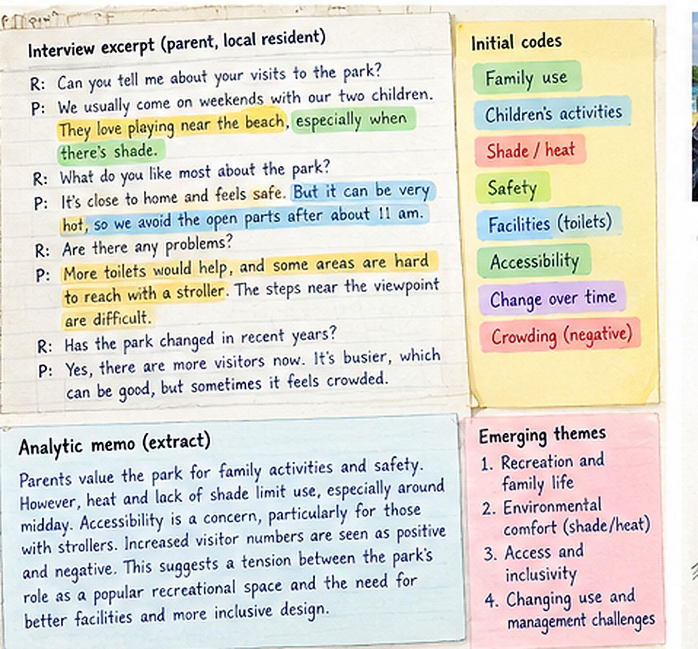
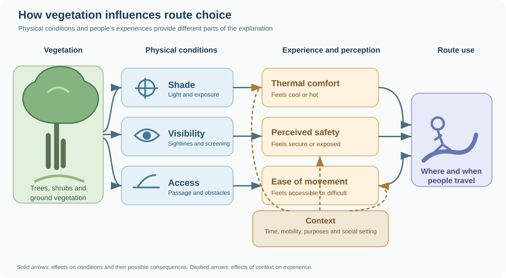
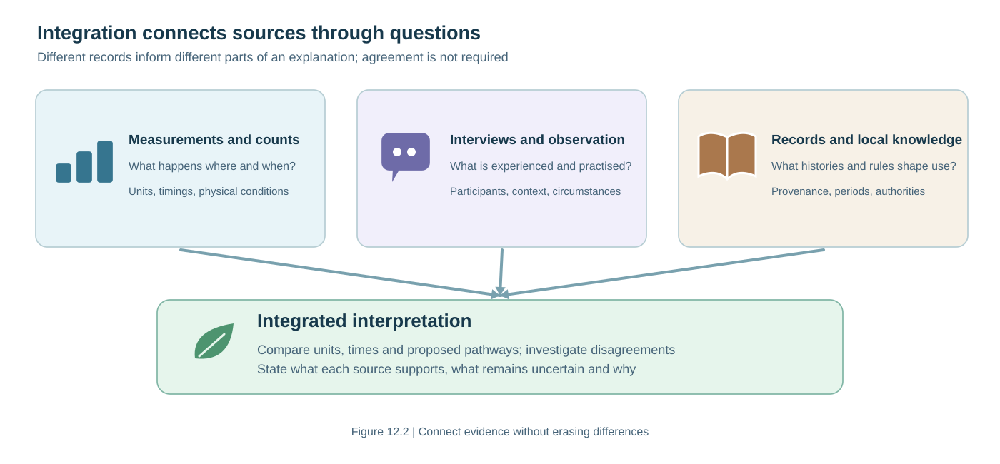
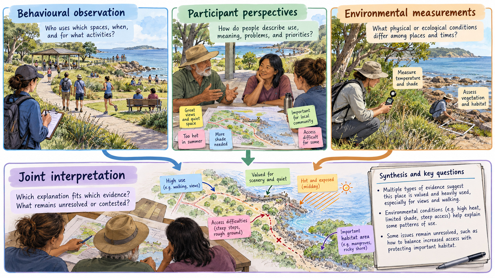
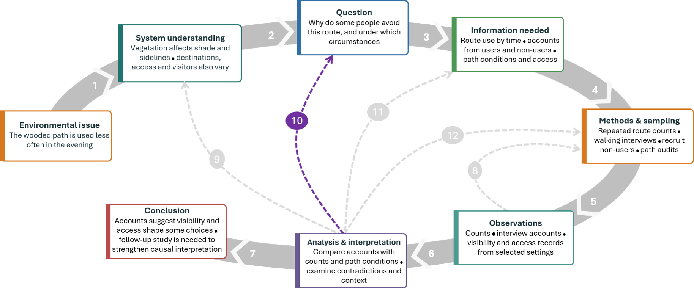

<script src="chapter-assets/chapter-interactions.js" defer></script>

<script src="chapter-assets/integrated-method-guide.js" defer></script>


```{=html}
<dialog class="figure-dialog" aria-label="Enlarged figure"><button class="figure-close" type="button" aria-label="Close enlarged figure">Close ×</button><p></p></dialog>
```


## 12.1 From records to explanation {#ch12-opening}

<p>In Chapter 11 we discussed the collection of information about people’s experiences, practices and decisions. Now suppose our team has returned from several visits to an urban park with recordings of interviews, notes on how people move between routes, photographs of paths and signs, management records, and accounts from residents who rarely enter the park. Let's assume that the team collected a substantial amount of material. Such a collection of records does not, by itself, explain why the wooded path is used less in the evening. Among the notes, we might find that a manager attributes the difference to visitors’ preference for open vegetation, several visitors value the trees and shade but describe poor visibility or a difficult surface, and another resident rarely encounters the wooded route at all because it leads away from the bus stop. That's a lot of different directions! We need to discover which experiences, described by whom, refer to the same issue, which describe different processes, and how we could distinguish among those possibilities.</p>
<p>The difficulty becomes apparent when we try to summarise what the interviews have told us. If we collect quotations mentioning trees and count how many sound favourable, we may overlook the conditions in which people make choices. A participant who says a route feels uncomfortable after dark has given us information about a particular experience. That account does not tell us what the same person would do at noon, how other residents behave, or whether an objectively measured hazard is present. The maintenance worker who describes a clearing rule has information about institutional practice, but may know little about how visitors experience the bend in the path. Turning these materials into scientific conclusions requires us to preserve their contexts, develop interpretations that account for differences among cases, and seek observations that could challenge our explanations. This analytical work can begin while the investigation is still under way. An interview that reveals an unexpected access problem may prompt us to visit another entrance, speak with people who do not use the park or reconsider a questionnaire prepared earlier. A comparison that initially looks contradictory may show that two sources refer to different people, locations or times. Chapters 2 and 5 introduced similar reasoning for ecological observations: the meaning of a recorded pattern depends on how observations were selected and how plausible explanations are evaluated. Interviews, field notes and historical accounts add questions about language, context, meanings and the relationships through which information was produced. Researchers use coding, comparisons among cases and analytic memos to make that work more systematic. @braunclarke2006 introduce thematic analysis, while @gale2013 describe an approach to comparing qualitative cases through the Framework Method. The park investigation will provide a continuing case in which the interpretation changes as the team examines accounts, observations and alternative explanations.</p>

## 12.2 Coding and comparing accounts {#ch12-analysis}


<p>We have interviews with four people about the wooded path. Before deciding what they tell us, we need to look carefully at what each person was actually describing. What was the participant asked? Which place and time did they mean? Were they explaining a particular journey or making a more general judgement? To work through those questions, we need to keep the interview notes, the circumstances of the interview and the original wording connected. A quotation removed from its context can suggest several interpretations, not all of them accurate. Consider these excerpts.</p>
<blockquote>
<p><strong>Visitor A, weekday evening:</strong> “I like the trees, but I
don’t go through there when it is getting dark. You cannot see much
beyond the corner, and there are usually fewer people.”</p>
<p><strong>Visitor B, weekend morning:</strong> “That is the route I
take with my father. It is cooler and more pleasant, but the uneven
section is hard for him to manage.”</p>
<p><strong>Nearby resident C, infrequent visitor:</strong> “The park
looks nice, but the entrance closest to my home takes me away from the
place I need to go. I usually walk beside the road.”</p>
<p><strong>Maintenance staff member D:</strong> “We have to keep the
main route clear. We leave some vegetation on the edges, but we cut it
back if it blocks visibility or access.”</p>
</blockquote>
<p>Visitor A’s comment concerns visibility and the presence of other people at a
particular time. It does not establish that A dislikes trees. Visitor B appreciates the
shade while describing an accessibility problem. Resident C may not even have evaluated
the wooded route: their decision involves the geography of destinations and entrances.
Staff member D describes a maintenance rule; observing its application would be necessary
to know how it operates across locations and occasions. These distinctions depend on
reading what each participant was describing, not treating isolated phrases as
expressions of a general preference for or against vegetation. <strong>Coding</strong> means applying concise labels to parts of the material
so that related passages can be found and compared. You might initially identify
<em>shade</em>, <em>visibility</em>, <em>surface condition</em>,
<em>route connection</em> and <em>management rules</em>. Codes are analytical aids;
their meaning depends on how they are defined and used. A passage may receive several
codes, and a code may cover different expressions of a related issue. You must decide
whether two passages concern the same problem or merely use similar words. Some codes
can come from the research question, such as accessibility or perceived naturalness;
others may emerge from the participants' accounts. Keep a record of code definitions
and changes. An initial code called <em>vegetation preference</em> may prove too broad
if it combines an appreciation of shade with concern about visibility.</p>
<p><span id="tbl-ch12-accounts"></span></p>
<table>
<caption><strong>Table 12.1.</strong> Comparing four interview accounts about a wooded path. Provisional codes identify subjects for comparison; the final column records questions that would require further information.</caption>
<colgroup>
<col style="width: 25%"/>
<col style="width: 25%"/>
<col style="width: 25%"/>
<col style="width: 25%"/>
</colgroup>
<thead>
<tr class="header">
<th>Account</th>
<th>Situation described</th>
<th>Provisional codes</th>
<th>Question opened by the account</th>
</tr>
</thead>
<tbody>
<tr class="odd">
<td>A</td>
<td>Evening use of a wooded bend</td>
<td>Visibility; time of day; social presence</td>
<td>Is avoidance linked to the bend, darkness, low visitor numbers or a
combination?</td>
</tr>
<tr class="even">
<td>B</td>
<td>Accompanying an older relative</td>
<td>Shade; surface accessibility; shared activity</td>
<td>How does route surface affect people who otherwise value the wooded
setting?</td>
</tr>
<tr class="odd">
<td>C</td>
<td>Travel between home and destination</td>
<td>Connectivity; alternatives; non-use</td>
<td>Does low use reflect where the path leads rather than its
appearance?</td>
</tr>
<tr class="even">
<td>D</td>
<td>Maintenance of path edges</td>
<td>Management criteria; visibility; access</td>
<td>Do the stated criteria match what is done, and under which
conditions?</td>
</tr>
</tbody>
</table><section class="ch11-exercise" id="ch12-original-exercise-1">
<h4>Test your understanding 12.1 : codes are not findings</h4>
<div class="ch11-question"><p>In <a href="#tbl-ch12-accounts">Table 12.1</a>, Visitor A and staff
member D both mention visibility. Does that give us two independent
confirmations that poor visibility reduces route use? Explain what each
account establishes, and propose one observation or comparison that
would help investigate the suggested pathway.</p>
</div>
<label for="ch12-original-exercise-1-answer">Your reasoning</label>
<textarea id="ch12-original-exercise-1-answer" placeholder="Write an answer before seeing the suggested response." rows="4"></textarea>
<div class="ch11-actions"><span aria-live="polite" class="ch11-count">0 words</span><button aria-expanded="false" class="ch11-reveal" disabled="" type="button">Show suggested response</button></div>
<p class="answer-status">Write your answer before revealing the suggested response.</p>
<div class="ch11-solution" hidden=""><p>No. Visitor A reports discomfort linked to being unable to see ahead
during an evening visit. Staff member D reports a maintenance practice
or rule involving visibility. They are different kinds of information
from people in different roles; the shared label <em>visibility</em>
does not turn either into a measured effect on route use. One next step
is to document sightlines and lighting at the described bend, then
observe use at comparable bends and times with different visibility
while recording connectivity, surface condition and pedestrian activity.
Further interviews could establish what people meant by visibility
concerns. Such a comparison may strengthen or challenge the proposed
explanation, but its design will determine whether a causal conclusion
is possible.</p>
</div>
<noscript><details><summary>Suggested response (available without JavaScript)</summary><p>No. Visitor A reports discomfort linked to being unable to see ahead
during an evening visit. Staff member D reports a maintenance practice
or rule involving visibility. They are different kinds of information
from people in different roles; the shared label <em>visibility</em>
does not turn either into a measured effect on route use. One next step
is to document sightlines and lighting at the described bend, then
observe use at comparable bends and times with different visibility
while recording connectivity, surface condition and pedestrian activity.
Further interviews could establish what people meant by visibility
concerns. Such a comparison may strengthen or challenge the proposed
explanation, but its design will determine whether a causal conclusion
is possible.</p>
</details></noscript>
</section>

<p>After initial coding, a researcher can compare accounts within and
across participants. Visitor A and staff member D both mention
visibility, but from different positions: one describes discomfort; the
other describes a rule. These are not two independent measurements of
the same thing. Their relationship is a possible explanation to be
investigated by visiting the bend and examining maintenance decisions.
Visitor B suggests that a route can be attractive yet difficult to use.
Resident C identifies a reason for low use that has little to do with
the route’s immediate vegetation. Taken together, the accounts suggest
that the observed pattern cannot be interpreted as a straightforward
ranking of preference for dense or open greenery. It may reflect several
pathways that operate differently for different people and at different
times.</p><details class="ch11-foldable alternative-table box" id="ch12-alternative-accounts"><summary>Box 12.1 · When the same vegetation is valued differently</summary><p>Consider four further experiences of vegetation and park use. Which differences would you investigate, and whose accounts might be absent if you interviewed only current visitors?</p><table id="tbl-ch12-accounts-alternative">
<caption>Table 12.2. Comparing different experiences of vegetation, access and activities in a park, with provisional codes and questions to investigate.</caption>
<colgroup>
<col style="width: 33%"/>
<col style="width: 33%"/>
<col style="width: 33%"/>
</colgroup>
<thead>
<tr class="header">
<th style="text-align: left;">Participant’s account</th>
<th style="text-align: left;">Possible provisional codes</th>
<th style="text-align: left;">Questions to consider when comparing
accounts</th>
</tr>
</thead>
<tbody>
<tr class="odd">
<td style="text-align: left;">A. Trees provide shade for a rest on the
walk home.</td>
<td style="text-align: left;">Shade; resting on a routine journey</td>
<td style="text-align: left;">Does the value of shade depend on the
journey, time of day or reason for visiting?</td>
</tr>
<tr class="even">
<td style="text-align: left;">B. The planting looks attractive, but the
path is avoided after dark because visibility is poor.</td>
<td style="text-align: left;">Appearance; visibility; time of day</td>
<td style="text-align: left;">Is the concern associated with vegetation,
lighting, familiarity with the path or previous experience?</td>
</tr>
<tr class="odd">
<td style="text-align: left;">C. Long grass attracts insects that a
parent enjoys seeing with children, but makes a shortcut difficult.</td>
<td style="text-align: left;">Wildlife interest; movement; competing
uses</td>
<td style="text-align: left;">How does the same vegetation condition
support one activity and interfere with another?</td>
</tr>
<tr class="even">
<td style="text-align: left;">D. Entrance steps prevent a person from
entering the area.</td>
<td style="text-align: left;">Physical access; non-use</td>
<td style="text-align: left;">Which experiences will we miss if we speak
only with people already using this part of the park?</td>
</tr>
</tbody>
</table></details>
<p>An <strong>analytic memo</strong> records a provisional explanation,
the material supporting it and what remains uncertain. A useful memo
after these interviews might read as follows:</p>
<blockquote>
<p><em>The four accounts suggest that vegetation character does not
explain route use independently of access conditions. Shade may make the
wooded route attractive, while visibility after dark, the surface and
route connectivity may limit its use. Staff descriptions suggest that
management decisions respond to at least some of these concerns, but we
have not observed maintenance work. We should inspect the route at the
times mentioned, speak with additional users and non-users, and check
whether the same concerns arise in other locations. The current accounts
show distinct mechanisms, not their relative prevalence.</em></p>
</blockquote>
<p>The memo records what the team currently thinks explains the pattern and what would change that interpretation. It directs attention to the relevant bend during the evening, to access barriers encountered by people who might not enter the park and to maintenance decisions about vegetation and surfaces. A later interview with someone who regularly takes the wooded route after dusk might reveal that familiarity, lighting or travelling with companions changes the experience. That account would not cancel the earlier concern; it would help explain the circumstances in which visibility affects route choice. A new observation period could then compare similar bends with different sightlines while retaining information on route connections, surfaces and activity. Each step follows from a particular uncertainty in the emerging account. The combination of case records, codes and memos is useful because we can move between a recurring issue and the circumstances of particular participants. @gale2013 describe the Framework Method, which uses indexing and a structured comparison of cases; @braunclarke2006 explain how themes are developed through interpretation of patterns across material. For our four accounts, a theme such as <em>the route is accessible only under some conditions</em> would require showing how physical access, time of day and route purpose combine in the participants’ experiences. It cannot be produced by counting the frequency of the word <em>access</em>. We would compare the cases with contradictory accounts and with what can be observed at the locations described. @saldana2021 offers further examples of how codes and analytic categories can be revised as the analysis develops.</p>
<p>To see how this works in practice, imagine preparing a simple spreadsheet after the first four interviews. Each row represents a passage, with columns for participant, place, date or period, the original words, a provisional code and the question the passage raises. Visitor A’s phrase about the bend after dark receives the codes <em>visibility</em>, <em>time</em> and perhaps <em>social presence</em>. Visitor B’s statement about accompanying an older relative receives <em>shade</em>, <em>route surface</em> and <em>shared mobility</em>. Both passages concern the wooded route, but assigning them the same general code, such as <em>negative vegetation experience</em>, would conceal exactly the distinction we need to investigate. A second round of reading might divide <em>accessibility</em> into surface obstacles, route connectivity and access at entrances, and distinguish a physical sightline from anxiety about an unfamiliar place. Each revision should be documented, with the earlier labels retained in the coding record or memo so another researcher can reconstruct how the interpretation developed. Now ask whether the categories identify a recurring process across cases. Suppose we interview someone who walks through the bend after dark because the route is direct and well lit at the entrance, and another who avoids the path at noon because its surface is too uneven. We can compare their accounts with those already collected, paying attention to what changes between cases. It might become useful to organise a matrix with routes as columns and participants as rows, or to compare users and non-users separately. These are analytical decisions, not administrative ones. They determine which similarities and disagreements are visible, and they can suggest further sampling. We should retain the actual narrative of each person’s journey, because a code such as <em>visibility</em> may describe a condition, a perception or a management practice depending on who used it. When the interpretation depends on that difference, the original account and the field context must remain accessible.</p><details class="ch11-foldable box" id="ch11-note-6">
<summary>
Box 12.2 · Keeping a record of analytical decisions
</summary>
<div class="ch11-foldable-body">
<p>
Imagine returning to your interviews a week after writing the memo in
Section 12.2. You now have two accounts of evening visits that differ
from the one in Table 12.1. Keep the original passages and their
participant references, then add a dated note describing how the new
accounts affected your interpretation. You might change a label from
“avoidance of dense vegetation” to “visibility concerns under particular
conditions”, because the original label suggested a more general dislike
of vegetation than the evidence supported. Recording the earlier wording
and the reason for the change makes it possible to revisit that decision
when still more material becomes available.
</p>
<p>
For a substantial study, the relevant analytical approach will determine
how systematically codes are defined or revised, and how a team examines
differences in interpretation. Those procedures are not identical across
qualitative traditions. @saldana2021
offers practical treatments of coding and memos;
@gale2013 illustrate a more formal
matrix-based method. If you want to investigate differing approaches to
thematic analysis and their quality criteria, see
@braunclarke2006 and
@braunclarke2021.
</p>
</div>
</details>
<p>Keeping a case-by-issue matrix alongside the full transcripts also helps. Put participants in rows and emerging issues in columns, with brief summaries and references to the original passages. Looking down one column shows how people describe the same issue under different circumstances; reading across one row keeps the connections among the issues in one person’s account. The matrix can reveal that a general code such as <em>safety</em> mixes concerns about traffic, social encounters and being unable to see ahead. Revising the categories at that point is analytical progress: the distinctions suggest different observations and potentially different management responses. A matrix cannot substitute for rereading the accounts, since the short summaries inevitably leave context out.</p>
<figure class="restored-illustration medium-illustration" id="fig-ch12-coding"><button class="figure-enlarge" type="button">Enlarge figure</button><figcaption>Figure 12.1. From interview excerpts to provisional codes, emerging themes and an analytic memo. The memo begins to connect accounts into an interpretation that can be examined against other cases and sources.</figcaption></figure>


<section class="ch11-exercise" id="ch12-ch11-exercise-extra-11F"><h4>Test your understanding 12.2  · From codes to an interpretation</h4><div class="ch11-question"><p>Return to the four accounts in Table 12.1. Suggest an interpretation connecting at least two accounts. Explain how comparing their circumstances helps you develop it, and describe one additional account or observation that might lead you to revise the interpretation.</p></div><label for="ch11-exercise-extra-11F-answer">Your reasoning</label><textarea id="ch11-exercise-extra-11F-answer" placeholder="Write your answer before seeing the suggested response." rows="4"></textarea><div class="ch11-actions"><span aria-live="polite" class="ch11-count">0 words</span><button aria-expanded="false" class="ch11-reveal" disabled="" type="button">Show suggested response</button></div><div class="ch11-solution" hidden=""><p>One possible interpretation is that the value of park vegetation depends on what people want to do and the conditions of their visit. Participant A values shade because it makes a routine journey more comfortable. Participant B appreciates planting but avoids the path after dark, suggesting that the value placed on appearance can change when visibility becomes a concern. Participant C provides another contrast: long grass supports an enjoyable activity with children but interferes with using a shortcut. These accounts do not establish that everyone evaluates vegetation in this way, but they show why a simple code such as 'vegetation preference' could hide important differences.</p><p>To examine the interpretation, I would seek an account from someone who uses the wooded path comfortably after dark, and ask about route familiarity, lighting, companions and the reason for the visit. I would also observe the path under comparable conditions. If that person values the enclosed atmosphere precisely because it feels secluded, the interpretation needs to recognise that similar conditions can acquire different meanings. An alternative response could focus on participant D: interviewing a person unable to enter the area might reveal that the absence of some groups from the park reflects physical barriers, not lack of interest. In either case, I would record how the contrasting evidence changes the provisional explanation rather than simply placing it under another code. The choice of a contrasting case should follow from which part of the explanation needs testing.</p></div><noscript><details><summary>Suggested response</summary><p>One possible interpretation is that the value of park vegetation depends on what people want to do and the conditions of their visit. Participant A values shade because it makes a routine journey more comfortable. Participant B appreciates planting but avoids the path after dark, suggesting that the value placed on appearance can change when visibility becomes a concern. Participant C provides another contrast: long grass supports an enjoyable activity with children but interferes with using a shortcut. These accounts do not establish that everyone evaluates vegetation in this way, but they show why a simple code such as 'vegetation preference' could hide important differences.</p><p>To examine the interpretation, I would seek an account from someone who uses the wooded path comfortably after dark, and ask about route familiarity, lighting, companions and the reason for the visit. I would also observe the path under comparable conditions. If that person values the enclosed atmosphere precisely because it feels secluded, the interpretation needs to recognise that similar conditions can acquire different meanings. An alternative response could focus on participant D: interviewing a person unable to enter the area might reveal that the absence of some groups from the park reflects physical barriers, not lack of interest. In either case, I would record how the contrasting evidence changes the provisional explanation rather than simply placing it under another code. The choice of a contrasting case should follow from which part of the explanation needs testing.</p></details></noscript><p class="answer-status">Write your answer before revealing the suggested response.</p></section>


## 12.3 Evaluating interpretations {#ch12-inference}

<p>Imagine that the park manager reads the team’s first memo and proposes cutting vegetation along the wooded path to attract more evening visitors. The interviews make this proposal understandable: one participant describes being unable to see around a bend at dusk, and the maintenance worker says that vegetation is cleared when it obstructs visibility. But the accounts also mention uneven surfaces, the position of entrances, destinations and the value of a shaded route. Would cutting back the vegetation actually bring more evening visitors to the path? That depends on why people avoid it in the first place. We can begin by returning to the original interviews, rather than relying only on the short codes, and asking which explanations fit the different accounts and what we would need to observe to distinguish them. Did Visitor A describe a frightening encounter, difficulty seeing around the corner or simply a preference for walking where other people are present? These possibilities concern different processes. If A reports feeling unsafe, that is information about the experience, which may influence behaviour regardless of whether there is an independently documented hazard. It does not establish the probability of crime. Likewise, Visitor B’s description of an uneven path concerns a physical barrier that could be inspected, whereas Resident C’s account concerns where the route connects. An interpretation that describes all four accounts as opposition to dense vegetation would misrepresent several of them. An explanation centred entirely on vegetation preference already has difficulty accounting for these different cases.</p>
<p>The team could now represent a small set of candidate pathways. Vegetation affects shade and what visitors can see; those physical characteristics may affect comfort, perceived safety and route choice. Surface condition and the locations people wish to reach create additional pathways, while time of day, lighting, familiarity and whether someone travels alone can change their operation. Management also responds to use: a busy route may receive more clearing and maintenance. An observed association between open vegetation and high use could therefore arise partly because busy places are maintained differently. Figure 12.2 lays out the candidate relationships so that we can ask which links are supported by observations and which are still proposed explanations.</p>
<figure class="vector-figure rich-figure wide-figure" id="fig-ch12-paths"><button class="figure-enlarge" type="button">Enlarge figure</button>

<figcaption aria-hidden="true">Figure 12.2. Vegetation influences shade, visibility and access directly. The way people experience these conditions depends on the time, their needs and the social setting; those experiences may in turn influence route choice and use.</figcaption>
</figure>
<p>The next interviews and visits should be selected to expose the proposed explanation to difficult cases. If we think visibility is the principal reason for low evening use, why is another wooded bend, with similarly dense vegetation, used regularly at the same hour? Perhaps it is better lit, connects an important destination or is familiar to regular users. A person who values a quiet, enclosed route may also challenge the assumption that the same condition discourages everyone. We could compare the locations through repeated route counts, photographs taken at relevant times, measurements of sightlines and path surfaces, and walking interviews with people who choose different routes. These comparisons do not isolate every causal effect, but they show which differences need to enter a more informative investigation. If the management question becomes whether cutting vegetation would increase use, the team would need to consider a credible intervention comparison, potentially involving similar routes before and after treatment and suitable untreated comparisons, while checking for changes in lighting, access and pedestrian destinations. Two distinct reasons for selecting additional cases follow from these comparisons. We may select a route that looks similar to the wooded path but has a different level of evening use, because the contrast could identify an omitted influence. Or we may deliberately seek a person whose experience challenges our initial interpretation, because that account could expose a condition under which the suggested mechanism does not operate. A negative or contrasting case is therefore chosen for analytical leverage, not because it represents the average visitor. Suppose a participant tells us that the enclosed bend is pleasant after dusk when walking with friends, but uncomfortable when walking alone. We could ask for a description of two recent journeys, including times, destinations and who was present. A further observation could record how many people travel alone or in groups at that location. The surprising account would therefore shape both the next interview and the subsequent behavioural observations.</p>
<p>At this stage the investigator also needs to keep competing explanations alive long enough to test them. Reduced visibility, longer travel time and poorer surface condition might all be associated with low use because they occur in the same route. Interview accounts can help identify them, but a study of their relative contribution would require comparisons where some of those characteristics vary independently. If no such routes exist in the park, the current observational material cannot separate their effects well. We could widen the study area, examine the same route under different lighting conditions, or assess a change in maintenance if it occurs. Each option introduces new sampling decisions and possible confounding. It is more informative to specify that the design cannot distinguish poor sightlines from a long detour than to conclude vaguely that “other factors may also be involved”. The problem is a missing comparison, and we can say what comparison would help.</p>

<p>Research elsewhere offers ways of investigating related questions, and also shows how the choice of method affects what can be concluded. @lis2019 used park photographs to investigate how vegetation arrangement, opportunities for concealment and perceived safety relate to landscape preferences. The controlled visual material makes particular features easier to compare than in an ordinary field interview, while the response remains a judgement about the scene presented. A study of urban greenery in Singapore asked adults to assess images of natural and built green environments and examined variation in those evaluations among participants ([@dillon2024]). In metropolitan Asunción, @berdejo2026 surveyed 356 urban-green-space visitors and analysed associations between perceived safety, conditions such as disorder and maintenance, and environmental characteristics; remotely measured tree cover was not a significant predictor of perceived safety in their reported models. These studies address overlapping questions with different populations, measurements and comparisons. For interested readers, studies of perceived safety and mobility in Bogotá provide further approaches, including attention to everyday walking experiences and urban form ([@yunda2025]; see also the Bogotá mobility and treescape studies listed in the references). The point for our park study is operational: a photographic experiment, a visitor survey, a walking interview and a systematic observation of actual route use offer different tests of the proposed relationships.</p>
<p>Our interpretation is also shaped by how the investigation was conducted. An interviewer introduced by a park authority may hear different accounts of maintenance than a researcher presented as independent. People interviewed on the wooded route are, by selection, people who were able and willing to enter it. The team should document its recruitment locations, changes to prompts, relationships with participants and disagreements during interpretation. Discussing conflicting interpretations within a research team can reveal assumptions, although numerical agreement among coders does not by itself validate a theme. These are the practical elements of reflexive analysis: they allow readers to understand how information entered the study and how the explanation changed, as discussed by @hammersley2019, @newing2011 and @tracy2010. The analysis supports a more specific provisional conclusion: some users associate the enclosed bend with poor visibility at particular times; others value the shade but face physical-access problems; and the route serves some journeys more directly than others. That conclusion is stronger than a general claim that people dislike wooded paths because it identifies the different processes suggested by the accounts. It also provides more specific choices for what to observe next. The table below connects the sources of information with the conclusions they can support and the comparisons that remain necessary.</p>
<div class="callout-note box" data-collapse="true" title="Box 12.3 · Checking a proposed explanation against different kinds of evidence">
<p>Imagine that a park manager asks whether poor visibility is the
principal reason why an enclosed path receives fewer evening visitors
than a nearby open route. We can draw on different kinds of records, but
each contributes something different. A visitor’s account tells us about
their experience; a field observation describes the physical setting;
and a count of users helps us establish a behavioural pattern. Combining
them may strengthen an explanation, but it does not make all the records
interchangeable.</p>
<p><span id="tbl-ch12-multi-source"></span></p>
<table>
<caption>Table 12.3. What different sources can, and cannot, establish about park-route use.</caption>
<colgroup>
<col style="width: 33%"/>
<col style="width: 33%"/>
<col style="width: 33%"/>
</colgroup>
<thead>
<tr class="header">
<th style="text-align: left;">Evidence we might collect</th>
<th style="text-align: left;">What it can contribute</th>
<th style="text-align: left;">What it cannot establish on its own</th>
</tr>
</thead>
<tbody>
<tr class="odd">
<td style="text-align: left;">Interviews with people who avoid the path
after dark, including questions about a recent visit</td>
<td style="text-align: left;">How participants explain their choices and
whether visibility is among the reasons they report</td>
<td style="text-align: left;">That vegetation is the physical cause of
their concern, or that their experience is common among all
residents</td>
</tr>
<tr class="even">
<td style="text-align: left;">Field observations of sightlines,
lighting, entrances and signs at different times</td>
<td style="text-align: left;">Whether the environmental features
suggested by the accounts are present and vary with conditions</td>
<td style="text-align: left;">Whether people notice those features or
respond to them in the same way</td>
</tr>
<tr class="odd">
<td style="text-align: left;">Comparable counts of use on the wooded and
open routes, by time of day</td>
<td style="text-align: left;">How observed use differs between routes
and periods</td>
<td style="text-align: left;">The reasons for those differences</td>
</tr>
<tr class="even">
<td style="text-align: left;">Accounts from frequent evening users and
people who rarely enter the park</td>
<td style="text-align: left;">Alternative experiences and barriers
missing from interviews with people who avoid the path</td>
<td style="text-align: left;">Their relative prevalence in the wider
population without an appropriate sampling design</td>
</tr>
</tbody>
</table>
<p>Suppose the observations show that visibility is restricted after
dark, but the interviews also reveal that some visitors take the wooded
path precisely because it is quiet and enclosed. Those findings can
coexist. They would encourage us to examine differences in activity,
familiarity and experience rather than assume that a physical
characteristic has the same effect on everyone. If a subsequent
questionnaire is intended to estimate how many residents avoid the path
because of visibility concerns, our qualitative work can inform its
questions, but the survey still needs its own sampling design and
interpretation. The analytical task is to connect each conclusion to the
evidence capable of supporting it, while recognising what remains
uncertain.</p>
</div>
<p></p>

## 12.4 Integrating evidence {#ch12-mixed}


<p>After a second round of fieldwork, suppose route counts show that the wooded path is used frequently on weekend mornings but much less on weekday evenings. Interviews reveal that people value its shade, yet some avoid an enclosed bend after dark or find the surface difficult to negotiate. A maintenance log records vegetation clearing near that bend, while a route map reveals that the open alternative connects more directly to several destinations. These records can now be compared around the same question. The count establishes when the pattern occurs. The interviews show how particular people describe their experiences and choices. The path survey and map document physical conditions and connections. The maintenance record tells us which actions were recorded, although it may not show everything that occurred on the ground. None of these accounts has to stand in for the others.</p>
<figure class="rich-figure" id="fig-ch12-integration"><button class="figure-enlarge" type="button">Enlarge figure</button>

<figcaption aria-hidden="true">Figure 12.3. Observations and measurements, participant accounts and historical or local records contribute different kinds of information to an explanation. Comparing them helps assess what each proposed relationship is supported by.</figcaption>
</figure>

<p>But before comparing these records, we need to make sure they actually refer to the same places, times and people. An evening interview about the enclosed bend, for example, cannot be compared meaningfully with a single daytime count for the whole park. We could record the interviewee’s route and relevant time, match the statement to a mapped location, inspect the bend at comparable hours and repeat the count during those periods. A field note showing that plants block a sightline does not tell us how many people change their route because of it, but it helps identify the characteristic to vary or measure in a later comparison. The value of combining the sources arises from these concrete relationships among them. A joint display is one practical tool for this work. We can place quantitative patterns and qualitative accounts side by side for the same question, then write a third column explaining how they relate and what further observation would discriminate among interpretations. The third column is the analysis: agreement may support an explanation, while an apparent disagreement can reveal that the records concern different circumstances. For instance, high overall satisfaction with the park does not contradict a small group of residents describing severe accessibility barriers; the first observation may represent an average among current visitors and the second a particular experience among people poorly represented in that average. We would investigate who was sampled before interpreting the difference.</p><figure class="restored-illustration rich-figure" id="fig-ch12-integrated-park"><button class="figure-enlarge" type="button">Enlarge figure</button><figcaption>Figure 12.4. Bringing together observations, participant accounts and environmental measurements from a coastal park. Their spatial and temporal correspondence helps evaluate explanations of use, experience and environmental conditions.</figcaption></figure>
<p>Imagine filling one row of the joint display for weekday evenings at the wooded bend. The count is low relative to the open route during matched observation periods. Interview A describes an inability to see beyond the corner, and an inspection made after sunset confirms that the sightline is limited. Taken together, these records support the description that the bend is poorly visible when the route is relatively little used. They do not establish that visibility caused the low count. The next row might concern weekend mornings, when the path is busier and respondents value its shade. If the bend remains physically enclosed at both times, its use changing with time suggests that the relationship depends on other circumstances, such as lighting, destinations, temperature or who is present. Our interpretation becomes more specific because we compare the same place under different conditions, rather than because the table combines qualitative and quantitative columns. A third row could record non-users interviewed in nearby housing blocks. Someone who cannot use the entrance steps is missing from an on-site interview sample and may never appear in the route counts. Their account identifies a different type of barrier. A survey of current park users might show high average satisfaction while entirely overlooking those excluded residents. Bringing these results together does not require them to agree: the analytical finding could be that reported satisfaction is high among people who can use the park, while entry conditions prevent another group from taking part. An ecologist will recognise the sampling issue. Recording abundant plants in accessible plots does not establish that the same species dominate sites that were never surveyed. The relevant population and the processes determining which units could enter the sample remain part of the interpretation.</p>
<table>
<caption>Table 12.4. Comparing visitor observations, interview accounts and environmental measurements to assess proposed explanations for route use.</caption>
<colgroup>
<col style="width: 25%"/>
<col style="width: 25%"/>
<col style="width: 25%"/>
<col style="width: 25%"/>
</colgroup>
<thead>
<tr class="header">
<th>Proposed explanation</th>
<th>Interview and field-note material</th>
<th>Other observations or measurements</th>
<th>What is and is not supported</th>
</tr>
</thead>
<tbody>
<tr class="odd">
<td>People avoid the route because they dislike dense vegetation.</td>
<td>Some like the trees; some describe discomfort after dark.</td>
<td>Evening use is lower; wooded and open routes differ in several other
features.</td>
<td>Low use is recorded, but a general dislike of dense vegetation is
not established.</td>
</tr>
<tr class="even">
<td>Visibility contributes to avoidance at certain times.</td>
<td>Several accounts mention visibility and evening conditions.</td>
<td>Bend visibility and lighting can be assessed by time and
location.</td>
<td>A plausible, testable pathway; its importance for overall use
remains uncertain.</td>
</tr>
<tr class="odd">
<td>Surface and connectivity limit access.</td>
<td>Some accounts refer to uneven paving or indirect connections.</td>
<td>Route audit documents surface conditions and connections.</td>
<td>Physical constraints can be documented; how widely they change route
choices needs further study.</td>
</tr>
<tr class="even">
<td>Cutting vegetation will increase use.</td>
<td>Some participants describe reasons that might be affected by
clearance.</td>
<td>No comparable before–after or intervention contrast is
available.</td>
<td>A management prediction, not an observed effect.</td>
</tr>
</tbody>
</table><section class="ch11-exercise" id="ch12-original-exercise-2">
<h4>Test your understanding 12.3 : agreement, disagreement or different questions?</h4>
<div class="ch11-question"><p>A questionnaire indicates generally high satisfaction with a park,
while interviews with residents who use wheelchairs identify several
inaccessible routes. Is this a contradiction? What does each source
measure, who may be missing, and what practical comparison could clarify
the relationship between the findings?</p>
</div>
<label for="ch12-original-exercise-2-answer">Your reasoning</label>
<textarea id="ch12-original-exercise-2-answer" placeholder="Write an answer before seeing the suggested response." rows="4"></textarea>
<div class="ch11-actions"><span aria-live="polite" class="ch11-count">0 words</span><button aria-expanded="false" class="ch11-reveal" disabled="" type="button">Show suggested response</button></div>
<p class="answer-status">Write your answer before revealing the suggested response.</p>
<div class="ch11-solution" hidden=""><p>Not necessarily. Overall satisfaction is a broad, self-reported
assessment; access difficulties concern particular routes and the needs
of particular users. A park can score highly on the first measure and
still exclude some people or activities. A survey of people already
visiting the park may omit those who rarely attend because access is
difficult. The interviews are informative about experienced barriers but
do not estimate their prevalence across all users or residents. A useful
follow-up would map actual accessible routes and obstructions, observe
conditions at relevant times and recruit both users and non-users with
different mobility needs. An appropriately sampled questionnaire could
then address how widespread specified barriers are within a defined
population. The sources are complementary because they investigate
different parts of the problem.</p>
</div>
<noscript><details><summary>Suggested response (available without JavaScript)</summary><p>Not necessarily. Overall satisfaction is a broad, self-reported
assessment; access difficulties concern particular routes and the needs
of particular users. A park can score highly on the first measure and
still exclude some people or activities. A survey of people already
visiting the park may omit those who rarely attend because access is
difficult. The interviews are informative about experienced barriers but
do not estimate their prevalence across all users or residents. A useful
follow-up would map actual accessible routes and obstructions, observe
conditions at relevant times and recruit both users and non-users with
different mobility needs. An appropriately sampled questionnaire could
then address how widespread specified barriers are within a defined
population. The sources are complementary because they investigate
different parts of the problem.</p>
</details></noscript>
</section>
<p>Collecting interview accounts and numerical observations in one project does not by itself establish how their findings relate. A survey about preferences and a set of interviews about barriers may describe related but different outcomes. A plant-community inventory and interviews with gardeners can be connected when the design retains where and when management decisions occurred and where ecological conditions were measured. Otherwise we may have two informative studies without a clear basis for linking their findings. @fetters2013 discuss integration across design, methods and reporting; the decision for our investigation is where a connection between sources is needed to address the question, and what sampling or matching would make that connection credible. Sometimes the most useful result is a change in the original question. Suppose the team expected canopy density to explain low evening use, but paired observations show that two densely vegetated routes differ strongly in use and also connect different destinations. A follow-up interview may suggest that connectivity is more important for commuting visitors, while visibility influences discretionary evening walks. We could revise the explanation to distinguish journey purpose and time, recruit people with those contrasting routines and design an observational comparison of routes with similar connectivity but different sightlines. The subsequent investigation is better focused because the analysis has exposed which original comparisons could not distinguish the pathways.</p><section class="ch11-exercise" id="ch12-ch11-exercise-7"><h4>Test your understanding 12.4  · When evidence appears to conflict</h4><div class="ch11-question"><p>A structured count records many evening visitors on a wooded path.
Several interviewees nevertheless say they avoid it at night because
they feel unsafe. List at least four explanations that would allow both
observations to be credible. Which would require comparing sampling
populations? Which would require checking the definitions of ‘evening’
and ‘night’? Which would require exploring the meaning of ‘avoid’?
Design one further observation and one interview prompt that could
distinguish alternatives without assuming the interviews or counts must
be wrong.</p></div><label for="ch11-exercise-7-answer">Your reasoning</label><textarea id="ch11-exercise-7-answer" placeholder="Write a short explanation before revealing the suggested response." rows="4"></textarea><div class="ch11-actions"><span aria-live="polite" class="ch11-count">0 words</span><button aria-expanded="false" class="ch11-reveal" disabled="" type="button">Show suggested response</button></div><div class="ch11-solution" hidden=""><p>An evening visitor count and an interview report of avoiding the path after dark are not automatically contradictory. The counter measures passages during specified intervals; the interview describes an individual's experience or behaviour, which may refer to a different time, section of path or set of circumstances. First I would establish how the count was obtained, whether repeated passages from the same person were included, and exactly when and where interviews referred to the path. Evening passages may be numerous because commuters use the route while people visiting for recreation avoid it, or because some frequent users are comfortable while other residents stay away. I would therefore combine time-matched counts and observations with targeted interviews of route users and non-users, and perhaps measurements of lighting or path conditions. If both sources genuinely cover the same circumstances and still differ, that difference is worth investigating: expressed concerns do not always predict actual behaviour. Neither type of evidence should automatically be privileged. Together they may reveal distinct populations, purposes of travel, or processes that are invisible when we compare only aggregate numbers with isolated quotations.</p></div><noscript><details><summary>Suggested response (available without JavaScript)</summary><p>An evening visitor count and an interview report of avoiding the path after dark are not automatically contradictory. The counter measures passages during specified intervals; the interview describes an individual's experience or behaviour, which may refer to a different time, section of path or set of circumstances. First I would establish how the count was obtained, whether repeated passages from the same person were included, and exactly when and where interviews referred to the path. Evening passages may be numerous because commuters use the route while people visiting for recreation avoid it, or because some frequent users are comfortable while other residents stay away. I would therefore combine time-matched counts and observations with targeted interviews of route users and non-users, and perhaps measurements of lighting or path conditions. If both sources genuinely cover the same circumstances and still differ, that difference is worth investigating: expressed concerns do not always predict actual behaviour. Neither type of evidence should automatically be privileged. Together they may reveal distinct populations, purposes of travel, or processes that are invisible when we compare only aggregate numbers with isolated quotations.</p></details></noscript><p class="answer-status">Write your answer before revealing the suggested response.</p></section>


## 12.5 Scale, time and process {#ch12-scale}

<p>A visitor tells us about a memorable visit months earlier, a route count records who passes a particular location during one hour, and a vegetation survey describes the plants in a plot on the day of the survey. Even when all three concern the same park, they do not necessarily describe the same place or period. Researchers refer to these differences as the spatial and temporal support of observations. Before combining the records, we need to ask which circumstances each one represents. If respondents describe the wooded path as uncomfortably hot in the afternoon, an air-temperature logger at the park entrance may be a poor match, even if it records temperature accurately. We need measurements near the route and at the times relevant to the accounts, or a reasoned model linking the available measurements to that exposure. The same issue appears in ecological studies when plot-level conditions are used to explain landscape-wide patterns or a one-off sample is used to represent a process that changes rapidly. Changes across time create further complications. An interview about declining access to a coastal site could concern an event, a gradual shift in management, or changes in the person’s daily routine. A historical map, an aerial photograph and an oral history may refer to different years and spatial boundaries. We should specify which periods the sources cover and whether the claim concerns a historical sequence, a difference between groups or a response to an intervention. A timeline developed with participants can help locate events and identify contradictions, but it does not turn remembered dates into exact measurements. We can preserve both the recalled sequence and the documentary chronology, then investigate the reason for disagreement where it affects the explanation.</p>
<p>Consider a city that converts a concrete drainage channel into a vegetated river corridor. Hydrological monitoring might record water levels and discharge; vegetation plots could track plant establishment; bird observations might document changes in habitat use. Local residents may describe whether the new riverbank offers safer walking routes, where children play or when flooding prevents access. Suppose the ecological measurements indicate improved vegetation cover, but residents still avoid the corridor after rain because water collects on a path. These findings are compatible: they concern different outcomes, places and time scales. A researcher who reports a single “restoration success” score would hide that distinction. The next comparison depends on the decision being evaluated: hydrological function needs appropriate flow and rainfall records; access needs observation of the relevant paths during the conditions when they become unusable; claims about benefits across neighbourhoods need information about who can reach the corridor.</p>
<p>A conceptual model could then represent the relevant processes and their temporal relationships. It can represent land management as a cause of vegetation, drainage and path conditions; rainfall as a driver of inundation; and those physical conditions as influences on where people move. The model also reveals feedback: people’s use and complaints may lead managers to improve paths or alter vegetation. We do not need to measure every pathway in a single study, but when presenting an explanation we should show which links were investigated and which remain interpretations to be examined. A student designing fieldwork could use such a model to choose locations and observation periods before collecting large quantities of poorly matched information. For an integrated field project, the team could create a timeline with a common horizontal axis: dates of channel works, vegetation measurements, rainfall events, periods of path closure and resident observations. That exercise may reveal that complaints about flooding refer to storms before a drainage improvement, while photographs showing mature vegetation were taken several years later. The records then cannot be treated as simultaneous outcomes of the same intervention. A second view could map where each observation was made: a hydrological gauge at the upstream end, a vegetation transect along the restored bank and interviews about a low-lying crossing downstream. Comparing the temporal and spatial coverage before analysis can prevent an apparent contradiction from being created merely by incompatible units. It can also expose a genuine gap, such as the absence of observations during the heavy-rainfall events that are central to residents’ concerns.</p>


## 12.6 Different knowledge systems {#ch12-knowledge}

<p>Some environmental investigations bring together knowledge developed through different practices and responsibilities, beyond the methods of one research team. Imagine planning monitoring for a mangrove channel. Fishers may know which passages become difficult at particular tides and seasons; residents may remember where floodwater reached houses before a seawall was built; maintenance staff can describe dredging and clearing; and hydrologists have water-level records for selected periods. The sources do not all describe the same variable. One contains repeated practical observations linked to navigation, another a history of lived experience, another a record of institutional intervention and another a set of instrument readings. Together they can reveal important places and events the initial monitoring plan did not include. Suppose a fisher identifies a narrow passage as especially difficult after strong seasonal winds, while the water-level recorder near the estuary mouth shows little unusual variation. The two sources need not be contradictory. They may refer to different locations, tidal phases or combinations of water depth and currents; the passage could also have changed since the recorder was installed. We could first ask when and where the difficulty occurs, map the passage together, inspect it during those conditions and decide whether additional water-level, sediment or current measurements would be informative. The locally developed account helps identify a question and an observation window. The new measurements can then investigate the suggested physical relationship without pretending to verify every aspect of the person’s knowledge or experience.</p>
<p>The investigation could proceed in the following way. During preliminary visits, ask several people who use different parts of the channel to describe particular journeys or events, and mark the locations they identify while keeping their explanations attached to each place. Compare the accounts to see whether the descriptions concern the same season, tide and navigation problem. With their participation and the necessary permissions, select a small number of monitoring locations that cover the reported problem areas and at least one contrasting location. The hydrological team can decide what should be measured and at what frequency; subsequent discussions with local observers can help interpret events that the instruments record incompletely. If the monitoring suggests a different explanation, return to the original accounts and examine the discrepancy. Perhaps the difficult passage concerns sediment movement or a short-lived current rather than water level. The observational process gains from both kinds of knowledge because their differences lead to a better specified question. There is also an important distinction between asking people for information and inviting them to influence the investigation. A project can acknowledge local experience while retaining a fixed research question and complete researcher control over sampling, analysis and publication. A more collaborative project may allow participants to change monitoring priorities, review interpretations, decide what sensitive place-based information can be disclosed or help define what a satisfactory outcome would look like. Either arrangement can be legitimate for an appropriate study, but the roles and expectations should be clear. Claims that “the community participated” are not very informative unless we know who had an opportunity to contribute, at what stage and with what influence. These questions complement the participant-selection and mapping decisions developed in Chapter 11 rather than requiring a separate catalogue of participatory methods here.</p>

<p>@tengo2014 propose a multiple-evidence-base approach for engaging scientific, Indigenous and local knowledge systems while recognising that each has its own ways of developing and evaluating knowledge. For researchers, this has practical consequences: preserve the original terms and context where these are important, establish permissions for using maps or place-based knowledge, and be clear about which questions can be investigated through additional measurements and which concern competing interests or values. A wetland may be valuable for flood storage, biodiversity, customary access and cultural history. Better hydrological data can clarify one part of that discussion but cannot settle how those purposes should be prioritised. Institutional relationships also affect whose knowledge becomes part of the investigation. A research team might depend on local guides to select sites yet retain all authority over questions, interpretations and publication. Participants may be unwilling to discuss management problems openly if the group includes an official with power over access or livelihoods. @reed2008, @evans2006 and @norstrom2020 examine participation and co-production under different institutional arrangements. For a student project, a useful practice is to state who helped define questions, who supplied observations, what was open for revision, how disagreements were handled and who will have access to the resulting material. These decisions influence the information available for analysis as well as the obligations researchers have towards participants.</p>

## 12.7 Analysis within a wider inquiry {#ch12-design}

<p>Our park team began with a simple observation: the wooded route seems to be used less often in the evening. Route counts and questionnaires, as discussed in Chapter 10, could help establish how much use differs among routes and times. The interviews and walking observations developed in Chapter 11 help us understand how people navigate and experience those settings. But as we have seen, interpreting what people say, comparing their accounts with the counts and examining alternative explanations can change what the team decides to investigate next. These steps belong to the broader course of inquiry introduced in Chapter 1. Consider what the team knows about the park so far. The route offers shade, bends out of sight, has an uneven surface in one section and connects particular destinations. People enter the park for different purposes and at different times. Our question asks why some people avoid the route, and under which circumstances. We therefore need more than a total count: records of use by time, accounts from both users and non-users, and observations of the physical conditions and route connections. To obtain those observations, the team repeats counts across comparable periods, conducts walking interviews and interviews outside the park, and documents sightlines, surfaces and entrances. These activities can be chosen before the study, but the information collected may also expose omissions in the original design.</p>
<p>The analysis illustrates why the inquiry has feedback loops. Coding distinguishes shade from visibility, access and route purpose; comparing cases reveals that the same vegetation can be appreciated in one circumstance and avoided in another. A participant who does not use the wooded path because it leads away from their destination challenges an explanation based on vegetation preference. We can now revise the original question from “Does dense vegetation discourage use?” to “Under which conditions do visibility, physical accessibility and route connections influence choices among alternative paths?” That is the feedback marked by the prominent arrow <strong>10</strong> in Figure 12.5, returning from <em>Analysis &amp; interpretation</em> to <em>Question</em>. It is not merely a request for more data; it changes what counts as an informative comparison and which people or settings should be included. Other arrows show that observations may also lead researchers to reconsider system understanding, information requirements or methods and sampling. Changing the question has wider consequences than simply choosing another method. If the original aim were merely to count passages on each route, the team might respond to an incomplete dataset by adding observation hours. But the accounts reveal that “avoidance” covers several experiences and decisions. People who never consider the route because it does not lead to their destination differ from people who consider it but find the surface difficult, and from people who take it during the day but avoid it at dusk. A more precise question now directs us towards comparing those distinct pathways. Its influence extends to whom we recruit, how we classify route choices, which environmental characteristics we measure and how we analyse the results. If additional fieldwork reveals that the routes are not comparable because one is a much longer journey, the appropriate response may be to revise the comparison itself. </p>
<p>The investigation need not follow a sequence predicted in advance. Environmental research often begins with an observation that has several possible explanations, and it is appropriate to develop the design as these become clearer, provided that we describe the changes and distinguish exploratory findings from later independent tests. For example, interviews that first suggest an association between visibility and route avoidance cannot also serve as an independent confirmation of a hypothesis developed from those same accounts. The next stage might deliberately seek contrasting routes or interviewees, or it might test a more specific prediction using newly collected data. The design may remain observational throughout. What changes is the reasoning that connects the question to the observations and conclusions.</p>

<figure class="restored-illustration large-illustration" id="fig-ch12-inquiry-adapted"><button class="figure-enlarge" type="button">Enlarge figure</button><figcaption>Figure 12.5. The course of inquiry from Chapter 1 applied to the wooded-path investigation. The highlighted feedback arrow (10) shows how interpreting the accounts and route observations can lead to a revised research question; the other loops represent further opportunities to reconsider earlier decisions.</figcaption></figure>
<p>Once the question is refined, the team can decide what kind of conclusion it needs. It may be sufficient to explain the different reasons that selected participants give for using or avoiding the route, documenting the contexts in which those reasons arise. A manager who needs an estimate of how many nearby residents face a particular access problem would require a suitable resident sample and an appropriately tested questionnaire. A claim that vegetation cutting would increase evening use would require an intervention or credible comparison that separates vegetation changes from lighting, route connectivity, maintenance and temporal trends. The qualitative analysis helps make those alternatives visible and guides the subsequent design; it does not determine the outcome of those different investigations in advance.</p>
<p>Table 12.5 places these different questions alongside the observations and comparisons each would require. It also helps identify which already collected information can be reused and where the team needs additional participants, locations or measurements.</p>
<table>
<caption>Table 12.5. Matching the research question and proposed conclusion to sources of information. The interactive method key in Section 12.8 leads to practical guides and worked investigations.</caption>
<colgroup>
<col style="width: 25%"/>
<col style="width: 25%"/>
<col style="width: 25%"/>
<col style="width: 25%"/>
</colgroup>
<thead>
<tr class="header">
<th>Question driving the investigation</th>
<th>Core sources of information</th>
<th>Crucial design decision</th>
<th>Main boundary on inference</th>
</tr>
</thead>
<tbody>
<tr class="odd">
<td>Who values open lawns, and how strongly?</td>
<td>Targeted interviews to refine concepts; population survey;
time-specific use observations</td>
<td>Define whose views are being estimated, and sample beyond the most
visible users</td>
<td>Convenience comments are not population estimates; preferences do
not by themselves decide policy</td>
</tr>
<tr class="even">
<td>Why is a shaded route used differently at different times?</td>
<td>Route counts, physical audit, go-along interviews, accounts from
non-users</td>
<td>Match observations and accounts to routes, times and participant
circumstances</td>
<td>An association between vegetation and use does not establish a
vegetation effect</td>
</tr>
<tr class="odd">
<td>How are shared gardening rules enacted?</td>
<td>Participant observation, interviews, relevant messages or rules</td>
<td>Observe routine and exceptional work; clarify the researcher’s
role</td>
<td>Reported rules do not establish how decisions operate on every
occasion</td>
</tr>
<tr class="even">
<td>How have relationships with mangroves changed?</td>
<td>Oral histories, archives, photographs, field observations</td>
<td>Check how sources were produced and whether historical periods are
comparable</td>
<td>Changes in surviving records need not equal changes in population
values</td>
</tr>
<tr class="odd">
<td>Does river restoration improve access and ecological condition?</td>
<td>Event-specific water and ecological monitoring; access observations;
interviews</td>
<td>Connect environmental and social measurements through shared places
and events</td>
<td>Different datasets may describe different outcomes and do not
automatically establish intervention effects</td>
</tr>
</tbody>
</table>
<p>The same reasoning applies beyond parks, including situations where environmental interventions have several effects that need to be understood separately. For example, planting trees on a heavily used lawn changes ecological conditions and potentially changes shade, recreational space and people’s movement. One investigation might document tree survival and canopy development, another the activities and experiences of visitors, and another the way planting decisions were negotiated. The analytical connections depend on the decisions being evaluated. The following exercise uses that situation to ask what information would be necessary before claiming that the planting improved the park for its different users.</p>
<details class="ch11-foldable box" id="ch12-case-tree-planting"><summary>Box 12.4 · Tree planting, recreation and competing outcomes</summary><div class="ch11-foldable-body">
<p>Consider a proposal to plant additional trees around an open lawn in a frequently used public park in Singapore. Trees can eventually provide shade and habitat, but planting sites may also be occupied by sports, family gatherings, informal games or seasonal events. The choice of where to plant could therefore affect both ecological conditions and people’s opportunities to use the space. Our initial question might be whether visitors support more trees. If we obtain a high mean preference rating, what would it tell us about the spatial arrangement people actually want? A person may support more trees in principle but oppose planting in the middle of the only level playing area. Others may welcome shade precisely where an exposed route currently discourages walking. A single rating cannot locate those different concerns.</p>
<p>A useful investigation would start with maps of existing trees, lawn area, paths and current activities. Observers could record where people gather and what they do at different hours, including weekdays and weekends. Researchers could then show participants two or three realistic planting layouts rather than an abstract photograph of a greener park. Walking interviews or annotated maps could reveal which places matter for particular activities and why. Interviews with managers could establish practical constraints, such as tree establishment, maintenance access or event requirements. Where ecological benefits are claimed, measurements or models should concern the proposed species, planting positions, survival and anticipated canopy development rather than assume that every new tree produces the same outcomes.</p>
<p>Analysis would compare the information at the scale of the proposed decision. If play and exercise are concentrated in one area but shade is most needed along paths, a design that retains open space while planting along routes might serve several objectives better than uniform tree placement. That conclusion would still depend on actual site conditions and the people represented in the observations. A programme aiming to evaluate the effects after planting could monitor vegetation and recreational use repeatedly, ideally with suitable comparison spaces, because a change in activity following construction might reflect several influences. Studies of urban vegetation preferences and management, including the work introduced in Chapters 10 and 11, offer additional ideas for the survey and interview components. The example illustrates how Chapter 12's analytical methods help locate distinct effects and clarify alternatives within a wider environmental decision.</p></div></details>

<section class="ch11-exercise" id="ch12-original-exercise-3">
<h4>Test your understanding 12.5 : integration without false agreement</h4>
<div class="ch11-question"><p><strong>A proposed tree-planting programme in Singapore’s urban
parks.</strong> Consider further tree planting within currently open
grass areas at the Singapore Botanic Gardens (SBG), and comparable
choices in other urban parks. The programme may increase shade, tree
cover and potential habitat value. Some regular visitors and nearby
residents, however, are concerned that grass areas used for evening
exercise, games, socialising and open views will become less available
or change character. Some regard the SBG primarily as a botanical
garden, while others use it as a neighbourhood park. For this exercise,
treat the particular objections as <strong>reported concerns that would
need to be investigated</strong>, not as a representative survey of park
users.</p>
<ol type="1">
<li>Identify at least three possible functions of the open grass areas
or the proposed tree planting. Which of these represent different
outcomes that could be measured, and which involve priorities or values
that evidence alone cannot rank?</li>
<li>How might conclusions differ if we spoke only with people visiting
on weekday mornings, those using the lawns in the evenings, nearby
residents who rarely visit, ecological staff, and Gardens managers? How
could we investigate whose views appear in public comments and whose are
absent?</li>
<li>Propose a combination of observational, ecological and social
methods that would provide information about the likely consequences of
<em>additional</em> tree planting, including the spatial placement of
trees. Explain how the information could be integrated without requiring
everyone to agree about the preferred balance between trees and open
space.</li>
<li>What would need to be monitored if planting were introduced
gradually and managers wished to adjust the programme in response to
ecological outcomes and changing patterns of use?</li>
</ol>
</div>
<label for="ch12-original-exercise-3-answer">Your reasoning</label>
<textarea id="ch12-original-exercise-3-answer" placeholder="Write an answer before seeing the suggested response." rows="4"></textarea>
<div class="ch11-actions"><span aria-live="polite" class="ch11-count">0 words</span><button aria-expanded="false" class="ch11-reveal" disabled="" type="button">Show suggested response</button></div>
<p class="answer-status">Write your answer before revealing the suggested response.</p>
<div class="ch11-solution" hidden=""><p>The grass may support exercise, informal games, social activity,
resting and appreciation of an open landscape. Additional trees may
provide shade, cooling and habitat, but may also change the usable
extent and configuration of grass areas and the visual character of the
Gardens. These are not all values of a single kind. Vegetation cover,
shade, occupancy of grass areas and activity types can be measured;
whether open lawns or ecological enrichment should receive greater
weight is partly a policy and public-value decision.</p>
<p>The investigation should distinguish the <strong>population of
interest</strong> (for example, all nearby residents, all Gardens
visitors, or regular evening lawn users) from the <strong>people easy to
contact</strong>. Brief daytime visitor counts would miss evening
recreation; online complaints would overrepresent those motivated and
able to respond; asking only existing park users would omit people who
have stopped visiting or cannot access the areas. Sampling should cover
relevant times and locations, including different lawn sizes and
proximities to entrances, and should intentionally include people with
different uses and experiences. Managers and horticultural staff have
information about planting constraints and institutional goals but
cannot substitute for users’ experiences.</p>
<p>A useful design could combine maps of existing and proposed tree
locations, repeated activity observations at different times, interviews
about the importance of openness or shade, a questionnaire with clearly
described design alternatives, and ecological or microclimate measures.
Published preference studies show that people may value trees
<em>and</em> recreation facilities, with substantial differences among
groups [@vanvliet2021; @talal2021; @hwang2019]. Interviews might
help design realistic survey alternatives; time-specific observations
could check whether reported lawn activities occur when and where
assumed; temperature and shade observations address a different question
from aesthetic preference. Results should be presented as distinct
environmental and social consequences with uncertainties, including
disagreements about priorities, not collapsed into an average approval
score.</p>
<p>If planting were phased, observations before and after changes at
several treated and comparable untreated lawn areas could help identify
changes in activities, shade and vegetation conditions, while recording
weather, events and seasonal use. Repeated discussions with affected
groups could reveal unintended consequences and provide opportunities to
revise planting locations. Even a well-designed study would not decide
automatically how much open grass should remain: that involves
specifying competing objectives, who has a voice in decisions and which
trade-offs are acceptable.</p>
</div>
<noscript><details><summary>Suggested response (available without JavaScript)</summary><p>The grass may support exercise, informal games, social activity,
resting and appreciation of an open landscape. Additional trees may
provide shade, cooling and habitat, but may also change the usable
extent and configuration of grass areas and the visual character of the
Gardens. These are not all values of a single kind. Vegetation cover,
shade, occupancy of grass areas and activity types can be measured;
whether open lawns or ecological enrichment should receive greater
weight is partly a policy and public-value decision.</p>
<p>The investigation should distinguish the <strong>population of
interest</strong> (for example, all nearby residents, all Gardens
visitors, or regular evening lawn users) from the <strong>people easy to
contact</strong>. Brief daytime visitor counts would miss evening
recreation; online complaints would overrepresent those motivated and
able to respond; asking only existing park users would omit people who
have stopped visiting or cannot access the areas. Sampling should cover
relevant times and locations, including different lawn sizes and
proximities to entrances, and should intentionally include people with
different uses and experiences. Managers and horticultural staff have
information about planting constraints and institutional goals but
cannot substitute for users’ experiences.</p>
<p>A useful design could combine maps of existing and proposed tree
locations, repeated activity observations at different times, interviews
about the importance of openness or shade, a questionnaire with clearly
described design alternatives, and ecological or microclimate measures.
Published preference studies show that people may value trees
<em>and</em> recreation facilities, with substantial differences among
groups [@vanvliet2021; @talal2021; @hwang2019]. Interviews might
help design realistic survey alternatives; time-specific observations
could check whether reported lawn activities occur when and where
assumed; temperature and shade observations address a different question
from aesthetic preference. Results should be presented as distinct
environmental and social consequences with uncertainties, including
disagreements about priorities, not collapsed into an average approval
score.</p>
<p>If planting were phased, observations before and after changes at
several treated and comparable untreated lawn areas could help identify
changes in activities, shade and vegetation conditions, while recording
weather, events and seasonal use. Repeated discussions with affected
groups could reveal unintended consequences and provide opportunities to
revise planting locations. Even a well-designed study would not decide
automatically how much open grass should remain: that involves
specifying competing objectives, who has a voice in decisions and which
trade-offs are acceptable.</p>
</details></noscript>
</section>
<p>The interactive guide in §12.8 allows students to explore alternative routes through these decisions, including combinations of methods and returns to earlier stages of inquiry.</p>

## 12.8 Choosing and combining methods {#ch12-guide}


<p>The examples in Chapters 10–12 show how different questions lead to different combinations of observations, interviews, surveys, records and environmental measurements. The guide below lets you explore those choices, revise an earlier decision and compare alternative methods. Its recommendations provide possible starting points for investigations. When developing a real study, the choices still need to be evaluated against relevant published research and the conditions of the study system.</p>

<section class="integrated-guide" id="integrated-method-guide" aria-label="Interactive guide for choosing and combining research methods">
<h3>Explore a research design</h3>
<p>Work from the question and the explanation you want to investigate towards the observations, participants and comparisons that might help. As in the <a href="01-inquiry.html">course-of-inquiry diagram in Chapter 1</a>, later choices may lead you to reconsider earlier ones. The guide illustrates a selection of approaches, not the full range of research methods. It is an exercise in designing studies and a starting point for reading the methodological literature, not a substitute for that research.</p>
<div class="inquiry-route" aria-label="Course of inquiry">Question <span>→</span> explanations <span>→</span> comparisons <span>→</span> methods and sampling <span>→</span> inference <span>↺</span></div>
<div class="integrated-choices" id="integrated-choices"></div>
<div class="integrated-results" id="integrated-results" aria-live="polite"></div>
<details class="integrated-reading" id="ch12-further-textbooks"><summary>Textbooks for further study</summary>
<p><strong>@saldana2021, <em>The Coding Manual for Qualitative Researchers</em>.</strong> A practical account of ways to code interviews, observations and documents, write analytic memos and revisit early categories. Useful when moving beyond the short coding exercise in §12.2.</p>
<p><strong>@braunclarke2022, <em>Thematic Analysis: A Practical Guide</em>.</strong> Develops reflexive thematic analysis from familiarisation through theme development and writing. Particularly useful for understanding why a theme involves interpretation rather than simply grouping statements under a label.</p>
<p><strong>@newing2011, <em>Conducting Research in Conservation: Social Science Methods and Practice</em>.</strong> Connects social-science methods to environmental research questions, including differences in the kinds of information that methods produce and how their findings can be interpreted alongside ecological observations.</p>
</details>

<noscript><p>JavaScript is needed for the interactive selections. The methods and examples are discussed throughout <a href="10-quantitative-socioenvironmental.html">Chapter 10</a> and <a href="11-qualitative-participatory.html">Chapter 11</a>.</p></noscript>
</section>
<div id="integrated-source-library" hidden="hidden" aria-hidden="true">
<details class="ch11-foldable box" id="ch12-method-ch11-note-10"><summary>Method guide · Semi-structured interviews</summary><div class="ch11-foldable-body"><p><strong>When.</strong> Use when the study needs accounts of
experiences, choices or processes and when respondents’ own categories
may matter. Interviews can investigate why a measured pattern occurs and
how people understand environmental management. They are not usually a
substitute for probability sampling to estimate prevalence.</p>
<p><strong>Design.</strong> Develop a topic guide from the research
question, beginning with a concrete experience. Write a small set of
open prompts and optional probes; pilot them for language, timing and
assumptions. Recruit people selected for relevant experience or
contrast, including hard-to-reach perspectives where appropriate.
Arrange consent, privacy, an appropriate setting, recording choices and
secure handling before proceeding. Interview with attentive follow-up
rather than leading questions. Record relevant context and a
post-interview memo, noting unexpected topics and possible researcher
effects.</p></div></details><details class="ch11-foldable box" id="ch12-method-ch11-note-11"><summary>Method guide · Focus groups</summary><div class="ch11-foldable-body"><p><strong>When.</strong> Choose a focus group when interaction,
negotiation, shared language or the social construction of views is
itself informative. It may help investigate disagreement about urban
vegetation, flood management or community conservation. It is often
unsuitable for sensitive matters where confidentiality and freedom to
dissent cannot be protected.</p>
<p><strong>Design.</strong> Specify the purpose of group composition and
selection. Prepare neutral prompts and a moderator guide, including
follow-up questions for alternative perspectives. Arrange a suitable
location and consent procedure, clarify limits to confidentiality, and
plan how to handle dominant or quiet participants. Record sequence and
interaction, not only individual statements. Use a co-facilitator if
possible to manage notes and practical problems.</p></div></details><details class="ch11-foldable box" id="ch12-method-ch11-note-12"><summary>Method guide · Unstructured observation and ethnographic
field notes</summary><div class="ch11-foldable-body"><p><strong>When.</strong> Use when relevant practices or relationships
are not yet understood well enough for a fixed coding scheme, or when
the study concerns how people act and interact over time. Longitudinal
presence can reveal routines and informal rules not readily captured in
interviews.</p>
<p><strong>Design.</strong> Select places, events and periods that bear
on the question; decide whether the researcher observes, participates or
alternates roles. Record descriptive notes separately from analytic
memos, preserving sequence, setting, interactions and uncertainty. Avoid
unnecessary identifying information. Negotiate access and expectations
clearly and periodically reassess whether ongoing recording remains
appropriate. Revisit cases at times when the process might differ.</p></div></details><details class="ch11-foldable box" id="ch12-method-ch11-note-13"><summary>Method guide · Walking or go-along interviews</summary><div class="ch11-foldable-body"><p><strong>When.</strong> Use when the question concerns experiences in
space: route choice, accessibility, perceived safety, sensory
environment or remembered environmental change. The setting can
stimulate detailed discussion that is difficult to reproduce
elsewhere.</p>
<p><strong>Design.</strong> Negotiate a safe and accessible route and
account for mobility, weather, fatigue and recording limitations. Let
participants identify meaningful stops when feasible. Obtain consent for
notes, audio and any location information, and set boundaries for
incidental encounters with nonparticipants. Do not assume precise GPS
traces are necessary or appropriate. Document what the participant
points to and their explanation without conflating description and
interpretation.</p></div></details><details class="ch11-foldable box" id="ch12-method-ch11-note-14"><summary>Method guide · Document and archival analysis</summary><div class="ch11-foldable-body"><p><strong>When.</strong> Use for historical reconstruction,
institutional decisions, management narratives or representations of
environmental change. It is especially useful when events precede direct
fieldwork or when official rules and public accounts are part of the
phenomenon.</p>
<p><strong>Design.</strong> Define the source corpus, periods,
repositories, inclusion rules and search terms. Keep a register of who
produced each item, for what audience and purpose, and how it was
selected or preserved. Develop coding categories appropriate to text,
images or maps; pilot them and track ambiguity. Respect copyright and
access restrictions.</p></div></details><details class="ch11-foldable box" id="ch12-method-ch11-note-15"><summary>Method guide · Participatory mapping</summary><div class="ch11-foldable-body"><p><strong>When.</strong> Use when participants hold situated knowledge
of access, hazards, meaningful places or spatial history that may be
absent from official maps. The collaborative discussion often
contributes at least as much as the mapped product.</p>
<p><strong>Design.</strong> Decide who participates and whose
perspectives might be missing. Use accessible base maps or alternatives,
start from open prompts, document disagreements and avoid forcing a
single boundary for contested areas. Decide in advance how sensitive
locations will be treated, who controls copies and what may be released.
If using digital geospatial tools, provide options for participants
without digital mapping experience.</p></div></details><details class="ch11-foldable box" id="ch12-method-ch11-note-16"><summary>Method guide · Photovoice and participant-generated
imagery</summary><div class="ch11-foldable-body"><p><strong>When.</strong> Use when participants should help define which
environmental features or experiences are worth investigating, or when
visual representations facilitate discussion and communication with
decision-makers.</p>
<p><strong>Design.</strong> Co-develop clear prompts, image ethics and
restrictions on photographing nonparticipants. Provide alternatives for
those without cameras or digital access. Let participants choose,
explain and if desired withhold images. Record their accounts rather
than reading significance into images unaided. Negotiate image
ownership, future use and presentation venues.</p></div></details><details class="ch11-foldable box" id="ch12-method-ch11-note-17"><summary>Method guide · Qualitative coding and thematic
interpretation</summary><div class="ch11-foldable-body"><p><strong>When.</strong> Use when transcripts, notes or documents need
systematic organisation and interpretation around meanings or processes.
Choose the analytic tradition before defining what a ‘theme’ is and what
quality criteria are appropriate.</p>
<p><strong>Design.</strong> Preserve the connection between source,
context and excerpt. Read across the corpus before fixing an overly
rigid code list. Develop provisional codes, record decisions and
revisions, look for negative cases and compare how similar words
function differently across participants. Codebooks may help
collaborative coding when consistency is a research objective; reflexive
approaches prioritise interpretive engagement instead.</p></div></details><details class="ch11-foldable" id="ch12-method-ch11-guide-example-park"><summary>Worked example · Planning a qualitative follow-up to park observations</summary><div class="ch11-foldable-body"><p>We can now design a complete qualitative follow-up to the urban-park observations. Suppose a municipality has two concerns: some paths are used less frequently than expected, and views on reduced mowing are sharply divided in consultation comments. We want to understand how visitors, non-visitors and staff interpret the same park features and what influences their decisions. We begin with a conceptual model, but we deliberately leave space for processes not anticipated by the researchers. The initial model includes vegetation and thermal comfort, access and destinations, management, perceived enclosure and social experience. Early interviews may reveal that perceived cleanliness, previous incidents or cultural expectations play more important roles than expected. The model should be revised in response to those observations rather than protected against them.</p><p>A well-supported qualitative sample would include contrasting experiences relevant to the question. We might seek regular visitors using both path types, people who use only one, nearby non-users with relevant access constraints, and staff involved in maintenance or design. We would not promise a fixed number of interviews as though a universal formula determined adequacy. Instead, we would plan an initial sample, document recruitment, and review whether important contrasting cases or mechanisms remain unexplored. If a gatekeeper controls access to staff, the team must consider whether the recruitment process affects voluntariness and disclosure. A refusal or restricted access is a limitation to document, not a reason to substitute an official spokesperson and describe the result as workers' views.</p><p>The field protocol would combine site description with appropriately approved semi-structured interviews. Questions would begin with actual experiences: recent routes, times and reasons for visits, encounters with management changes, and perceptions of alternative areas. Separate prompts could explore discomfort, valued features and unexpected problems, but only after respondents have described the places in their own terms. Field notes would record setting and interactional context without unnecessary personal identifiers. Analysis would preserve individual cases while comparing patterns: for instance, how perceptions of enclosure vary by time, experience or purpose of visit. Researchers would actively look for participants whose accounts challenge the emerging interpretation. If all interviews are recruited from one organised recreational group, that narrow recruitment becomes part of the limitation.</p><p>The resulting report could make a careful explanatory claim: among the sampled participants, use and evaluation of wooded paths were shaped by combinations of thermal comfort, route convenience and perceptions of visibility, with the relative importance varying by activity and experience. The report would provide selected evidence for those components and describe the conditions in which the interpretation was developed. It could not estimate their prevalence among all residents. It could, however, explain why a survey instrument focused only on 'preference for nature' would miss relevant factors, and it could guide an expanded quantitative study with better-specified constructs. This is a substantive contribution to environmental research: the qualitative work changes what should be measured and how the ecological intervention is understood.</p><p>A research design should also specify what counts as a satisfactory stopping point. Beyond the number of interviews, ask whether the central mechanisms are supported by several relevant cases, whether important alternatives have been explored, whether sampling gaps are recognised, and whether additional recruitment is likely to change the explanation enough to justify its cost and burden. The result need not resolve every possible social pathway. It must provide a coherent, well-supported account appropriate to the question and a candid statement of where further evidence is needed. That discipline is directly comparable to the stopping rule for ecological fieldwork: additional measurements are valuable when they change the inference, not merely when they increase the size of the dataset.</p></div></details>
<details id="ch12-investigation-1">
<summary>
<strong>1. Singapore Botanic Gardens and open lawns</strong> — tree
planting, recreation and the representation of different views
</summary>
<p>Suppose managers wish to assess whether further planting within
selected open lawns is compatible with maintaining their existing
recreational uses and landscape character. First describe the
alternatives concretely: adding trees at lawn edges, placing isolated
shade trees, creating small clusters, or leaving particular open lawns
unchanged. The trees’ expected mature size and their placement are
important; a decision about a few saplings is also a decision about what
the space may become in a decade. This is a question about
multifunctional design and trade-offs, not simply whether respondents
support tree planting in principle.</p>
<p>Before writing a questionnaire, record the spatial and temporal uses
of the affected grass areas. Divide each lawn into understandable
observation units, and observe during weekday mornings, weekday evenings
and weekends under comparable weather where practical. Record activities
and group sizes without identifying individuals, along with shade, path
connections and temporary events. Interview a deliberately varied set of
people to learn how they understand the change: evening sports users,
nearby residents, occasional visitors, people visiting for horticultural
interest, and managers or ecological staff. Include people who are not
currently present at the lawns, because absence may reflect mobility,
access or timing rather than lack of interest. Comments in public
meetings or online platforms can help identify concerns but should not
be treated as a representative sample.</p>
<p>The interviews might reveal that “greenery” is not one
characteristic. Some users may value an open view across the lawn,
others cool shade around its edge, and others continuous space for group
activities. These distinctions can inform a questionnaire presenting
clearly illustrated and realistically constrained planting alternatives.
Sampling can then investigate how preferences vary among a defined
population and across user groups. Ecological surveys and temperature
measurements provide separate information about tree establishment,
shade and potential habitat contributions. A joint display can compare
each planting alternative in terms of its physical consequences,
time-specific recreational uses and reported preferences. It should
retain disagreements rather than erase them in one average score. If
planting proceeds in stages, repeated observations can inform adaptive
changes in placement, although simple before–after comparisons remain
vulnerable to changes in season, weather and surrounding facilities.</p>
<p><strong>Comparable studies:</strong> <a href="https://doi.org/10.1016/j.ufug.2018.12.005">Hwang et al. (2019),
Singapore vegetation preferences</a>; <a href="https://doi.org/10.3390/ijerph18010212">van Vliet et al. (2021),
experimental preferences for tree distribution and amenities</a>; <a href="https://doi.org/10.1002/ppp3.10188">Talal et al. (2021), park-user
interviews</a>. These provide methodological precedents, not findings
about current SBG visitor opinions.</p>
</details><details id="ch12-investigation-2">
<summary>
<strong>2. Shaded routes, visibility and perceived safety</strong> —
separating environmental features, experience and use
</summary>
<p>Suppose observations suggest that one shaded route receives fewer
evening visitors than a more open route. A site audit should first
document the route network, surfaces, sightlines, lighting, vegetation
structure, entrances and destinations. Timed counts of journeys can then
be repeated across several comparable routes and time windows. The
routes, rather than each pedestrian counted at one location, form an
important level of comparison for evaluating characteristics that differ
among routes. A single wooded and a single open route are poor grounds
for generalising about vegetation or for estimating its independent
effect.</p>
<p>The next question is what the count leaves unexplained.
Semi-structured interviews with route users, and go-along interviews
where ethical and practical arrangements permit, can reveal how people
describe visibility, access and comfort. It is important to recruit
people who avoid the route as well as those already using it. The same
respondent may value shade in the daytime and prefer a well-lit route at
night. Researchers should avoid interpreting reports of discomfort as
records of criminal victimisation. If the project genuinely concerns
recorded crime, it requires relevant crime data, with appropriate
attention to reporting and spatial accuracy; if it concerns subjective
experiences, interviews and safety assessments are relevant in their own
right.</p>
<p>Analyse interviews in relation to the location and time described,
then compare them with route observations and an environmental audit. If
several people mention poor visibility but the path is well used at
night, inspect whether the reported concern applies to a different
segment or user group. Differences among settings provide opportunities
for more informative comparisons. An intervention study involving
vegetation trimming or lighting would require a defined treatment,
comparable observations before and after, and suitable comparison
locations to address concurrent changes. Removing vegetation might
improve sightlines while reducing thermal comfort or habitat, so the
relevant outcomes should be measured together.</p>
<p><strong>Comparable studies:</strong> <a href="https://doi.org/10.3390/su11226324">Lis et al. (2019), vegetation
and perceived park safety</a>; <a href="https://doi.org/10.1038/s42949-026-00337-w">Berdejo-Espinola et
al. (2026), physical disorder and safety in Paraguay</a>; <a href="https://doi.org/10.3390/ijerph21030347">Dillon et al. (2024),
responses to Singapore green spaces</a>; <a href="https://doi.org/10.5354/0717-5051.2025.76952">Yunda (2025),
different patterns in Bogotá park reviews</a>.</p>
</details><details id="ch12-investigation-3">
<summary>
<strong>3. Community gardening and maintenance norms</strong> —
practices, expectations and institutional decisions
</summary>
<p>Imagine that gardeners in several community plots regularly remove
plants that establish spontaneously between beds. Is this mainly a
response to safety, perceived tidiness, planting objectives,
instructions from an organiser, or interactions among these influences?
Simply interviewing gardeners about their preferences may miss the
circumstances in which clearing decisions occur. The study should
observe normal maintenance days as well as preparation for inspections
or public events, noting who initiates a task, who agrees or objects,
and how practices differ among plots. The unit of analysis might be the
maintenance episode or decision, not only the person interviewed.</p>
<p><strong>Participant observation</strong> may add information that
brief non-participant visits cannot. A researcher who joins gardening
sessions with an agreed and ethically appropriate role can learn which
choices are negotiated in conversation and which are treated as routine.
But involvement also changes relationships: the researcher may be
expected to help, take sides or keep private information confidential.
Descriptive field notes should therefore remain distinct from
interpretations about motivations and from statements made privately.
Interviews with gardeners, organisers and estate managers can compare
official rules with how practices are understood. A record of messages
or management instructions may reveal which expectations were formally
communicated, but the study still needs to see how people respond to
them.</p>
<p>Coding accounts may suggest categories such as care, tidiness,
access, biodiversity and responsibility. Those categories are a starting
point for explaining why different groups maintain vegetation
differently. Contrasting plots, occasions and participants can challenge
an interpretation developed from a particularly memorable episode. If
the project also asks about ecological consequences, simple vegetation
surveys before and after maintenance could document differences in plant
cover or flowering resources. That would not itself demonstrate which
social process produced the differences. This is a case where
environmental observations and ethnographic material need to remain
analytically distinct until the proposed pathway connecting them has
been examined.</p>
<p><strong>Comparable studies:</strong> <a href="https://doi.org/10.1080/02723638.2020.1788304">Montefrio et
al. (2021), aesthetic politics in Singapore community gardens</a>; <a href="https://doi.org/10.17528/cifor/002095">Evans et al. (2006), the
role of participatory research and decision authority</a>.</p>
</details><details id="ch12-investigation-4">
<summary>
<strong>4. Mangroves, memory and changing cultural
relationships</strong> — reconstructing environmental history from
unlike records
</summary>
<p>Suppose we want to understand how relationships with a mangrove
coastline have changed. An archive may include older photographs of
fishing, trade or religious activities, while present-day social media
photographs emphasise promenades, recreation and scenic views. This
contrast suggests possible historical change, but the materials were
assembled differently. A government archive may have preserved some
events and ignored everyday recreation; digital platforms may favour
activities that people choose to photograph and share. The unit of
evidence is therefore a record created under particular conditions, not
one randomly sampled person’s value at a known time.</p>
<p>Begin by documenting where each record came from: dates, authors,
locations, the selection and preservation processes, and what the record
actually depicts. Oral histories can add contextual information from
people who knew the coastline at different periods. Interviews with
current users can investigate present-day practices and meanings.
Environmental maps and historic aerial photographs may establish changes
in the physical shoreline, but do not directly measure cultural values.
If possible, compare sources produced in more similar ways across time,
such as repeated newspaper reporting or household surveys with
sufficiently similar questions. Where that is impossible, maintain the
uncertainty about changes in documentation as an alternative
explanation.</p>
<p>A joint interpretation might establish that mangrove access and
landscape form have changed, that certain cultural uses are recorded
historically, and that current interviewees describe other uses. This
would be a richer reconstruction than a simple assertion that
communities once valued heritage but now value recreation. It might also
identify whose relationships have disappeared from the available
sources. If the research influences management, participants should have
opportunities to assess how their experiences are represented and
whether publication of particular locations or customary practices could
have consequences.</p>
<p><strong>Comparable study:</strong> <a href="https://doi.org/10.1007/s13280-015-0647-7">Thiagarajah et
al. (2015), historical and contemporary cultural ecosystem-service
values in Singapore</a>. See also <a href="https://doi.org/10.1007/s13280-014-0501-3">Tengö et al. (2014),
multiple evidence bases</a>.</p>
</details><details id="ch12-investigation-5">
<summary>
<strong>5. A restored urban waterway</strong> — connecting environmental
performance and lived access
</summary>
<p>A restored waterway may be assessed for ecological condition, flood
regulation and recreational use. These outcomes need different evidence.
Ecological plots or animal surveys may detect habitat change;
water-level loggers and rainfall observations may describe specific
hydrological processes; timed counts and interviews may describe access
and use. Begin by stating precisely what a project is said to improve. A
reduction in catchment peak discharge does not guarantee that a
particular footpath remains passable during storms, and a resident’s
report that the path floods does not demonstrate that the
river-restoration project has failed at its catchment-scale flood
objective.</p>
<p>If local residents describe a path becoming inaccessible after heavy
rainfall, note the exact section, event timing and effects on journeys.
Place hydrological sensors or observations where that experience occurs,
alongside rainfall data and inspection of drainage or deposited
sediment. Interview both frequent users and people whose travel may be
disrupted; seek management records documenting closures, maintenance and
infrastructure changes. A joint display can then relate each observed
event to the physical measurements, experiences and alternative
pathways. It is possible that a storm raises local water levels without
generating a catchment-scale failure, or that access is blocked by
sediment, fallen branches or maintenance works. Distinguishing these
mechanisms changes the appropriate response.</p>
<p>To evaluate whether restoration caused improvement, examine
pre-restoration information and comparable locations or time periods.
Changes in rain intensity, land development, access infrastructure and
management could otherwise be mistaken for an effect of the restoration.
If the project involves decisions about access during extreme events,
discuss with affected groups which outcomes and periods are most
consequential, while retaining the different evidence needed for
hydrological, ecological and social questions. The study can then
specify which results guide further monitoring or design changes and
which decisions involve balancing multiple objectives.</p>
<p><strong>Comparable methodological studies:</strong> <a href="https://doi.org/10.1111/1475-6773.12117">Fetters et al. (2013),
integration across mixed-methods designs</a>; <a href="https://doi.org/10.1038/s41893-019-0448-2">Norström et al. (2020),
knowledge co-production</a>. These are methodological precedents, not
empirical evaluations of the hypothetical waterway.</p>
</details>
</div>


## Further exercises {#ch12-further-exercises}

<span id="ch12-further-1"></span>

**Exercise 1 — What would distinguish the explanations? (Talal et al. 2021 and Lis et al. 2019).** A survey suggests that park visitors prefer areas with extensive tree cover, while observations show that a wooded route is rarely used. Develop two explanations for the apparent contrast. For each, specify what interviews, behavioural observations and environmental measurements could reveal, and what comparison would make the explanation more credible. Explain which conclusions the proposed study could not establish.

<span id="ch12-further-2"></span>

**Exercise 2 — Combining knowledge and evidence (Thiagarajah et al. 2015).** The study reconstructs changing cultural ecosystem services in Singapore through historical and contemporary sources. Select a specific environmental change and identify how a historical document, an interview and a current field observation would each contribute different information. What would you do if the sources appeared to disagree?

<span id="ch12-further-3"></span>

**Exercise 3 — Use the integrated method guide.** Begin with the question, “How does reduced mowing affect how people use an urban park?” Follow one path through the guide and examine the recommended approaches. Then revise the question to “Why do different groups support or oppose reduced mowing?” Revisit the earlier choices rather than starting from a preferred instrument. Compare the proposed samples, what each approach can establish, and where a combined study would be useful.


