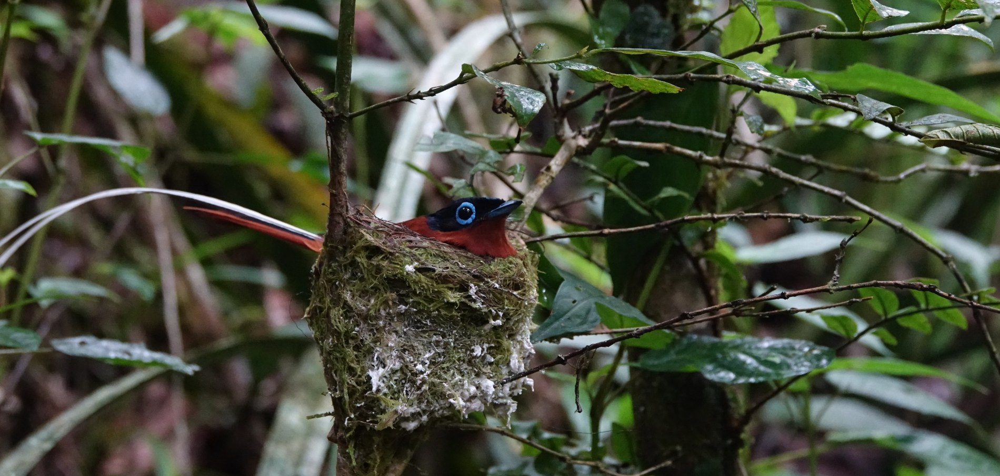

<figure class="chapter-opening-photo preface-opening-photo">
  
  <figcaption>Photograph: Michiel van Breugel</figcaption>
</figure>

These online course readings have been developed specifically for **ENV2301: Methods & Techniques for Environmental Studies** and form the main reading for the course. In the lectures, I introduce the main ideas and principles related to the design of environmental and ecological field studies and the methods used to conduct them. The field activities and classroom exercises demonstrate selected methods and design principles and provide opportunities to practise the reasoning. These course readings discuss topics in greater detail than I can in the lectures and provide more extensive background, so that you can work through the main concepts and ideas independently and at your own pace.

Although the course title refers to methods and techniques, I have not organised ENV2301 as a catalogue of instruments or field protocols. Instead, I try to focus on the larger problem of how to design a study that can answer a useful environmental question. I do that because choosing and understanding a method requires knowing what quantity it measures, why that quantity is relevant to the question, where and when it should be measured, how observations should be distributed through a variable system, and what conclusions the resulting data can support. All this requires a working knowledge of the study system and a basic understanding of sampling principles. The course therefore follows a recurring line of reasoning: **environmental issue or knowledge gap → working understanding of the system → question or objective → information and comparisons needed → variables, measurements and methods → sampling in space and time → observations and constraints → analysis and interpretation → bounded conclusion or decision**. In practice, you will move back and forth through this sequence when developing and conducting a study. For example, while doing fieldwork for a project, you might discover that past land-use practices differed across the study area, with potentially important consequences for a variable you are interested in, such as the distribution of a protected plant species. That would hopefully lead you to revise your understanding of the system and, consequently, your sampling design. The sequence above is therefore a way of organising the decisions that shape study design and implementation in an adaptive way. It is certainly not a recipe that must be followed once from left to right!

This way of working can initially feel less comfortable than courses in which each problem has a clearly defined procedure and one expected answer. However, environmental field studies rarely offer that kind of certainty. Financial and logistical constraints generally mean that researchers cannot sample everything they would like to, and must choose between several possible designs, each with different strengths and limitations. A good conclusion therefore needs to include an explicit statement of the underlying assumptions and uncertainties. Of course, that does not mean that anything goes. The purpose of the course is to help you develop the skills to make the reasoning behind your choices more explicit and structured. One point that I want to emphasise is that many of the underlying ideas, while initially appearing difficult, are actually quite intuitive. That is why I have tried to use common-sense explanations wherever these are sufficient, rather than explaining a simple point in unnecessarily technical terms. I introduce formal terminology and statistics when I think they are needed to describe the reasoning more precisely.

Vegetation and vegetation-related questions provide a recurring thread through the book, although they are not the only systems I examine. This reflects both my own research background and a teaching choice. Understanding a study system requires more than naming a few variables: it involves processes that interact, feedbacks, environmental context, spatial and temporal scales, historical influences and plausible alternative explanations. I hope that returning to a partly familiar ecological system throughout the book and course will allow you to develop those ideas gradually and then see how the same understanding affects later choices about measurement, sampling and interpretation. I also use examples related to hydrology, biogeochemistry, animal ecology, urban environments, pollution and socio-environmental questions, because ultimately you will need to be able to apply what you have learned across a variety of contexts and fields.

I have organised the chapters around the logic outlined above. **Chapter 1** introduces environmental inquiry and the decisions connecting a broad problem to a well-supported conclusion. **Chapter 2** develops the idea of a working understanding of a study system through causal pathways, feedbacks, alternative explanations, stochastic processes and the sources of variable outcomes. **Chapter 3** then moves from concepts to observable variables, proxies, measurements and field methods, asking what a particular observation actually represents and how measurement quality affects interpretation.

**Chapters 4–7** develop the sampling logic that determines what can be learned from those measurements. Chapter 4 begins with a simple fact: a field study usually observes only part of a variable system. It develops ecological variability, sampling variability, standard error, confidence intervals and resampling, starting from the intuition of what happens when researchers repeatedly sample a variable population. Chapter 5 asks what additional observations actually add to a study, distinguishing sample size, replication, subsampling and the allocation of effort across levels of a hierarchical design. Chapter 6 distributes those sampling units through heterogeneous space, considering spatial grain, extent, coverage, gradients, placement strategies and shared spatial context. Chapter 7 adds time, including repeated observations, monitoring, temporal grain and duration, trajectories and chronosequences.

**Chapter 8** considers the additional observation problems created by studying mobile organisms. Animals can be present without being detected, and their mobility means that they may be present or observable at one moment but not another. That temporal variation may be related to environmental conditions, such as a diurnal activity pattern, and may in turn affect how easily animals are detected. The chapter therefore distinguishes detections, occurrence, occupancy, activity indices and abundance, and asks how movement and detectability change the meaning of sampling units and repeated observations. **Chapter 9** returns explicitly to how researchers can answer more causal questions through controlled field experiments and interventions. One thing I hope will be clear after this chapter is that experimental work is complementary to observation and monitoring. The same measurement, sampling, spatial and temporal principles still apply, but manipulation, treatment assignment and structured interventions can provide additional information about causal pathways and the effects of an intervention compared with what would otherwise have happened.

**Chapters 10–12** extend the discussion to the study of people and their interactions with the environment. I use an urban park as a recurring example, asking how researchers might investigate why people use different parts of the park, how they experience its vegetation and other environmental features, and how management decisions could affect those experiences. **Chapter 10** introduces quantitative approaches to socio-environmental research, including structured observations of behaviour, questionnaires, photographic comparisons, existing records and the sampling of people. Many of the principles developed in earlier chapters apply here as well, although studying people introduces additional questions about whom to observe, who participates, what people report and how representative the observations are.

**Chapter 11** turns to qualitative approaches, including interviews, observations of social practices, historical accounts, focus groups and participatory methods. These approaches can help researchers understand people's experiences, practices and decisions in ways that would be difficult to capture through numerical measurements alone. The chapter also discusses how participants are selected and how those choices influence what can be learned. **Chapter 12** continues from there. Suppose a research team has conducted interviews, observed how people behave and collected a substantial amount of information about their experiences. How can the researchers make sense of it all? How can they identify recurring patterns, examine different or contradictory accounts, and develop explanations that are supported by their observations? Chapter 12 discusses how qualitative information is analysed and interpreted, how it can be combined with quantitative observations and other information, and how the resulting findings may lead researchers to reconsider their original questions and research design. In that way, it also brings the discussion back to the broader process of scientific inquiry introduced in Chapter 1.

A supplementary section, **Practice for the final assessment**, provides interactive exercises in which you can practise making and justifying sampling decisions. These exercises bring together ideas from different chapters, often asking how a change in the research question, the study system or the available resources would affect the sampling design. You can first try to answer a question yourself and then reveal a detailed explanation of the reasoning.

Across the book, several themes will recur deliberately. **One** is that more observations are not automatically more information: ten additional measurements from the same tree, plot or site can answer a different question from ten additional independent trees, plots or sites. **Another** is that variability is not simply noise to be removed. Real environmental systems vary among organisms, places and times, and understanding that variability is often part of the scientific question. **A third** is that uncertainty has several sources. Better instruments may reduce measurement uncertainty, more sampling units may reduce sampling uncertainty, and better spatial coverage may reduce the risk that important conditions were omitted. However, any one of these improvements does not automatically solve the others. Repetition across chapters is intentional where I think these ideas need to be seen in different settings before they become familiar.

I hope it is clear by now that the aim is not to memorise a number of preferred methods for specific environmental problems. By the end of the course, you should be able to explain why a particular design provides useful information for a particular question, what assumptions connect the observations to the intended conclusion, which variation the design captures or misses, and what additional information would most improve the study. Technical procedures are of course important, but they always need to be selected and assessed as part of the overall reasoning towards a study design.

::: {.callout-note collapse="false"}
## Classroom draft and about use of AI in developing this text

These notes are a **classroom draft** and will continue to be revised during the semester as examples, figures and references are improved and as questions arising in class reveal places that need clearer explanation. They are intended for students enrolled in ENV2301 and should not be circulated outside the class. Revisions may change wording, examples or organisation, but the course requirements will be communicated through Canvas and class announcements rather than by expecting students to track changes in the book themselves.

These course readings draw on my research and teaching experience, as well as on ideas and approaches developed in a range of textbooks and scientific publications. Books such as *Observation and Ecology* (Sagarin & Pauchard), *Practical Field Ecology* (Wheater et al.), *Experimental Design for the Life Sciences* (Ruxton & Colegrave), and *Research Methods for Environmental Studies* (Kanazawa) have helped shape my thinking about scientific inquiry, field research and how research methods can be taught. The conceptual approach developed in my own research on ecological succession, particularly van Breugel et al. (2024), also informs the emphasis on causal pathways, feedbacks, environmental variation and the interpretation of observed patterns.

In developing this course reading, I used ChatGPT (GPT-6, high reasoning mode) extensively. The book is built around my own ideas about the course structure, about scientific reasoning, and about how environmental research methods should be understood and taught. I wrote the initial drafts and the core examples, then gave the AI detailed, strict instructions to draft and revise text based on them, to critically evaluate my arguments and explanations, and to suggest alternative approaches and examples. I adopted the suggestions and edits that I judged improved the text and used them to develop the next draft. The text therefore emerged from an iterative process of discussion, drafting, and rewriting, within and across chapters, over the course of the semester.

Much of the literature cited was introduced by me; some was suggested by the AI, in whch case I checked all claims, data, and citations against the original sources. Where AI suggested a reference, I read the source to confirm that it exists and supports the statement made. Because I know this field well, I can judge whether an AI-generated explanation is accurate, oversimplified, or subtly wrong. For topics outside my own expertise, I studied the original sources and standard textbooks before accepting or revising any text. You are still building that expertise, and your coursework is meant to develop your own reasoning, so this approach is not a template for your assignments. Please follow the NUS AI policy, and ask if you are unsure.

The book remains a work in progress and will continue to develop beyond this academic year. I take full responsibility for all content.

Michiel van Breugel, 03/11/2026

:::
